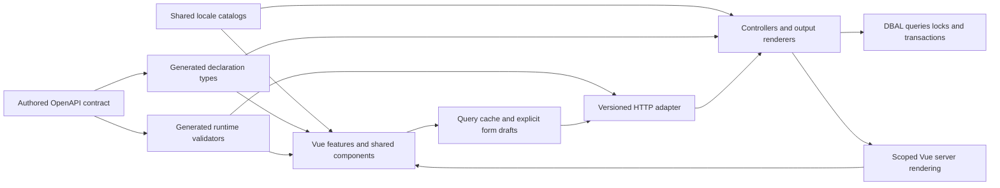

# Frontend foundation design
<!--
documentation-metadata
audience: maintainers; frontend developers; API developers; migration reviewers
owner: frontend migration maintainers
status: migration-pending
last-verified: 2026-10-08
verification-baseline: docs-baseline-2026-09-06-d14
verification-scope: explicitly authorized progressive delivery amendment and source ownership; FPR-07 explicitly authorized 2026-10-08 scope/fallback/documentation amendments and staging; original choices/D1-D5 retained; no new runtime verification claimed; ordinary development loading, hydration, lazy navigation, HMR and serialized generator restart verification; approved D1–D5 rectification source/ownership and documentation consistency review; actual execution evidence remains in the paired review record; source review of expanded opt-in packing management, overview, identity/help and shared foundation; retains original step-two proof-slice rationale as historical design; broader feature migration and benchmarks remain future work; approved rectification adds native overview/identity adapters and per-field comparisons
source-anchors: src/frontend/components/LoadingSkeleton.vue; src/frontend/features/help/HelpPage.vue; src/frontend/features/overview/OverviewPage.vue; src/frontend/features/overview/OverviewRegion.vue; tests/frontend/frontend-content-loading.spec.ts; src/modules/frontendDevelopment.ts; src/frontend/app/mountPreservingDrafts.ts; tests/unit/frontend-development.spec.ts; tests/frontend/frontend-hydration-drafts.spec.ts; tests/e2e/frontend-development.spec.ts; docs/FRONTEND_MIGRATION_BASELINE.md; docs/FRONTEND_PILOT.md; docs/frontend-migration/; contracts/api/v1/; src/app.ts; src/routes/frontendPilot.ts; src/routes/api/v1/; src/frontend/app/; src/frontend/features/packing/; src/frontend/features/identity/; src/modules/frontendPilotRenderer.ts; src/modules/packing/api.ts; src/modules/renderer.ts; src/modules/invoice/; src/modules/database/services/; src/types/; src/public/js/; src/views/; package.json; tsconfig.json; tsconfig.server.json; esbuild.client.js; .github/workflows/ci.yml; .github/workflows/release.yml; docs/ARCHITECTURE.md; docs/DEVELOPMENT.md
next-review: expanded-packing-parity-or-next-feature-slice
-->

Use Vue 3 and TypeScript for Surveyor's frontend, with Vite, Vue Router and TanStack Vue Query. Define the new API in
OpenAPI, generate shared declaration types and runtime validators from it, and use one locale catalog per language
for browser and server output. Keep Express, existing controller/business owners and the pure database-service layer.

This record owns the step-2 design and records the later expansion of step 3. The initial packing/help proof slice
has grown to packing creation/duplication, item and assignment management, full entity settings, files, lifecycle,
bounded overview and the identity entry flows needed to use them without a legacy packing frontend fallback. The
[pilot implementation guide](FRONTEND_PILOT.md) owns current routes, code/build boundaries, limitations and test entry
points. The broader feature migration remains pending. The design follows the committed
[baseline](FRONTEND_MIGRATION_BASELINE.md) and its 121 edge cases at source commit
`0a3662ae0a6e99e0df0a38f603831d3ac9ff4b61`. Decisions below describe the implementation direction and the evidence
required before broader route cutover. No default route has moved. Source coverage of those workflows is distinct
from completed visual, concurrency, accessibility or deployment acceptance; the pilot record owns that evidence.

## Design records

### Authorized rectification (2026-10-07)

The original primary choices remain binding. An alternative mentioned in a design record, an implementation
spike, or a later documentation edit does not authorize a departure. The maintainer explicitly approved the
following amendments and directed implementation after finalizing this plan:

| Decision | Approved resolution |
|---|---|
| D1: translation integration | Restore **i18next-vue**, retaining the typed application translation interface and the shared i18next core. Prove request isolation, hydration and reactive locale changes. |
| D2: concurrent changes | Replace persisted packing metadata revisions with lightweight comparisons of current values under the existing locks. Include every field that benefits, including setup fields. Compare touched fields, preserve unrelated changes and local drafts, and retain atomic item-capacity/assignment checks. No live-editing infrastructure or relationship revision history. |
| D3: contract version | Correct the unreleased **v1 in place**. Do not create another version for pilot changes. |
| D4: uncertain commands | Retain **reconcile-only** recovery without operation tracking. A read cannot confirm an unknown creation. Retain input and provide explicit review and acknowledged departure, without automatic replay. |
| D5: replacing a release | Support replacement of the current binary folder without retained old assets or external operational requirements. Detect updates through ordinary session refresh, allow compatible pending edits to finish, and reload an idle clean view once. Preserve mounted drafts on missing chunks or incompatible commands. |

The approved rectification is implemented; its completed work sequence has been retired. The
[dated pilot review](frontend-migration/PILOT_PARITY_REVIEW.md#approved-foundation-rectification-2026-10-08)
records actual builds, tests, complete paired comparison, focused supplements and remaining acceptance limits.
Its [development-runtime correction](frontend-migration/PILOT_PARITY_REVIEW.md#development-runtime-correction-2026-10-08)
records the subsequent source-entry failure and repairs to loading, hydration, pending navigation and watcher
coordination. Built-runtime evidence alone did not establish the original normal-development requirement.
The [staged development guide](frontend-migration/staged/DEVELOPMENT.md#implementing-the-next-feature-slice) owns the reusable contribution workflow.
Broader feature migration and default-route cutover remain pending.

### Authorized migration amendments (2026-10-08)

The maintainer finalized the following scope and acceptance amendments after the completed pilot review.
These amendments supplement D1–D5; they do not authorize a new technology choice or backend redesign:

- The objective is migration of the existing frontend with nearly identical UI/UX and unchanged native business
  behavior. Backend adapters are limited to the contract, projection and existing controller/DBAL reuse needed
  for that migration. General authentication/session, authorization-framework, legacy race and broad locking
  improvements are deferred independently in the existing remediation backlog.
- Help and packing, together with their necessary shared foundation and existing entry journeys, must be complete
  in this iteration. The pilot continues expanding toward the approved full native scope. Overview and other
  implemented scaffolds remain future increments with explicit TODOs; their implemented code must still preserve
  native behavior and meet readability/modularity requirements. Presence is not feature-completeness evidence.
- Interactive migrated pages require JavaScript. Disabled JavaScript receives a clear shared message or a genuinely
  read-only result, and must not offer misleading controls or indefinite loading. Same-component SSR/hydration
  remains permitted. The original mandatory interactive native no-JavaScript fallback is superseded, including
  the old packing-card image acceptance; no new SSR image subsystem is required by that finding.
- Production documentation continues to describe native production. Feature user guides retain their existing
  tasks and labels. Prospective development, architecture, testing, operations and visual guidance is staged in
  temporary copies under `docs/frontend-migration/staged/` and merged into the existing canonical owners at
  production cutover, preserving intervening native changes. One global localization guide, with language
  counterparts, owns language choice without duplicating implementation information in feature help.
- Active responsive shared views target convergence within roughly one minute while retaining the healthy
  30-second cadence, server cooldown, hidden-tab and observer disposal boundaries. This replaces the generic
  two-minute failed-read delay; it adds no arbitrary age-based command prohibition or new live-editing service.

The [pilot guide](FRONTEND_PILOT.md) owns the concrete rectification sequence and staged merge inventory.
The [paired review](frontend-migration/PILOT_PARITY_REVIEW.md) owns execution evidence. The existing
[staged contribution recipe](frontend-migration/staged/DEVELOPMENT.md#implementing-the-next-feature-slice)
records reusable implementation lessons; a new plan or control registry is unnecessary.

### Authorized progressive delivery amendment (2026-10-08)

The maintainer explicitly requested shared loading skeletons and incremental, parallel loading for interactive
pages. This adds a delivery amendment to the original server-projected Overview implementation; it does not replace
Vue, same-component SSR/hydration, the approved D1–D5 choices or existing controller/DBAL ownership.

Initial interactive Overview HTML waits for authoritative session bootstrap and renders the shared Vue shell.
It no longer waits for sequential projections of all four collection/visibility regions. Each mounted active region
reads its own existing URL filters through the existing scoped API/controller, and renders when its response arrives.
A closed hidden region starts on opening; an explicitly opened hidden deep link can start before main-region counts
arrive. Confirmed membership retains the native empty/count rules. A slow region cannot withhold a ready sibling.

Read-only Help retains its complete authorized server projection and remains readable without JavaScript. The Vue
renderer makes no self-HTTP requests. Missing interactive data uses the shared skeleton while its query is pending;
complete scoped data and local drafts remain mounted during background reads. Initial failure renders the existing
error, and unknown membership never claims zero or an empty result. Identity/resource transitions must not retain
another scope's content, and language-owned bodies must match the selected language. User-authored values and
machine state may remain visible during a same-resource locale read while interface labels translate reactively.

The [staged loading guideline](frontend-migration/staged/DEVELOPMENT.md#progressive-loading-and-shared-placeholders)
owns the reusable component/query rules. The [pilot guide](FRONTEND_PILOT.md) and
[paired review](frontend-migration/PILOT_PARITY_REVIEW.md) own the implemented scope and execution evidence;
this delivery amendment does not authorize production cutover or broader backend work.

| Record | Decision it owns |
|---|---|
| [Framework decision](frontend-migration/FRAMEWORK_DECISION.md) | Vue versus Svelte and other options; reusable UI primitives; same-component server rendering; build integration |
| [API contract](frontend-migration/API_CONTRACT_DESIGN.md) | One authored schema source; versioning; DTOs; identity, validation, error and conditional-write contracts |
| [Refresh and conflicts](frontend-migration/REFRESH_CONFLICT_DESIGN.md) | Query ownership, polling, drafts, stale writes, uncertain results, identity changes and invalidation |
| [Localization](frontend-migration/LOCALIZATION_DESIGN.md) | Shared catalogs, typed message parameters, request/recipient locale, fallback, email/PDF and legacy migration |
| [Edge-case records](frontend-migration/EDGE_CASES.md) | Existing observable behavior and exceptions each feature slice must preserve |

The records deliberately distinguish library capabilities, Surveyor design choices and behavior already implemented.
Use the detailed record when changing a decision rather than maintaining competing copies in architecture summaries.

## Overall structure



The normal JavaScript-enabled experience uses client routing and typed API reads/commands, with declared multipart
for files. It does not exchange Pug fragments or create a second imperative DOM tree. Express renders the **same Vue
components** for the initial shell and the browser hydrates them. Help GET/search and the mixed overview render
authorized data on the server. Identity and guest forms preserve native post/redirect/get adapters through the
same controller operations. Packing item/settings interactions load their DTOs after hydration and require JavaScript.
Survey voting and other unmigrated native flows are not implemented by the packing renderer. External authentication,
downloads, print documents and email deep links remain legitimate document boundaries.

Scoped SSR is an intentional addition to the initial static-SPA proposal: dropping those native capabilities would
violate parity. Its cost is a server bundle, request-isolated rendering and hydration tests. Express remains the
HTTP/session owner; a second application server or Nuxt migration is unnecessary for this design.

## Module ownership

The following layout describes the implemented foundation and its next feature boundaries. The mixed overview
owns its five-type projection independently of packing; reusable controls remain shared components:

```text
contracts/api/v1/                 Authored OpenAPI paths and reusable wire schemas
src/types/api/v1.d.ts             Generated shared API declaration shapes, ignored
src/types/LocalizationTypes.d.ts  Generated catalog-derived declarations, ignored
src/locales/<locale>.json         One authored message catalog per language
src/modules/localization/        Shared runtime translator and locale resolution
src/modules/api/                 Small HTTP contract adapter and error serialization
src/routes/api/v1/               Explicit routes calling existing feature controllers
src/frontend/
  app/                          Client/server entries, route table, session and query setup
  components/                   Shared Surveyor controls and page structures
  composables/                  Named reusable draft/command/query behavior
  features/
    packing/                    Detail/create/settings and packing API owner
    overview/                   Mixed membership/cards/regions and overview API owner
    identity/                   Login/register/recovery/reset and packing guest entry
    help/                       Fixed-source localized help and search
    ...                         Existing product feature boundaries
  styles/                       Shared tokens and Bootstrap-compatible styling
```

Keep one package manager, root package and lockfile. A monorepo package split would add publishing/workspace concerns
without solving the current maintenance problem. Shared browser-safe domain modules can remain under their current
feature owner, as the invoice wording, coverage and presentation modules already do. Import those owners directly;
do not introduce forwarding modules or barrel re-exports.

| Owner | Responsibility | Boundary |
|---|---|---|
| Vue page/feature | Compose controls; coordinate a concrete user workflow; select queries and commands | No direct DOM assembly or persistence entities |
| Shared component | Repeated visual/accessibility behavior and its explicit props/events | No hidden authorization decisions or database knowledge |
| Query/command owner | Generated API client use, identity-scoped keys, cache dependencies and command outcome | No duplicate business validation or separate server-data store |
| Draft composable | Original snapshot, current user values, dirtiness, pending state and conflict review | Does not mutate query-cache objects |
| HTTP adapter | Decode and validate wire data, bind explicit operations, serialize typed outcomes | Does not become a second controller framework |
| Controller/business owner | Authentication/authorization decisions, context-specific validation, orchestration and errors | Uses service-managed transactions for checks against locked state |
| DBAL | Queries, locks, transactions and persistence | No API/UI errors or business rules moved out of controllers |
| Catalog/translator | Complete messages, locale-aware formatting and typed interpolation | No parallel frontend/backend dictionaries |

Pure internal contracts remain declaration files under the established type directory. An API DTO may intentionally
differ from a database entity: mapping that boundary is useful separation, not type drift. The same wire shape must
never be handwritten again for the client, controller, validator or documentation. The API record specifies generation.

## Shared components without a universal feature engine

Keep the existing dark Bootstrap appearance, layout rhythm, labels, ordering and responsive behavior during migration.
Wrap suitable accessible primitives in a small Surveyor component library; the framework record selects the primitive
strategy. Screens import Surveyor components so a later visual change reaches all uses.

| First shared owner | Behaviors it must cover |
|---|---|
| Page shell and entity header | Active profile, contextual help, server-projected actions, archived notice, consistent heading/title |
| Modal, tabs and confirmation | One focus owner, labelled dialog, pending dismissal lock, returned focus, independent hidden drafts |
| Field and error summary | Label/help/error association, native input semantics, reveal invalid collapsed sections, omitted versus false/empty values |
| Command button and feedback | Duplicate-submit protection, transient versus persistent feedback, confirmed versus uncertain outcome |
| Entity/timezone pickers | Selected value independent of filtering, bounded result pages, stale-response suppression, aliases and reset semantics |
| Resource state | Initial loading, empty, forbidden/missing, stale-but-readable, retry and confirmed-write/read-failure states |
| Table and pagination controls | Existing mobile scrolling, stable row identity, search focus/caret, complete accessible action reachability |

Create feature-specific composites where semantics differ: survey choice/vote, required activity assignment,
invoice-share row and property section are not variations of one generic CRUD form. Do not make every screen use a
schema-generated form or a single giant table abstraction. Share a component after identifying repeated behavior or
an existing shared owner, rather than adding one wrapper per HTML element.

There is no initial Pinia store duplicating query data. Vue state owns transient UI; TanStack Query owns server
snapshots; a small session owner coordinates identity. Packing's existing browser-local checklist remains a separate
exception with its current list/item storage key, not a newly profile-scoped server preference.

## Build and deployment design

Vite supports development integration with an existing backend and a production manifest for resolving built asset
paths. Use that integration in Express, with separate browser type checking and a server entry for scoped SSR.
[Vite backend integration](https://vite.dev/guide/backend-integration)

The implementation keeps current legacy esbuild outputs and adds isolated Vite assets until their routes move.
Separate output directories prevent either build from emptying the other's assets. The build responsibilities are:

1. Generate and validate contracts and catalog metadata deterministically.
2. Type-check browser SFCs with the browser/bundler configuration; type-check/compile Express with its existing
   server configuration, explicitly excluding frontend entries.
3. Build current legacy assets, the Vite client assets/manifest, and the scoped SSR bundle in separate destinations.
4. Copy release-shipped views/help and package both manifests/bundles with the existing application release.

The server build excludes both browser trees and Vue-specific declarations. SSR has its own entry/build and is
loaded by the Express renderer. Its request data, locale, app,
router and query state are per-request; no singleton cache may leak one person's data into another response.
Only browser-safe imports may enter the client graph. No TypeORM, file, email, settings secrets or server-only module
may be pulled in through a convenient feature import.

Serve application HTML and private API responses with suitable private/no-store policy; fingerprinted static assets
can be cached. Separate deployment and API-compatibility identifiers let an old tab recognize a replacement.
Only assets in the installed release are required. Existing session checks detect a change; a loaded compatible
form may finish, while a clean idle view reloads once. Missing route chunks defer reload while a draft, pending
write or unknown outcome needs attention. Incompatible commands reject before side effects and preserve mounted input.
The D5 amendment above supersedes the original retained-assets proposal; folder replacement and fallback copying
require no asset store, retained release directories or persistent draft recovery.

History-mode routing needs server handling for direct URLs. Use an explicit migrated-route allowlist, not a wildcard
that turns API errors, missing files or PDF paths into HTML. [Vue Router history modes](https://router.vuejs.org/guide/essentials/history-mode.html)

The root [package scripts](../package.json) now prepare generated contracts/catalogs and both bundles through the
normal build/server entry points. Express hosts Vite middleware/HMR in development, and the authored-input watcher
serializes contract/catalog regeneration before restarting the request owner. Normal source edits need no manual
regeneration; `npm run prepare:frontend` remains available for standalone checks. Generated outputs remain ignored and
are recreated for clean-checkout builds. Executable contract/type checks are application correctness checks; prose
reports stay advisory.

## A normal feature change after the foundation

For a new editable packing description, the expected workflow is:

1. Change the authored request/response schema once if the wire shape needs a new field; regenerate declarations
   and validators through the normal build path, or `prepare:frontend` during an existing watch session.
2. Add the controller policy/projection or reuse the existing operation; preserve omitted/null semantics and update
   touched current-value comparisons inside the transaction. Keep query/persistence changes in the existing DBAL owner.
3. Add complete catalog messages and bind a shared field in the feature component. Use the standard draft and
   conditional-command behavior rather than building request, spinner, alert and reload code again.
4. Extend the affected behavior assertion at its cheapest meaningful boundary; update native rendering where that
   feature already has a fallback, using the same component.

This is a target development experience, not a claim of measured coding effort. The implemented packing expansion
provides a concrete review surface for whether the shared abstractions make changes small and readable.

## Implementation sequence

### Original step-3 proof plan

The original plan started with session bootstrap and packing: load one authorized list, edit its metadata, assign/unassign the active
profile, and preserve local Packed state. This touches identity, generated contracts, conditional writes, refresh,
shared forms, translations, capacity and browser-local state without beginning with financial calculations.

That initial plan deliberately deferred creation, duplication, permission management, header files, event linkage
and lifecycle actions. The current implementation supersedes that deferral: those packing workflows now have Vue
owners and v1 operations. The table below records the original foundation work packages, not the current feature
limit. There was no native packing export to migrate. Default route cutover still waits for parity evidence.

| Work package | Concrete implementation outcome | Minimum useful evidence |
|---|---|---|
| Contract/catalog generation | One packing/session schema source, generated client/server types and validators; two pilot locales produced through the same catalog path | Clean generation/type check; malformed payload rejection; response validation; frontend/backend message and parameter agreement |
| Identity/API adapter | Structured session/error responses, expected-context checking, CSRF policy, authoritative capabilities; no login HTML mistaken for mutation success | Real route checks for account, guest, forbidden actor, expiry, context switch and private-field omission |
| Metadata revision | Add reviewed entity/migration change and update every legacy and v1 writer affecting the scoped revision | Disposable-database test of v1/v1 and legacy/v1 concurrent edits; assignment-only change does not cause a metadata conflict |
| Vue packing pilot | Current layout, reusable field/modal/command/state controls, GET/metadata PATCH/self-assignment, unchanged local checklist key | Component tests for dirty refresh/conflict/failed save; paired visual and behavior review of all implemented screens and significant owner/guest states at desktop/mobile widths |
| Shared freshness | Visible-route polling, focus/reconnect refresh, scope disposal, command-specific retry and dependent invalidation | Controlled delayed/out-of-order responses, profile switch and confirmed mutation followed by failed read |
| Native rendering proof | Use the shared Vue renderer on one small fallback surface before committing broader cutover | JavaScript-disabled native form/link journey, hydration with no duplicate action, request/locale isolation |

The generator includes negative compile fixtures for both consumer boundaries. Help supplies the native-rendered
proof through its fixed-source and synthetic-rendering boundaries; packing alone would not establish the SSR decision.
Do not turn maintained prose into a required application test.

The recorded packing mutation/capacity and session-audience concerns must be addressed or explicitly bounded before
the pilot claims protection for them. Do not run the database-backed suites or migration against existing shared data.
Follow the existing database and testing guides when implementing and executing those work packages.

### Current expanded packing implementation

The [authored contracts](../contracts/api/v1/openapi.yaml), [packing operation owner](../src/modules/packing/api.ts)
and [Vue packing feature](../src/frontend/features/packing/) now cover the detail table, inline field permissions,
Everyone/order, quick add/removal, self-assignment and manager removal, creation/duplication, properties, linked event
discovery/relinking, audience/admin permissions, header upload/removal, archive/restore and owner-only permanent delete.
The feature-owned mixed overview preserves independent participant/owner and main/hidden regions through the existing
bounded overview controller; personal visibility remains separate from shared archival. No packing workflow requires
an old packing page or browser module to complete it.

The [identity feature](../src/frontend/features/identity/) and [v1 identity adapter](../src/routes/api/v1/auth.ts)
reuse account/guest checks for local login, registration/activation/reset, guest entry/recovery, logout and profile
selection. Guest capability links still authenticate on their first GET, then enter a validated pilot destination.
OIDC remains a provider navigation. Event pages and broader account/profile administration are outside the migrated
packing graph and retain authorized navigation to their owning modules; this is not an entire-application SPA claim.

Conditional protection includes separate metadata, item, order and setup-field comparisons. Under approved D2,
all tokens compare reviewed current values; packing stores no revision counter or relationship history. Shared native
and v1 operations reauthorize against locked state. Multipart creation validates one typed JSON part
and optional header file; scoped binary image reads use an opaque version. The detailed [API](frontend-migration/API_CONTRACT_DESIGN.md)
and [refresh](frontend-migration/REFRESH_CONFLICT_DESIGN.md) records own those exact limits.

### Subsequent feature slices

After packing parity review, migrate remaining account/profile administration, surveys/drivers/events, activity,
and invoices/outputs in bounded feature slices. The mixed overview and necessary identity entry now exist; do not count them again as unimplemented work.
The exact order can change with dependency evidence; each slice includes its reads, writes, lifecycle, permission,
error, fallback and output behavior rather than migrating only the happy-path page.

Before a default route moves, map every relevant behavior/edge ID to the replacement and its application evidence.
Retain native URL compatibility and complete authorization. The normal JavaScript experience must use JSON contracts
and client navigation inside the migrated graph. Remove the old Pug/browser owner when that feature's parity is
established; keep only explicit native-form/old-URL adapters that call the same controller operations.

Rollout remains route-scoped and reversible while schemas remain compatible. Current-value packing comparisons
add no persisted counter, so the abandoned pilot revision imposes no rollback requirement. An operator can replace
the installed binary folder and restore a fallback copy. The app coordinates rare old-tab updates itself; it does
not require old assets to remain served. Future persistent changes still need their own reviewed migration/rollback.

## Completion and review limits

Step 2 established module ownership, wire shapes, message ownership, identity scope, refresh/conflict behavior and
native fallback strategy. Step 3 now includes the expanded packing graph documented in the [pilot guide](FRONTEND_PILOT.md),
with executable contract, compiler, database and browser checks. Their presence does not assert that every acceptance
scenario passed. Broader feature parity, performance, full accessibility
and production rollout still require evidence before default cutover.

Current architecture/development/operator guides continue to describe the shipped implementation. Update them with
each implemented boundary, rather than replacing current facts with this future design. Preserve the existing
behavior/edge-case baseline as the historical input and link follow-up decisions from it.

Historical verification during step 2 comprised source/official-documentation review, cross-record review and the advisory
documentation report. That report found no broken links or missing npm scripts. It flags seven deliberately proposed
source paths that do not exist yet, alongside existing source-fingerprint, temporary-output metadata, older source-anchor
and unreferenced help-asset findings. Results are retained under
`test-results/frontend-baseline/foundation-design-report/`; advisory exit zero is not a clean repository-wide result.
No application build, test suite, database command or prototype was run for step 2. Current step-three implementation
checks and the repeated visual/behavior comparison are recorded in the [pilot guide](FRONTEND_PILOT.md) and
[paired review](frontend-migration/PILOT_PARITY_REVIEW.md).
