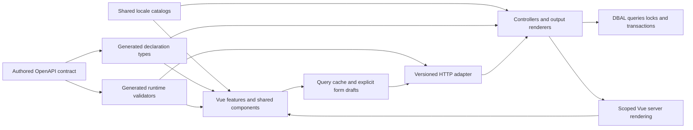

# Frontend foundation design
<!--
documentation-metadata
audience: maintainers; frontend developers; API developers; migration reviewers
owner: frontend migration maintainers
status: migration-pending
last-verified: 2026-10-04
verification-baseline: docs-baseline-2026-09-06-d14
verification-scope: step-two architecture and implementation design based on committed behavior and edge-case baselines, current module/build boundaries and primary framework documentation; proposed foundation is not implemented or benchmarked
source-anchors: docs/FRONTEND_MIGRATION_BASELINE.md; docs/frontend-migration/; src/app.ts; src/modules/renderer.ts; src/modules/invoice/; src/modules/database/services/; src/types/; src/public/js/; src/views/; package.json; tsconfig.json; tsconfig.server.json; esbuild.client.js; .github/workflows/ci.yml; .github/workflows/release.yml; docs/ARCHITECTURE.md; docs/DEVELOPMENT.md
next-review: foundation-proof-slice-implementation
-->

Use Vue 3 and TypeScript for Surveyor's frontend, with Vite, Vue Router and TanStack Vue Query. Define the new API in
OpenAPI, generate shared declaration types and runtime validators from it, and use one locale catalog per language
for browser and server output. Keep Express, existing controller/business owners and the pure database-service layer.

This is step 2 of the migration: a concrete design for implementation. It follows the committed
[baseline](FRONTEND_MIGRATION_BASELINE.md) and its 121 edge cases at source commit
`0a3662ae0a6e99e0df0a38f603831d3ac9ff4b61`. No framework, endpoint, database revision, locale preference or route cutover
is delivered by this document. Decisions below describe the selected implementation direction and the evidence the
first working slice must establish.

## Design records

| Record | Decision it owns |
|---|---|
| [Framework decision](frontend-migration/FRAMEWORK_DECISION.md) | Vue versus Svelte and other options; reusable UI primitives; same-component server rendering; build integration |
| [API contract](frontend-migration/API_CONTRACT_DESIGN.md) | One authored schema source; versioning; DTOs; identity, validation, error and conditional-write contracts |
| [Refresh and conflicts](frontend-migration/REFRESH_CONFLICT_DESIGN.md) | Query ownership, polling, drafts, stale writes, uncertain results, identity changes and invalidation |
| [Localization](frontend-migration/LOCALIZATION_DESIGN.md) | Shared catalogs, typed message parameters, request/recipient locale, fallback, email/PDF and legacy migration |
| [Edge-case records](frontend-migration/EDGE_CASES.md) | Existing observable behavior and exceptions each feature slice must preserve |

The records deliberately distinguish library capabilities, Surveyor design choices and behavior already implemented.
Use the detailed record when changing a decision rather than maintaining competing copies in architecture summaries.

## Overall structure



The normal JavaScript-enabled experience uses client routing and JSON reads/commands. It does not exchange Pug
fragments or create a second imperative DOM tree. On routes with an established native-link/form fallback, the server
renders the **same Vue components** and the browser hydrates them. Subsequent supported navigation stays in the SPA.
This preserves the overview's native search/filtering, survey voting, help GET/search and other verified native flows.
External authentication, downloads, print documents and email deep links remain legitimate document boundaries.

Scoped SSR is an intentional addition to the initial static-SPA proposal: dropping those native capabilities would
violate parity. Its cost is a server bundle, request-isolated rendering and hydration tests. Express remains the
HTTP/session owner; a second application server or Nuxt migration is unnecessary for this design.

## Module ownership

The following is a proposed source layout, not an inventory of files already present:

```text
contracts/api/v1/                 Authored OpenAPI paths and reusable wire schemas
src/types/api/v1.d.ts             Generated shared API declaration shapes, ignored
src/types/LocalizationTypes.d.ts  Generated catalog-derived declarations, ignored
src/locales/<locale>.json         One authored message catalog per language
src/modules/localization/        Shared runtime translator and locale resolution
src/modules/api/                 Small HTTP contract adapter and error serialization
src/routes/api/v1/               Explicit routes calling existing feature controllers
src/frontend/
  app/                          Client/server entries, route table, session and query setup
  components/                   Shared Surveyor controls and page structures
  composables/                  Named reusable draft/command/query behavior
  features/
    packing/                    Page, feature components and typed query/command owners
    overview/                   Independent regions and bounded server pagination
    ...                         Existing product feature boundaries
  styles/                       Shared tokens and Bootstrap-compatible styling
```

Keep one package manager, root package and lockfile. A monorepo package split would add publishing/workspace concerns
without solving the current maintenance problem. Shared browser-safe domain modules can remain under their current
feature owner, as the invoice wording, coverage and presentation modules already do. Import those owners directly;
do not introduce forwarding modules or barrel re-exports.

| Owner | Responsibility | Boundary |
|---|---|---|
| Vue page/feature | Compose controls; coordinate a concrete user workflow; select queries and commands | No direct DOM assembly or persistence entities |
| Shared component | Repeated visual/accessibility behavior and its explicit props/events | No hidden authorization decisions or database knowledge |
| Query/command owner | Generated API client use, identity-scoped keys, cache dependencies and command outcome | No duplicate business validation or separate server-data store |
| Draft composable | Original snapshot, current user values, dirtiness, pending state and conflict review | Does not mutate query-cache objects |
| HTTP adapter | Decode and validate wire data, bind explicit operations, serialize typed outcomes | Does not become a second controller framework |
| Controller/business owner | Authentication/authorization decisions, context-specific validation, orchestration and errors | Uses service-managed transactions for checks against locked state |
| DBAL | Queries, locks, transactions and persistence | No API/UI errors or business rules moved out of controllers |
| Catalog/translator | Complete messages, locale-aware formatting and typed interpolation | No parallel frontend/backend dictionaries |

Pure internal contracts remain declaration files under the established type directory. An API DTO may intentionally
differ from a database entity: mapping that boundary is useful separation, not type drift. The same wire shape must
never be handwritten again for the client, controller, validator or documentation. The API record specifies generation.

## Shared components without a universal feature engine

Keep the existing dark Bootstrap appearance, layout rhythm, labels, ordering and responsive behavior during migration.
Wrap suitable accessible primitives in a small Surveyor component library; the framework record selects the primitive
strategy. Screens import Surveyor components so a later visual change reaches all uses.

| First shared owner | Behaviors it must cover |
|---|---|
| Page shell and entity header | Active profile, contextual help, server-projected actions, archived notice, consistent heading/title |
| Modal, tabs and confirmation | One focus owner, labelled dialog, pending dismissal lock, returned focus, independent hidden drafts |
| Field and error summary | Label/help/error association, native input semantics, reveal invalid collapsed sections, omitted versus false/empty values |
| Command button and feedback | Duplicate-submit protection, transient versus persistent feedback, confirmed versus uncertain outcome |
| Entity/timezone pickers | Selected value independent of filtering, bounded result pages, stale-response suppression, aliases and reset semantics |
| Resource state | Initial loading, empty, forbidden/missing, stale-but-readable, retry and confirmed-write/read-failure states |
| Table and pagination controls | Existing mobile scrolling, stable row identity, search focus/caret, complete accessible action reachability |

Create feature-specific composites where semantics differ: survey choice/vote, required activity assignment,
invoice-share row and property section are not variations of one generic CRUD form. Do not make every screen use a
schema-generated form or a single giant table abstraction. Share a component after identifying repeated behavior or
an existing shared owner, rather than adding one wrapper per HTML element.

There is no initial Pinia store duplicating query data. Vue state owns transient UI; TanStack Query owns server
snapshots; a small session owner coordinates identity. Packing's existing browser-local checklist remains a separate
exception with its current list/item storage key, not a newly profile-scoped server preference.

## Build and deployment design

Vite supports development integration with an existing backend and a production manifest for resolving built asset
paths. Use that integration in Express, with separate browser type checking and a server entry for scoped SSR.
[Vite backend integration](https://vite.dev/guide/backend-integration)

The first implementation keeps current legacy esbuild outputs and adds isolated Vite assets until their routes move.
Use separate output directories so either build cannot empty the other's assets. The proposed build order is:

1. Generate and validate contracts and catalog metadata deterministically.
2. Type-check browser SFCs with the browser/bundler configuration; type-check/compile Express with its existing
   server configuration, explicitly excluding frontend entries.
3. Build current legacy assets, the Vite client assets/manifest, and the scoped SSR bundle in separate destinations.
4. Copy release-shipped views/help and package both manifests/bundles with the existing application release.

The server build currently excludes only the legacy browser tree; it must not accidentally compile a future Vue tree
as Node code. SSR has its own entry/build and is loaded by the Express renderer. Its request data, locale, app,
router and query state are per-request; no singleton cache may leak one person's data into another response.
Only browser-safe imports may enter the client graph. No TypeORM, file, email, settings secrets or server-only module
may be pulled in through a convenient feature import.

Serve application HTML and private API responses with suitable private/no-store policy; fingerprinted static assets
can be cached. A client/server build identifier lets an old browser recognize an incompatible deployment. Keep old
fingerprinted assets available across the deployment overlap. An update prompt must preserve dirty drafts; it must
not force-reload a financial command whose outcome is unknown.

History-mode routing needs server handling for direct URLs. Use an explicit migrated-route allowlist, not a wildcard
that turns API errors, missing files or PDF paths into HTML. [Vue Router history modes](https://router.vuejs.org/guide/essentials/history-mode.html)

Retain the root build/development entry points as the convenient developer workflow when the implementation lands.
The extra generators and bundles run through those scripts; developers should not need to remember a separate
manual sequence after every field or translation change. Generated outputs remain ignored and are recreated for
clean-checkout builds. Executable contract/type checks are application correctness checks; prose reports stay advisory.

## A normal feature change after the foundation

For a new editable packing description, the expected workflow is:

1. Change the authored request/response schema once if the wire shape needs a new field; regenerate declarations
   and validators automatically through the normal development/build path.
2. Add the controller policy/projection or reuse the existing operation; preserve omitted/null semantics and update
   the metadata revision within the transaction. Keep query/persistence changes in the existing DBAL owner.
3. Add complete catalog messages and bind a shared field in the feature component. Use the standard draft and
   conditional-command behavior rather than building request, spinner, alert and reload code again.
4. Extend the affected behavior assertion at its cheapest meaningful boundary; update native rendering where that
   feature already has a fallback, using the same component.

This is a target development experience, not a claim of measured coding effort. The proof slice below tests whether
the proposed abstractions actually make this change small and readable.

## Implementation sequence

### Step 3 — Build and validate a narrow working slice

Start with session bootstrap and packing: load one authorized list, edit its metadata, assign/unassign the active
profile, and preserve local Packed state. This touches identity, generated contracts, conditional writes, refresh,
shared forms, translations, capacity and browser-local state without beginning with financial calculations.

The pilot runs under an explicit opt-in route while current routes remain available. It is not the replacement of
the complete packing feature. Keep creation, duplication, permissions, header files, event linkage, archival,
exports and every other baseline behavior reachable in the current application until their replacement is ready.
Pilot links to an unmigrated page may navigate normally; default route cutover waits for complete slice parity.

| Work package | Concrete implementation outcome | Minimum useful evidence |
|---|---|---|
| Contract/catalog generation | One packing/session schema source, generated client/server types and validators; two pilot locales produced through the same catalog path | Clean generation/type check; malformed payload rejection; response validation; frontend/backend message and parameter agreement |
| Identity/API adapter | Structured session/error responses, expected-context checking, CSRF policy, authoritative capabilities; no login HTML mistaken for mutation success | Real route checks for account, guest, forbidden actor, expiry, context switch and private-field omission |
| Metadata revision | Add reviewed entity/migration change and update every legacy and v1 writer affecting the scoped revision | Disposable-database test of v1/v1 and legacy/v1 concurrent edits; assignment-only change does not cause a metadata conflict |
| Vue packing pilot | Current layout, reusable field/modal/command/state controls, GET/metadata PATCH/self-assignment, unchanged local checklist key | Component tests for dirty refresh/conflict/failed save, then one owner/guest browser journey at desktop/mobile widths |
| Shared freshness | Visible-route polling, focus/reconnect refresh, scope disposal, command-specific retry and dependent invalidation | Controlled delayed/out-of-order responses, profile switch and confirmed mutation followed by failed read |
| Native rendering proof | Use the shared Vue renderer on one small fallback surface before committing broader cutover | JavaScript-disabled native form/link journey, hydration with no duplicate action, request/locale isolation |

The generator should include negative compile fixtures that prove a wrong request/response shape is rejected by both
consumer boundaries. The first slice also needs a small native-rendered surface because packing alone would not test
the SSR decision. Reuse help's fixed-source and synthetic-rendering boundaries or a scoped overview search fixture;
do not turn maintained prose into a required application test.

The recorded packing mutation/capacity and session-audience concerns must be addressed or explicitly bounded before
the pilot claims protection for them. Do not run the database-backed suites or migration against existing shared data.
Follow the existing database and testing guides when implementing and executing those work packages.

### Subsequent feature slices

After the proof slice, complete packing and the shared entity controls, then move overview and connected navigation,
identity/account/profile flows, surveys/drivers/events, activity, and invoices/outputs in bounded feature slices.
The exact order can change with dependency evidence; each slice includes its reads, writes, lifecycle, permission,
error, fallback and output behavior rather than migrating only the happy-path page.

Before a default route moves, map every relevant behavior/edge ID to the replacement and its application evidence.
Retain native URL compatibility and complete authorization. The normal JavaScript experience must use JSON contracts
and client navigation inside the migrated graph. Remove the old Pug/browser owner when that feature's parity is
established; keep only explicit native-form/old-URL adapters that call the same controller operations.

Rollout is route-scoped and reversible while schemas remain backward compatible. A rollback can restore the old
rendering route without losing records. It cannot restore conflict protection if an old binary stops advancing new
revision columns: either retain that compatibility patch or disable new conditional-write routes during rollback.
This is an operational requirement for the revision migration, not a reason to delay ordinary read-only pilot work.

## Completion and review limits

Step 2 is complete when these decisions agree on module ownership, wire shapes, message ownership, identity scope,
refresh/conflict behavior, native fallback strategy and a reviewable proof slice. This design provides those decisions.
It does not yet prove library compatibility with the repository's installed compiler, browser support, build size,
performance, hydration, accessibility or production rollout. Step 3 supplies executable evidence before default cutover.

Current architecture/development/operator guides continue to describe the shipped implementation. Update them with
each implemented boundary, rather than replacing current facts with this future design. Preserve the existing
behavior/edge-case baseline as the historical input and link follow-up decisions from it.

Verification in this design step comprised source/official-documentation review, cross-record review and the advisory
documentation report. That report found no broken links or missing npm scripts. It flags seven deliberately proposed
source paths that do not exist yet, alongside existing source-fingerprint, temporary-output metadata, older source-anchor
and unreferenced help-asset findings. Results are retained under
`test-results/frontend-baseline/foundation-design-report/`; advisory exit zero is not a clean repository-wide result.
No application build, test suite, database command or prototype was run for step 2.
