# Surveyor architecture diagrams
<!--
documentation-metadata
audience: maintainers; developers; architecture reviewers
owner: architecture maintainers
status: current
last-verified: 2026-10-29
verification-baseline: docs-baseline-2026-09-06-ci-repair
verification-scope: Overview projection and session-store persistence source ownership corrected; existing 32 structural views and approved identity/Event boundaries retained; no live installation or deployment certification
source-anchors: src/backend/server.ts; src/backend/app.ts; src/backend/routes/; src/backend/controller/; src/backend/modules/database/; src/backend/modules/api/; src/backend/modules/activity/; src/backend/modules/invoice/; src/frontend/; src/common/; src/types/; contracts/api/v1/; scripts/generate-api.mjs; scripts/generate-locales.mjs; package.json; .github/workflows/
next-review: architecture-or-delivery-change
-->

These diagrams complement the [Architecture guide](../../ARCHITECTURE.md), [Database guide](../../DATABASE.md), [Operations guide](../../OPERATIONS.md) and [Development guide](../../DEVELOPMENT.md). The [reference index](README.md) explains navigation, optional export and maintenance. They describe application structure and workflow ownership from source; they do not assert that a particular installation, external provider or database has been exercised.

Flowchart arrows show calls, ownership or data movement as labeled; they do not imply a framework-enforced dependency rule. Sequence diagrams show the named workflow and preserve its completion boundary. State diagrams distinguish process-local jobs, persisted review, finance closure, file ownership and archival rather than combining their lifecycles.

| Section | Scope |
|---|---|
| [System and component structure](#system-and-component-structure) | 6 diagrams |
| [Data model](#data-model) | 7 diagrams |
| [Request and identity boundaries](#request-and-identity-boundaries) | 7 diagrams |
| [Activity workflows](#activity-workflows) | 4 diagrams |
| [Finance and file workflows](#finance-and-file-workflows) | 5 diagrams |
| [Application lifecycle and delivery](#application-lifecycle-and-delivery) | 3 diagrams |

## System and component structure

### System context

*Flowchart diagram.* C4-style context derived from the application routes and I/O. Account holders, guests and anonymous visitors are permission audiences within the same application. Production hosting requirements are maintained in the Operations guide.

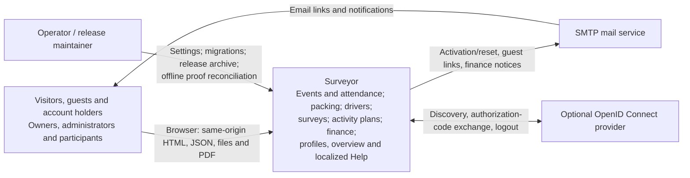

Source owners: [`src/backend/app.ts`](../../../src/backend/app.ts), [`src/backend/routes/api/v1.ts`](../../../src/backend/routes/api/v1.ts), [`src/backend/modules/email.ts`](../../../src/backend/modules/email.ts), [`src/backend/modules/oidc.ts`](../../../src/backend/modules/oidc.ts), [`src/backend/modules/settings.ts`](../../../src/backend/modules/settings.ts), [`scripts/reconcile-invoice-proofs.ts`](../../../scripts/reconcile-invoice-proofs.ts).

### Containers and runtime dependencies

*Flowchart diagram.* One Node application serves Vue SSR, the browser assets and the versioned API. The worker is a thread inside that process, not a separately deployed service. SQL stores sessions as well as domain records.

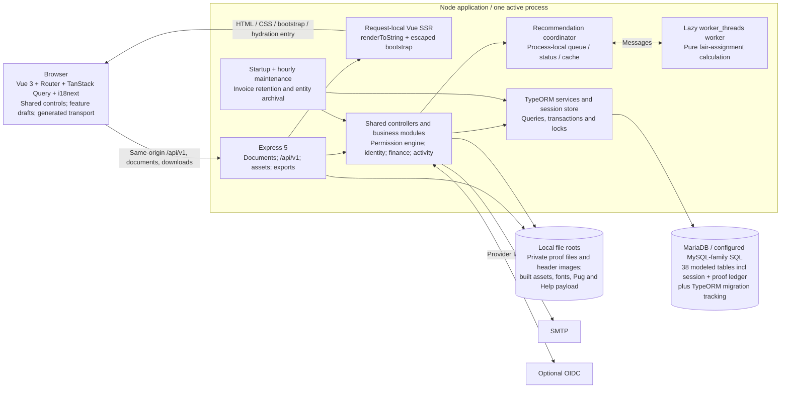

Source owners: [`src/backend/app.ts`](../../../src/backend/app.ts), [`src/backend/server.ts`](../../../src/backend/server.ts), [`src/backend/modules/frontendRenderer.ts`](../../../src/backend/modules/frontendRenderer.ts), [`src/backend/modules/database/dataSource.ts`](../../../src/backend/modules/database/dataSource.ts), [`src/backend/modules/database/services/UserService.ts`](../../../src/backend/modules/database/services/UserService.ts), [`src/backend/modules/lib/session.ts`](../../../src/backend/modules/lib/session.ts), [`src/backend/modules/activity/recommendationJobs.ts`](../../../src/backend/modules/activity/recommendationJobs.ts), [`src/backend/modules/invoice/proofs.ts`](../../../src/backend/modules/invoice/proofs.ts).

### Backend components and responsibility boundaries

*Flowchart diagram.* Arrows show meaningful runtime calls, not a claim of strict one-way package dependencies. Controllers coordinate operations; shared feature modules implement business callbacks under service-owned transactions. DBAL services own queries, locks and persistence.

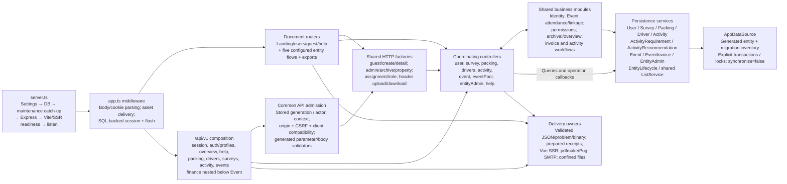

Source owners: [`src/backend/server.ts`](../../../src/backend/server.ts), [`src/backend/app.ts`](../../../src/backend/app.ts), [`src/backend/routes/api/v1.ts`](../../../src/backend/routes/api/v1.ts), [`src/backend/routes/api/v1/events.ts`](../../../src/backend/routes/api/v1/events.ts), [`src/backend/middleware/guestFlowFactory.ts`](../../../src/backend/middleware/guestFlowFactory.ts), [`src/backend/middleware/adminApiFactory.ts`](../../../src/backend/middleware/adminApiFactory.ts), [`src/backend/modules/api/session.ts`](../../../src/backend/modules/api/session.ts), [`src/backend/modules/api/transport.ts`](../../../src/backend/modules/api/transport.ts), [`src/backend/controller/entityAdminController.ts`](../../../src/backend/controller/entityAdminController.ts).

### Whole application feature map

*Flowchart diagram.* All ten browser feature directories and their backend owners. Finance is an Event section; Surveys deliberately have no Event link. Shared lifecycle, identity and access capabilities do not imply every feature exposes identical operations.

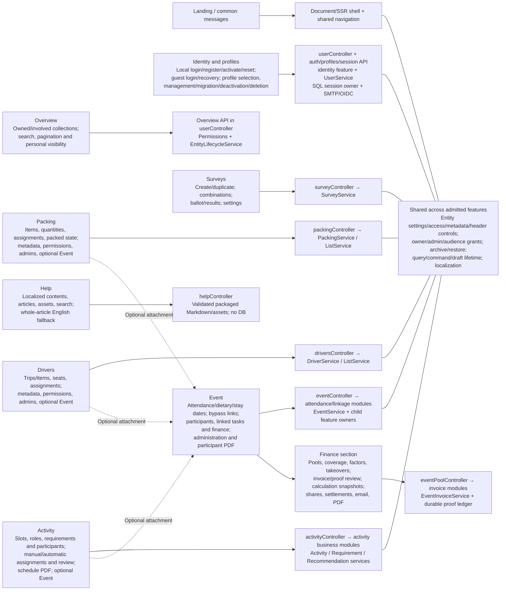

Source owners: [`src/frontend/routes/index.ts`](../../../src/frontend/routes/index.ts), [`src/frontend/features/event/EventPage.vue`](../../../src/frontend/features/event/EventPage.vue), [`src/backend/routes/api/v1.ts`](../../../src/backend/routes/api/v1.ts), [`src/backend/routes/api/v1/events.ts`](../../../src/backend/routes/api/v1/events.ts), [`src/backend/routes/surveyFlow.ts`](../../../src/backend/routes/surveyFlow.ts), [`src/backend/controller/helpController.ts`](../../../src/backend/controller/helpController.ts), [`src/backend/controller/userController.ts`](../../../src/backend/controller/userController.ts).

### Browser and SSR component architecture

*Flowchart diagram.* Each SSR request and each browser app has its own context and QueryClient. Browser-only reads start after hydration. Feature drafts belong to components/composables, rather than the query cache.

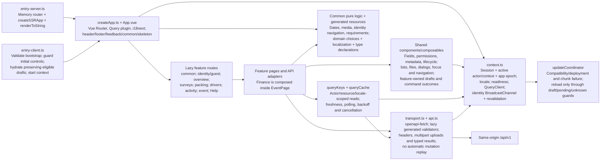

Source owners: [`src/frontend/app/createApp.ts`](../../../src/frontend/app/createApp.ts), [`src/frontend/app/entry-server.ts`](../../../src/frontend/app/entry-server.ts), [`src/frontend/app/entry-client.ts`](../../../src/frontend/app/entry-client.ts), [`src/frontend/app/context.ts`](../../../src/frontend/app/context.ts), [`src/frontend/app/queryCache.ts`](../../../src/frontend/app/queryCache.ts), [`src/frontend/app/transport.ts`](../../../src/frontend/app/transport.ts), [`src/frontend/composables/command.ts`](../../../src/frontend/composables/command.ts), [`src/frontend/app/updateCoordinator.ts`](../../../src/frontend/app/updateCoordinator.ts).

### Source package dependencies and shared contracts

*Flowchart diagram.* Dependency overview with runtime-generated dependencies called out. This is a responsibility map; dashed edges represent declaration-only contracts. Browser and server validator outputs remain separate owners.

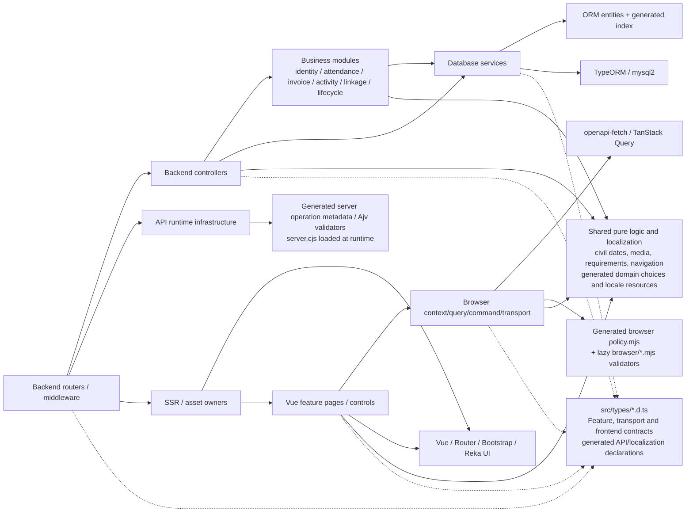

Source owners: [`src/backend/modules/frontendBoundary.ts`](../../../src/backend/modules/frontendBoundary.ts), [`src/backend/modules/api/contracts.ts`](../../../src/backend/modules/api/contracts.ts), [`src/frontend/app/transport.ts`](../../../src/frontend/app/transport.ts), [`src/backend/modules/database/dataSource.ts`](../../../src/backend/modules/database/dataSource.ts), [`src/common/localization/translator.ts`](../../../src/common/localization/translator.ts), [`package.json`](../../../package.json).

## Data model

The entity relationship views preserve the authored ORM foreign-key topology, including inheritance, physical nullability and unique-key membership. They are structural references: a nullable column does not mean the corresponding business operation permits a missing relationship. These charts do not define new schema invariants or verify the state of an installed database. Dashed application-reference arrows are distinguished from actual foreign keys in their own view.

### Whole database with 38 tables and 66 foreign keys

*Entity relationship diagram.* Complete source-derived table and foreign-key topology, including inherited relations. Primary keys are shown; domain diagrams expand key columns and constraints. Dotted lines mean non-identifying foreign keys. This is the authored ORM model, not a verified installed schema; physical nullability does not define which relationships business operations require.

```mermaid
erDiagram
    %% Source-only authored ORM model; zero-or-one parent ends reflect nullable FK columns.
    %% Dotted lines are non-identifying foreign keys, not unconstrained logical references.
    ActivityAssignment {
        int id PK
    }
    ActivityAssignmentRecommendation {
        uuid id PK
    }
    %% UNIQUE ActivityAssignmentRole.unique_act_ass_role_map (assignment_id, role_id)
    ActivityAssignmentRole {
        int id PK
    }
    ActivityPlan {
        uuid id PK
    }
    %% UNIQUE ActivityPlanRequirement.uk_plan_role (entity_id, role_id)
    ActivityPlanRequirement {
        int id PK
    }
    %% UNIQUE ActivityPlanRequirementOverride.uk_plan_participant_role (entity_id, profile_id, role_id)
    ActivityPlanRequirementOverride {
        int id PK
    }
    %% UNIQUE ActivityPlanStayRequirement.uk_activity_plan_stay_days (entity_id, stay_days)
    ActivityPlanStayRequirement {
        int id PK
    }
    ActivityPlanTextField {
        uuid id PK
    }
    %% UNIQUE ActivityRole.act_roles_name_plan (title, entity_id)
    ActivityRole {
        int id PK
    }
    ActivitySlot {
        uuid id PK
    }
    %% UNIQUE ActivitySlotRole.unique_act_slot_role_map (item_id, role_id)
    ActivitySlotRole {
        int id PK
    }
    DriversAssignment {
        int id PK
    }
    DriversItem {
        uuid id PK
    }
    DriversList {
        uuid id PK
    }
    %% UNIQUE EntityAdminAssignment.uk_entity_admin_assignment_user (entity_type, entity_id, profile_id)
    EntityAdminAssignment {
        int id PK
    }
    %% UNIQUE EntityPermissions.uk_entity_perm_audience (entity_type, entity_id, audience)
    EntityPermissions {
        int id PK
    }
    %% UNIQUE EntityVisibilityPreference.uk_entity_visibility_profile_target (profile_id, entity_type, entity_id)
    EntityVisibilityPreference {
        int id PK
    }
    Event {
        uuid id PK
    }
    EventInvoice {
        int id PK
    }
    EventInvoicePool {
        uuid id PK
    }
    EventInvoiceShare {
        int id PK
    }
    EventInvoiceSurcharge {
        int id PK
    }
    EventPoolAssignment {
        int id PK
    }
    %% UNIQUE EventPoolTakeover.uniq_pool_beneficiary (pool_id, beneficiary_registration_id)
    EventPoolTakeover {
        int id PK
    }
    %% UNIQUE EventRegBypassLink.uk_event_token (event_id, token)
    %% UNIQUE EventRegBypassLink.IDX_b9e53d9bd9982814e68ecf02db (token)
    EventRegBypassLink {
        uuid id PK
    }
    EventRegistration {
        int id PK
    }
    %% UNIQUE EventRegistrationDietary.uk_registration_choice (registration_id, choice)
    EventRegistrationDietary {
        int id PK
    }
    %% UNIQUE Guest.IDX_3d84b6c2d8e540af9da1cf265e (token)
    Guest {
        uuid id PK
    }
    InvoiceProofFile {
        char id PK
    }
    PackingAssignment {
        int id PK
    }
    PackingItem {
        uuid id PK
    }
    PackingList {
        uuid id PK
    }
    %% UNIQUE Profile.REL_74c607202390168d8cb82bfd1e (guest_id)
    Profile {
        uuid id PK
    }
    Session {
        varchar id PK
    }
    Survey {
        uuid id PK
    }
    %% UNIQUE SurveyCombination.combinations_single_entry (WEEKDAY, entity_id, nth_week)
    SurveyCombination {
        int id PK
    }
    SurveyResponse {
        int id PK
    }
    %% UNIQUE User.username (username)
    %% UNIQUE User.email (email)
    %% UNIQUE User.IDX_fe0bb3f6520ee0469504521e71 (username)
    %% UNIQUE User.IDX_97672ac88f789774dd47f7c8be (email)
    User {
        int id PK
    }
    ActivityAssignment }o..o| Profile : "profile_id"
    ActivityAssignment }o..o| ActivitySlot : "item_id"
    ActivityAssignment }o..o| ActivityPlan : "entity_id"
    ActivityAssignmentRecommendation }o..o| Profile : "profile_id"
    ActivityAssignmentRecommendation }o..o| ActivitySlot : "item_id"
    ActivityAssignmentRecommendation }o..o| ActivitySlot : "source_item_id"
    ActivityAssignmentRecommendation }o..o| ActivityPlan : "entity_id"
    ActivityAssignmentRole }o..o| ActivityAssignment : "assignment_id"
    ActivityAssignmentRole }o..o| ActivityRole : "role_id"
    ActivityPlan }o..o| Profile : "owner_id"
    ActivityPlan }o..o| Event : "event_id"
    ActivityPlanRequirement }o..o| ActivityRole : "role_id"
    ActivityPlanRequirement }o..o| ActivityPlan : "entity_id"
    ActivityPlanRequirementOverride }o..o| Profile : "profile_id"
    ActivityPlanRequirementOverride }o..o| ActivityPlan : "entity_id"
    ActivityPlanRequirementOverride }o..o| ActivityRole : "role_id"
    ActivityPlanStayRequirement }o..o| ActivityPlan : "entity_id"
    ActivityPlanTextField }o..o| ActivityPlan : "entity_id"
    ActivityRole }o..o| ActivityPlan : "entity_id"
    ActivitySlot }o..o| Profile : "profile_id"
    ActivitySlot }o..o| ActivityPlan : "entity_id"
    ActivitySlotRole }o..o| ActivitySlot : "item_id"
    ActivitySlotRole }o..o| ActivityRole : "role_id"
    DriversAssignment }o..o| Profile : "profile_id"
    DriversAssignment }o..o| DriversItem : "item_id"
    DriversAssignment }o..o| DriversList : "entity_id"
    DriversItem }o..o| Profile : "profile_id"
    DriversItem }o..o| DriversList : "entity_id"
    DriversList }o..o| Profile : "owner_id"
    DriversList }o..o| Event : "event_id"
    EntityAdminAssignment }o..o| Profile : "profile_id"
    EntityVisibilityPreference }o..o| Profile : "profile_id"
    Event }o..o| Profile : "owner_id"
    EventInvoice }o..o| EventInvoicePool : "pool_id"
    EventInvoice }o..o| EventRegistration : "registration_id"
    EventInvoice }o..o| Profile : "recorded_by_profile_id"
    EventInvoicePool }o..o| Event : "event_id"
    EventInvoiceShare }o..o| EventInvoicePool : "pool_id"
    EventInvoiceShare }o..o| EventRegistration : "registration_id"
    EventInvoiceSurcharge }o..o| EventInvoicePool : "pool_id"
    EventInvoiceSurcharge }o..o| EventRegistration : "registration_id"
    EventPoolAssignment }o..o| EventInvoicePool : "pool_id"
    EventPoolAssignment }o..o| EventRegistration : "registration_id"
    EventPoolTakeover }o..o| EventInvoicePool : "pool_id"
    EventPoolTakeover }o..o| EventRegistration : "payer_registration_id"
    EventPoolTakeover }o..o| EventRegistration : "beneficiary_registration_id"
    EventRegBypassLink }o..o| Profile : "profile_id"
    EventRegBypassLink }o..o| Event : "event_id"
    EventRegistration }o..o| Profile : "profile_id"
    EventRegistration }o..o| Event : "event_id"
    EventRegistrationDietary }o..o| EventRegistration : "registration_id"
    PackingAssignment }o..o| Profile : "profile_id"
    PackingAssignment }o..o| PackingItem : "item_id"
    PackingAssignment }o..o| PackingList : "entity_id"
    PackingItem }o..o| Profile : "profile_id"
    PackingItem }o..o| PackingList : "entity_id"
    PackingList }o..o| Profile : "owner_id"
    PackingList }o..o| Event : "event_id"
    Profile }o..o| User : "user_id"
    Profile |o..o| Guest : "guest_id"
    Survey }o..o| Profile : "owner_id"
    SurveyCombination }o..o| Profile : "profile_id"
    SurveyCombination }o..o| Survey : "entity_id"
    SurveyResponse }o..o| Profile : "profile_id"
    SurveyResponse }o..o| SurveyCombination : "item_id"
    SurveyResponse }o..o| Survey : "entity_id"
```

Source owners: [`src/backend/modules/database/entities/activity/ActivityAssignment.ts`](../../../src/backend/modules/database/entities/activity/ActivityAssignment.ts), [`src/backend/modules/database/entities/activity/ActivityAssignmentRecommendation.ts`](../../../src/backend/modules/database/entities/activity/ActivityAssignmentRecommendation.ts), [`src/backend/modules/database/entities/activity/ActivityAssignmentRole.ts`](../../../src/backend/modules/database/entities/activity/ActivityAssignmentRole.ts), [`src/backend/modules/database/entities/activity/ActivityPlan.ts`](../../../src/backend/modules/database/entities/activity/ActivityPlan.ts), [`src/backend/modules/database/entities/activity/ActivityPlanRequirement.ts`](../../../src/backend/modules/database/entities/activity/ActivityPlanRequirement.ts), [`src/backend/modules/database/entities/activity/ActivityPlanRequirementOverride.ts`](../../../src/backend/modules/database/entities/activity/ActivityPlanRequirementOverride.ts), [`src/backend/modules/database/entities/activity/ActivityPlanStayRequirement.ts`](../../../src/backend/modules/database/entities/activity/ActivityPlanStayRequirement.ts), [`src/backend/modules/database/entities/activity/ActivityPlanTextField.ts`](../../../src/backend/modules/database/entities/activity/ActivityPlanTextField.ts), [`src/backend/modules/database/entities/activity/ActivityRole.ts`](../../../src/backend/modules/database/entities/activity/ActivityRole.ts), [`src/backend/modules/database/entities/activity/ActivitySlot.ts`](../../../src/backend/modules/database/entities/activity/ActivitySlot.ts), [`src/backend/modules/database/entities/activity/ActivitySlotRole.ts`](../../../src/backend/modules/database/entities/activity/ActivitySlotRole.ts), [`src/backend/modules/database/entities/drivers/DriversAssignment.ts`](../../../src/backend/modules/database/entities/drivers/DriversAssignment.ts), [`src/backend/modules/database/entities/drivers/DriversItem.ts`](../../../src/backend/modules/database/entities/drivers/DriversItem.ts), [`src/backend/modules/database/entities/drivers/DriversList.ts`](../../../src/backend/modules/database/entities/drivers/DriversList.ts), [`src/backend/modules/database/entities/permissions/EntityAdminAssignment.ts`](../../../src/backend/modules/database/entities/permissions/EntityAdminAssignment.ts), [`src/backend/modules/database/entities/permissions/EntityPermissions.ts`](../../../src/backend/modules/database/entities/permissions/EntityPermissions.ts), [`src/backend/modules/database/entities/archive/EntityVisibilityPreference.ts`](../../../src/backend/modules/database/entities/archive/EntityVisibilityPreference.ts), [`src/backend/modules/database/entities/event/Event.ts`](../../../src/backend/modules/database/entities/event/Event.ts), [`src/backend/modules/database/entities/event/EventInvoice.ts`](../../../src/backend/modules/database/entities/event/EventInvoice.ts), [`src/backend/modules/database/entities/event/EventInvoicePool.ts`](../../../src/backend/modules/database/entities/event/EventInvoicePool.ts), [`src/backend/modules/database/entities/event/EventInvoiceShare.ts`](../../../src/backend/modules/database/entities/event/EventInvoiceShare.ts), [`src/backend/modules/database/entities/event/EventInvoiceSurcharge.ts`](../../../src/backend/modules/database/entities/event/EventInvoiceSurcharge.ts), [`src/backend/modules/database/entities/event/EventPoolAssignment.ts`](../../../src/backend/modules/database/entities/event/EventPoolAssignment.ts), [`src/backend/modules/database/entities/event/EventPoolTakeover.ts`](../../../src/backend/modules/database/entities/event/EventPoolTakeover.ts), [`src/backend/modules/database/entities/event/EventRegBypassLink.ts`](../../../src/backend/modules/database/entities/event/EventRegBypassLink.ts), [`src/backend/modules/database/entities/event/EventRegistration.ts`](../../../src/backend/modules/database/entities/event/EventRegistration.ts), [`src/backend/modules/database/entities/event/EventRegistrationDietary.ts`](../../../src/backend/modules/database/entities/event/EventRegistrationDietary.ts), [`src/backend/modules/database/entities/user/Guest.ts`](../../../src/backend/modules/database/entities/user/Guest.ts), [`src/backend/modules/database/entities/event/InvoiceProofFile.ts`](../../../src/backend/modules/database/entities/event/InvoiceProofFile.ts), [`src/backend/modules/database/entities/packing/PackingAssignment.ts`](../../../src/backend/modules/database/entities/packing/PackingAssignment.ts), [`src/backend/modules/database/entities/packing/PackingItem.ts`](../../../src/backend/modules/database/entities/packing/PackingItem.ts), [`src/backend/modules/database/entities/packing/PackingList.ts`](../../../src/backend/modules/database/entities/packing/PackingList.ts), [`src/backend/modules/database/entities/user/Profile.ts`](../../../src/backend/modules/database/entities/user/Profile.ts), [`src/backend/modules/database/entities/session/Session.ts`](../../../src/backend/modules/database/entities/session/Session.ts), [`src/backend/modules/database/entities/surveys/Survey.ts`](../../../src/backend/modules/database/entities/surveys/Survey.ts), [`src/backend/modules/database/entities/surveys/SurveyCombination.ts`](../../../src/backend/modules/database/entities/surveys/SurveyCombination.ts), [`src/backend/modules/database/entities/surveys/SurveyResponse.ts`](../../../src/backend/modules/database/entities/surveys/SurveyResponse.ts), [`src/backend/modules/database/entities/user/User.ts`](../../../src/backend/modules/database/entities/user/User.ts).

### Identity and access data

*Entity relationship diagram.* Profiles connect optional account and guest identities to the rest of the application. Profile.guest_id is unique. Permission/admin/visibility target pairs have no root foreign key; their logical targets are shown separately. UK marks membership in a unique key, including composite keys; source comments identify each grouped constraint.

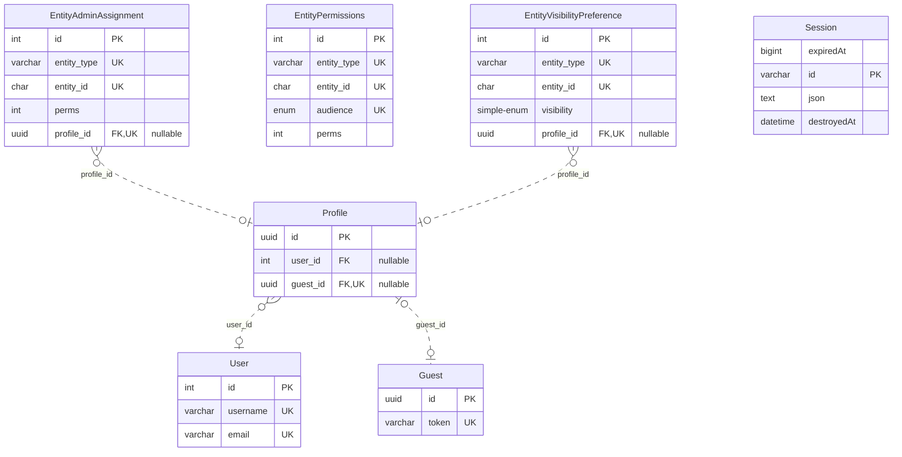

Source owners: [`src/backend/modules/database/entities/user/User.ts`](../../../src/backend/modules/database/entities/user/User.ts), [`src/backend/modules/database/entities/user/Guest.ts`](../../../src/backend/modules/database/entities/user/Guest.ts), [`src/backend/modules/database/entities/user/Profile.ts`](../../../src/backend/modules/database/entities/user/Profile.ts), [`src/backend/modules/database/entities/session/Session.ts`](../../../src/backend/modules/database/entities/session/Session.ts), [`src/backend/modules/database/entities/permissions/EntityAdminAssignment.ts`](../../../src/backend/modules/database/entities/permissions/EntityAdminAssignment.ts), [`src/backend/modules/database/entities/permissions/EntityPermissions.ts`](../../../src/backend/modules/database/entities/permissions/EntityPermissions.ts), [`src/backend/modules/database/entities/archive/EntityVisibilityPreference.ts`](../../../src/backend/modules/database/entities/archive/EntityVisibilityPreference.ts).

### Event attendance and finance

*Entity relationship diagram.* All Event-domain tables, including dietary rows, bypass tokens, pools, enrollment, invoices, shares, takeovers, adjustments and durable file ownership. Profile is shared context. InvoiceProofFile deliberately has no business-record foreign key. An organizer invoice can omit a paying registration. UK marks membership in a unique key; source comments identify each grouped constraint.

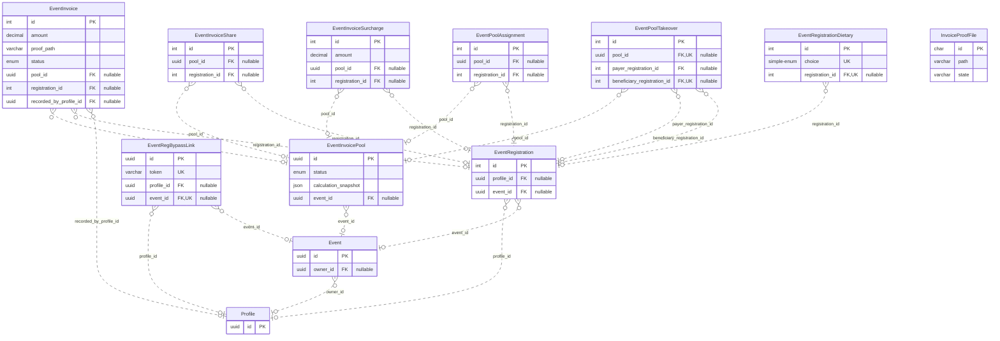

Source owners: [`src/backend/modules/database/entities/event/Event.ts`](../../../src/backend/modules/database/entities/event/Event.ts), [`src/backend/modules/database/entities/event/EventInvoice.ts`](../../../src/backend/modules/database/entities/event/EventInvoice.ts), [`src/backend/modules/database/entities/event/EventInvoicePool.ts`](../../../src/backend/modules/database/entities/event/EventInvoicePool.ts), [`src/backend/modules/database/entities/event/EventInvoiceShare.ts`](../../../src/backend/modules/database/entities/event/EventInvoiceShare.ts), [`src/backend/modules/database/entities/event/EventInvoiceSurcharge.ts`](../../../src/backend/modules/database/entities/event/EventInvoiceSurcharge.ts), [`src/backend/modules/database/entities/event/EventPoolAssignment.ts`](../../../src/backend/modules/database/entities/event/EventPoolAssignment.ts), [`src/backend/modules/database/entities/event/EventPoolTakeover.ts`](../../../src/backend/modules/database/entities/event/EventPoolTakeover.ts), [`src/backend/modules/database/entities/event/EventRegBypassLink.ts`](../../../src/backend/modules/database/entities/event/EventRegBypassLink.ts), [`src/backend/modules/database/entities/event/EventRegistration.ts`](../../../src/backend/modules/database/entities/event/EventRegistration.ts), [`src/backend/modules/database/entities/event/EventRegistrationDietary.ts`](../../../src/backend/modules/database/entities/event/EventRegistrationDietary.ts), [`src/backend/modules/database/entities/event/InvoiceProofFile.ts`](../../../src/backend/modules/database/entities/event/InvoiceProofFile.ts), [`src/backend/modules/database/entities/user/Profile.ts`](../../../src/backend/modules/database/entities/user/Profile.ts).

### Packing and drivers lists with surveys

*Entity relationship diagram.* The three list/ballot families share profile ownership and assignment patterns. Packing and drivers can link to Event; Survey cannot. Profile and Event are shared context. Relation IDs use the actual mixed numeric and UUID storage. UK marks membership in a unique key; source comments identify each grouped constraint.

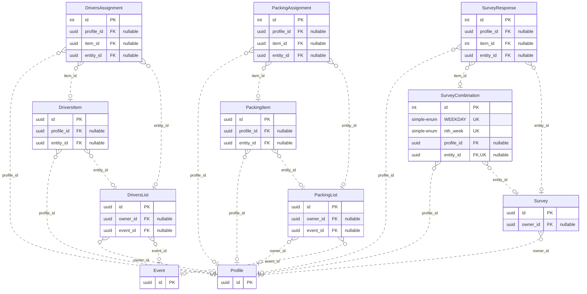

Source owners: [`src/backend/modules/database/entities/drivers/DriversAssignment.ts`](../../../src/backend/modules/database/entities/drivers/DriversAssignment.ts), [`src/backend/modules/database/entities/drivers/DriversItem.ts`](../../../src/backend/modules/database/entities/drivers/DriversItem.ts), [`src/backend/modules/database/entities/drivers/DriversList.ts`](../../../src/backend/modules/database/entities/drivers/DriversList.ts), [`src/backend/modules/database/entities/packing/PackingAssignment.ts`](../../../src/backend/modules/database/entities/packing/PackingAssignment.ts), [`src/backend/modules/database/entities/packing/PackingItem.ts`](../../../src/backend/modules/database/entities/packing/PackingItem.ts), [`src/backend/modules/database/entities/packing/PackingList.ts`](../../../src/backend/modules/database/entities/packing/PackingList.ts), [`src/backend/modules/database/entities/surveys/Survey.ts`](../../../src/backend/modules/database/entities/surveys/Survey.ts), [`src/backend/modules/database/entities/surveys/SurveyCombination.ts`](../../../src/backend/modules/database/entities/surveys/SurveyCombination.ts), [`src/backend/modules/database/entities/surveys/SurveyResponse.ts`](../../../src/backend/modules/database/entities/surveys/SurveyResponse.ts), [`src/backend/modules/database/entities/user/Profile.ts`](../../../src/backend/modules/database/entities/user/Profile.ts), [`src/backend/modules/database/entities/event/Event.ts`](../../../src/backend/modules/database/entities/event/Event.ts).

### Activity planning data

*Entity relationship diagram.* All eleven Activity tables, including optional source slots, per-profile nullable-role overrides, stay rules and text fields. Profile and Event are shared context. The migration-installed BEFORE INSERT role-capacity trigger is additional to these ORM relations. UK marks membership in a unique key; source comments identify each grouped constraint.

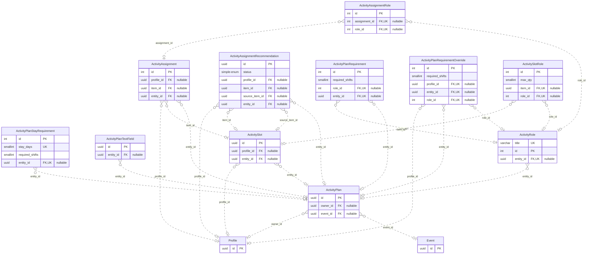

Source owners: [`src/backend/modules/database/entities/activity/ActivityAssignment.ts`](../../../src/backend/modules/database/entities/activity/ActivityAssignment.ts), [`src/backend/modules/database/entities/activity/ActivityAssignmentRecommendation.ts`](../../../src/backend/modules/database/entities/activity/ActivityAssignmentRecommendation.ts), [`src/backend/modules/database/entities/activity/ActivityAssignmentRole.ts`](../../../src/backend/modules/database/entities/activity/ActivityAssignmentRole.ts), [`src/backend/modules/database/entities/activity/ActivityPlan.ts`](../../../src/backend/modules/database/entities/activity/ActivityPlan.ts), [`src/backend/modules/database/entities/activity/ActivityPlanRequirement.ts`](../../../src/backend/modules/database/entities/activity/ActivityPlanRequirement.ts), [`src/backend/modules/database/entities/activity/ActivityPlanRequirementOverride.ts`](../../../src/backend/modules/database/entities/activity/ActivityPlanRequirementOverride.ts), [`src/backend/modules/database/entities/activity/ActivityPlanStayRequirement.ts`](../../../src/backend/modules/database/entities/activity/ActivityPlanStayRequirement.ts), [`src/backend/modules/database/entities/activity/ActivityPlanTextField.ts`](../../../src/backend/modules/database/entities/activity/ActivityPlanTextField.ts), [`src/backend/modules/database/entities/activity/ActivityRole.ts`](../../../src/backend/modules/database/entities/activity/ActivityRole.ts), [`src/backend/modules/database/entities/activity/ActivitySlot.ts`](../../../src/backend/modules/database/entities/activity/ActivitySlot.ts), [`src/backend/modules/database/entities/activity/ActivitySlotRole.ts`](../../../src/backend/modules/database/entities/activity/ActivitySlotRole.ts), [`src/backend/modules/database/entities/user/Profile.ts`](../../../src/backend/modules/database/entities/user/Profile.ts), [`src/backend/modules/database/entities/event/Event.ts`](../../../src/backend/modules/database/entities/event/Event.ts).

### Application references beyond foreign keys

*Flowchart diagram.* These dashed arrows are application-level references only, not SQL constraints. Polymorphic target kinds are selected by entity_type. Session and calculation snapshot references are embedded data. Proof ownership is path based so it survives domain cascades. The role-capacity trigger is migration-owned database logic.

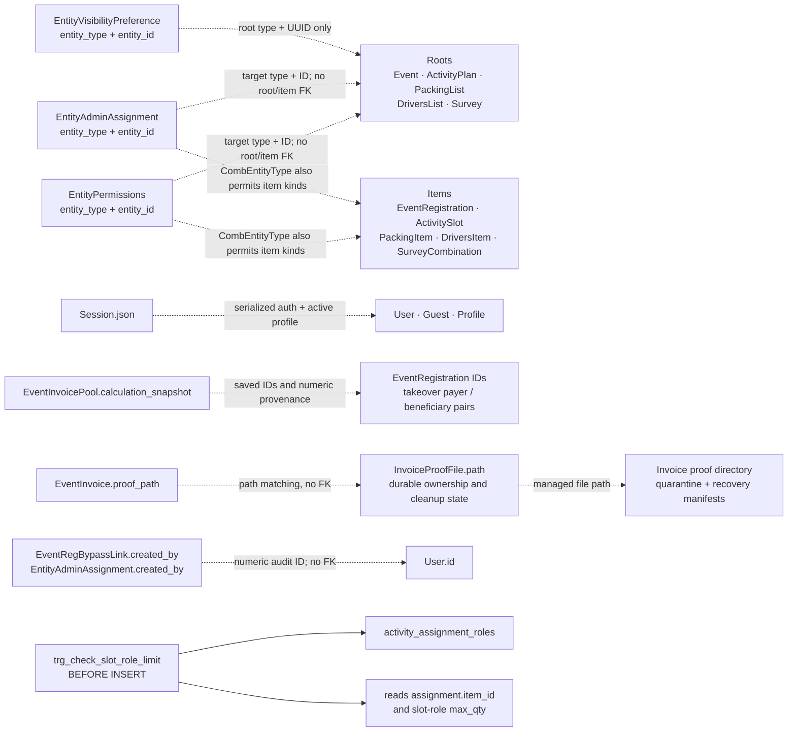

Source owners: [`src/backend/modules/database/entities/permissions/EntityPermissions.ts`](../../../src/backend/modules/database/entities/permissions/EntityPermissions.ts), [`src/backend/modules/database/entities/permissions/EntityAdminAssignment.ts`](../../../src/backend/modules/database/entities/permissions/EntityAdminAssignment.ts), [`src/backend/modules/database/entities/archive/EntityVisibilityPreference.ts`](../../../src/backend/modules/database/entities/archive/EntityVisibilityPreference.ts), [`src/types/UtilTypes.d.ts`](../../../src/types/UtilTypes.d.ts), [`src/types/express.d.ts`](../../../src/types/express.d.ts), [`src/types/InvoicePoolTypes.d.ts`](../../../src/types/InvoicePoolTypes.d.ts), [`src/backend/modules/invoice/proofs.ts`](../../../src/backend/modules/invoice/proofs.ts), [`src/backend/modules/database/entities/event/InvoiceProofFile.ts`](../../../src/backend/modules/database/entities/event/InvoiceProofFile.ts), [`src/backend/migrations/1785689525000-UpdateCheckSlotRoleTrigger.ts`](../../../src/backend/migrations/1785689525000-UpdateCheckSlotRoleTrigger.ts).

### ORM class inheritance

*UML class diagram.* UML class diagram of all concrete entity classes and abstract bases. Inherited columns are flattened into concrete tables; base classes are not additional tables. Session is independent.

```mermaid
classDiagram
    %% Concrete-table inheritance: abstract base columns are flattened into concrete tables, not separate tables.
    class ActivityAssignment
    class ActivityAssignmentRecommendation
    class ActivityAssignmentRole
    class ActivityPlan
    class ActivityPlanRequirement
    class ActivityPlanRequirementOverride
    class ActivityPlanStayRequirement
    class ActivityPlanTextField
    class ActivityRole
    class ActivitySlot
    class ActivitySlotRole
    class BaseEntity
    class BaseEntityItem
    class DefaultEntity
    class DefaultNumericEntityItemAssignment
    class DefaultUuidEntityItemAssignment
    class DriversAssignment
    class DriversItem
    class DriversList
    class EntityAdminAssignment
    class EntityPermissions
    class EntityVisibilityPreference
    class Event
    class EventInvoice
    class EventInvoicePool
    class EventInvoiceShare
    class EventInvoiceSurcharge
    class EventPoolAssignment
    class EventPoolTakeover
    class EventRegBypassLink
    class EventRegistration
    class EventRegistrationDietary
    class Guest
    class InvoiceProofFile
    class NumericBase
    class NumericDefaultEntityItem
    class NumericDescriptionEntityItem
    class NumericEntityItem
    class NumericProfileBase
    class NumericProfileEntityItem
    class PackingAssignment
    class PackingItem
    class PackingList
    class Profile
    class Session
    class Survey
    class SurveyCombination
    class SurveyResponse
    class TrackedBase
    class User
    class UuidBase
    class UuidDefaultEntityItem
    class UuidDescriptionEntityItem
    class UuidEntityItem
    class UuidProfileBase
    class UuidProfileEntityItem
    BaseEntity <|-- DefaultEntity
    BaseEntity <|-- Event
    BaseEntityItem <|-- NumericEntityItem
    BaseEntityItem <|-- UuidEntityItem
    DefaultEntity <|-- ActivityPlan
    DefaultEntity <|-- DriversList
    DefaultEntity <|-- PackingList
    DefaultEntity <|-- Survey
    DefaultNumericEntityItemAssignment <|-- ActivityAssignment
    DefaultNumericEntityItemAssignment <|-- DriversAssignment
    DefaultNumericEntityItemAssignment <|-- PackingAssignment
    DefaultNumericEntityItemAssignment <|-- SurveyResponse
    DefaultUuidEntityItemAssignment <|-- ActivityAssignmentRecommendation
    NumericBase <|-- ActivityAssignmentRole
    NumericBase <|-- ActivityPlanRequirement
    NumericBase <|-- ActivityPlanStayRequirement
    NumericBase <|-- ActivitySlotRole
    NumericBase <|-- EntityPermissions
    NumericBase <|-- EventInvoice
    NumericBase <|-- EventInvoiceShare
    NumericBase <|-- EventInvoiceSurcharge
    NumericBase <|-- EventPoolAssignment
    NumericBase <|-- EventPoolTakeover
    NumericBase <|-- EventRegistrationDietary
    NumericBase <|-- NumericProfileBase
    NumericBase <|-- User
    NumericDefaultEntityItem <|-- SurveyCombination
    NumericDescriptionEntityItem <|-- ActivityRole
    NumericDescriptionEntityItem <|-- NumericProfileEntityItem
    NumericEntityItem <|-- NumericDescriptionEntityItem
    NumericProfileBase <|-- ActivityPlanRequirementOverride
    NumericProfileBase <|-- DefaultNumericEntityItemAssignment
    NumericProfileBase <|-- EntityAdminAssignment
    NumericProfileBase <|-- EntityVisibilityPreference
    NumericProfileBase <|-- EventRegistration
    NumericProfileEntityItem <|-- NumericDefaultEntityItem
    TrackedBase <|-- BaseEntityItem
    TrackedBase <|-- InvoiceProofFile
    TrackedBase <|-- NumericBase
    TrackedBase <|-- UuidBase
    UuidBase <|-- BaseEntity
    UuidBase <|-- EventInvoicePool
    UuidBase <|-- Guest
    UuidBase <|-- Profile
    UuidBase <|-- UuidProfileBase
    UuidDefaultEntityItem <|-- ActivitySlot
    UuidDefaultEntityItem <|-- DriversItem
    UuidDefaultEntityItem <|-- PackingItem
    UuidDescriptionEntityItem <|-- UuidProfileEntityItem
    UuidEntityItem <|-- ActivityPlanTextField
    UuidEntityItem <|-- UuidDescriptionEntityItem
    UuidProfileBase <|-- DefaultUuidEntityItemAssignment
    UuidProfileBase <|-- EventRegBypassLink
    UuidProfileEntityItem <|-- UuidDefaultEntityItem
```

Source owners: [`src/backend/modules/database/entities/abstract/Base.ts`](../../../src/backend/modules/database/entities/abstract/Base.ts), [`src/backend/modules/database/entities/abstract/BaseEntity.ts`](../../../src/backend/modules/database/entities/abstract/BaseEntity.ts), [`src/backend/modules/database/entities/abstract/BaseEntityItem.ts`](../../../src/backend/modules/database/entities/abstract/BaseEntityItem.ts), [`src/backend/modules/database/entities/abstract/DescriptionEntityItem.ts`](../../../src/backend/modules/database/entities/abstract/DescriptionEntityItem.ts), [`src/backend/modules/database/entities/abstract/ProfileEntityItem.ts`](../../../src/backend/modules/database/entities/abstract/ProfileEntityItem.ts), [`src/backend/modules/database/entities/abstract/ProfileEntityItemAssignment.ts`](../../../src/backend/modules/database/entities/abstract/ProfileEntityItemAssignment.ts), [`src/backend/modules/database/entities/abstract/TrackedBase.ts`](../../../src/backend/modules/database/entities/abstract/TrackedBase.ts), [`src/backend/modules/database/entities/activity/ActivityAssignment.ts`](../../../src/backend/modules/database/entities/activity/ActivityAssignment.ts), [`src/backend/modules/database/entities/activity/ActivityAssignmentRecommendation.ts`](../../../src/backend/modules/database/entities/activity/ActivityAssignmentRecommendation.ts), [`src/backend/modules/database/entities/activity/ActivityAssignmentRole.ts`](../../../src/backend/modules/database/entities/activity/ActivityAssignmentRole.ts), [`src/backend/modules/database/entities/activity/ActivityPlan.ts`](../../../src/backend/modules/database/entities/activity/ActivityPlan.ts), [`src/backend/modules/database/entities/activity/ActivityPlanRequirement.ts`](../../../src/backend/modules/database/entities/activity/ActivityPlanRequirement.ts), [`src/backend/modules/database/entities/activity/ActivityPlanRequirementOverride.ts`](../../../src/backend/modules/database/entities/activity/ActivityPlanRequirementOverride.ts), [`src/backend/modules/database/entities/activity/ActivityPlanStayRequirement.ts`](../../../src/backend/modules/database/entities/activity/ActivityPlanStayRequirement.ts), [`src/backend/modules/database/entities/activity/ActivityPlanTextField.ts`](../../../src/backend/modules/database/entities/activity/ActivityPlanTextField.ts), [`src/backend/modules/database/entities/activity/ActivityRole.ts`](../../../src/backend/modules/database/entities/activity/ActivityRole.ts), [`src/backend/modules/database/entities/activity/ActivitySlot.ts`](../../../src/backend/modules/database/entities/activity/ActivitySlot.ts), [`src/backend/modules/database/entities/activity/ActivitySlotRole.ts`](../../../src/backend/modules/database/entities/activity/ActivitySlotRole.ts), [`src/backend/modules/database/entities/archive/EntityVisibilityPreference.ts`](../../../src/backend/modules/database/entities/archive/EntityVisibilityPreference.ts), [`src/backend/modules/database/entities/drivers/DriversAssignment.ts`](../../../src/backend/modules/database/entities/drivers/DriversAssignment.ts), [`src/backend/modules/database/entities/drivers/DriversItem.ts`](../../../src/backend/modules/database/entities/drivers/DriversItem.ts), [`src/backend/modules/database/entities/drivers/DriversList.ts`](../../../src/backend/modules/database/entities/drivers/DriversList.ts), [`src/backend/modules/database/entities/event/Event.ts`](../../../src/backend/modules/database/entities/event/Event.ts), [`src/backend/modules/database/entities/event/EventInvoice.ts`](../../../src/backend/modules/database/entities/event/EventInvoice.ts), [`src/backend/modules/database/entities/event/EventInvoicePool.ts`](../../../src/backend/modules/database/entities/event/EventInvoicePool.ts), [`src/backend/modules/database/entities/event/EventInvoiceShare.ts`](../../../src/backend/modules/database/entities/event/EventInvoiceShare.ts), [`src/backend/modules/database/entities/event/EventInvoiceSurcharge.ts`](../../../src/backend/modules/database/entities/event/EventInvoiceSurcharge.ts), [`src/backend/modules/database/entities/event/EventPoolAssignment.ts`](../../../src/backend/modules/database/entities/event/EventPoolAssignment.ts), [`src/backend/modules/database/entities/event/EventPoolTakeover.ts`](../../../src/backend/modules/database/entities/event/EventPoolTakeover.ts), [`src/backend/modules/database/entities/event/EventRegBypassLink.ts`](../../../src/backend/modules/database/entities/event/EventRegBypassLink.ts), [`src/backend/modules/database/entities/event/EventRegistration.ts`](../../../src/backend/modules/database/entities/event/EventRegistration.ts), [`src/backend/modules/database/entities/event/EventRegistrationDietary.ts`](../../../src/backend/modules/database/entities/event/EventRegistrationDietary.ts), [`src/backend/modules/database/entities/event/InvoiceProofFile.ts`](../../../src/backend/modules/database/entities/event/InvoiceProofFile.ts), [`src/backend/modules/database/entities/packing/PackingAssignment.ts`](../../../src/backend/modules/database/entities/packing/PackingAssignment.ts), [`src/backend/modules/database/entities/packing/PackingItem.ts`](../../../src/backend/modules/database/entities/packing/PackingItem.ts), [`src/backend/modules/database/entities/packing/PackingList.ts`](../../../src/backend/modules/database/entities/packing/PackingList.ts), [`src/backend/modules/database/entities/permissions/EntityAdminAssignment.ts`](../../../src/backend/modules/database/entities/permissions/EntityAdminAssignment.ts), [`src/backend/modules/database/entities/permissions/EntityPermissions.ts`](../../../src/backend/modules/database/entities/permissions/EntityPermissions.ts), [`src/backend/modules/database/entities/session/Session.ts`](../../../src/backend/modules/database/entities/session/Session.ts), [`src/backend/modules/database/entities/surveys/Survey.ts`](../../../src/backend/modules/database/entities/surveys/Survey.ts), [`src/backend/modules/database/entities/surveys/SurveyCombination.ts`](../../../src/backend/modules/database/entities/surveys/SurveyCombination.ts), [`src/backend/modules/database/entities/surveys/SurveyResponse.ts`](../../../src/backend/modules/database/entities/surveys/SurveyResponse.ts), [`src/backend/modules/database/entities/user/Guest.ts`](../../../src/backend/modules/database/entities/user/Guest.ts), [`src/backend/modules/database/entities/user/Profile.ts`](../../../src/backend/modules/database/entities/user/Profile.ts), [`src/backend/modules/database/entities/user/User.ts`](../../../src/backend/modules/database/entities/user/User.ts).

## Request and identity boundaries

### SSR document rendering and browser reads

*Sequence diagram.* Interactive pages generally SSR an admitted shell/skeleton; Help and static admitted outcomes have readable SSR content. Server rendering receives direct bootstrap data rather than calling its own HTTP API.

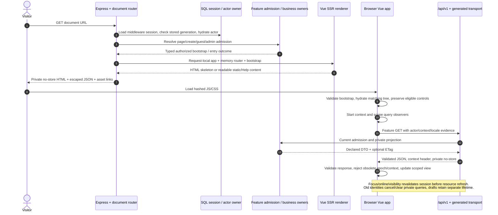

Source owners: [`src/backend/middleware/frontendDocuments.ts`](../../../src/backend/middleware/frontendDocuments.ts), [`src/backend/modules/frontendRenderer.ts`](../../../src/backend/modules/frontendRenderer.ts), [`src/frontend/app/entry-server.ts`](../../../src/frontend/app/entry-server.ts), [`src/frontend/app/entry-client.ts`](../../../src/frontend/app/entry-client.ts), [`src/frontend/app/context.ts`](../../../src/frontend/app/context.ts), [`src/frontend/app/transport.ts`](../../../src/frontend/app/transport.ts).

### Protected command and completion boundaries

*Sequence diagram.* Representative transaction-aware command path. Each operation retains its feature-owned completion contract; this diagram does not assert identical transaction boundaries for every workflow. A lost HTTP reply does not establish rollback.

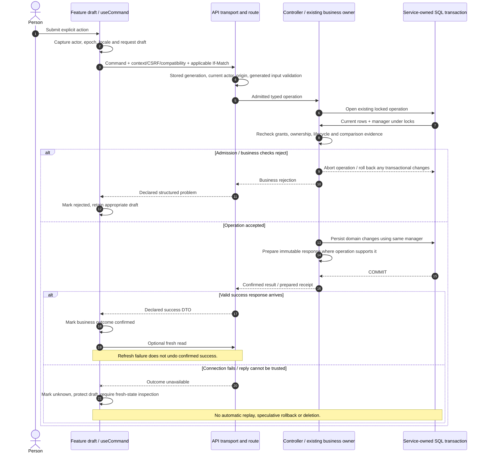

Source owners: [`src/frontend/composables/command.ts`](../../../src/frontend/composables/command.ts), [`src/frontend/app/transport.ts`](../../../src/frontend/app/transport.ts), [`src/backend/modules/api/session.ts`](../../../src/backend/modules/api/session.ts), [`src/backend/modules/api/transport.ts`](../../../src/backend/modules/api/transport.ts), [`src/backend/routes/api/v1/events.ts`](../../../src/backend/routes/api/v1/events.ts), [`src/backend/modules/database/services/EventService.ts`](../../../src/backend/modules/database/services/EventService.ts), [`src/backend/controller/surveyController.ts`](../../../src/backend/controller/surveyController.ts).

### Ordinary identity completion and external delivery

*Sequence diagram.* Local login/logout, guest creation/login, profile selection, token-free account/guest deletion and selected token workflows use detached preparation with a transaction-bound session store. Signup without an identity change need not create a session row. Profile transfer has its own owner/profile transaction shown below; final-profile deactivation uses ordinary local clear/save after its existing detach/cleanup sequence. API mutation-header checks and document capability admission remain distinct.

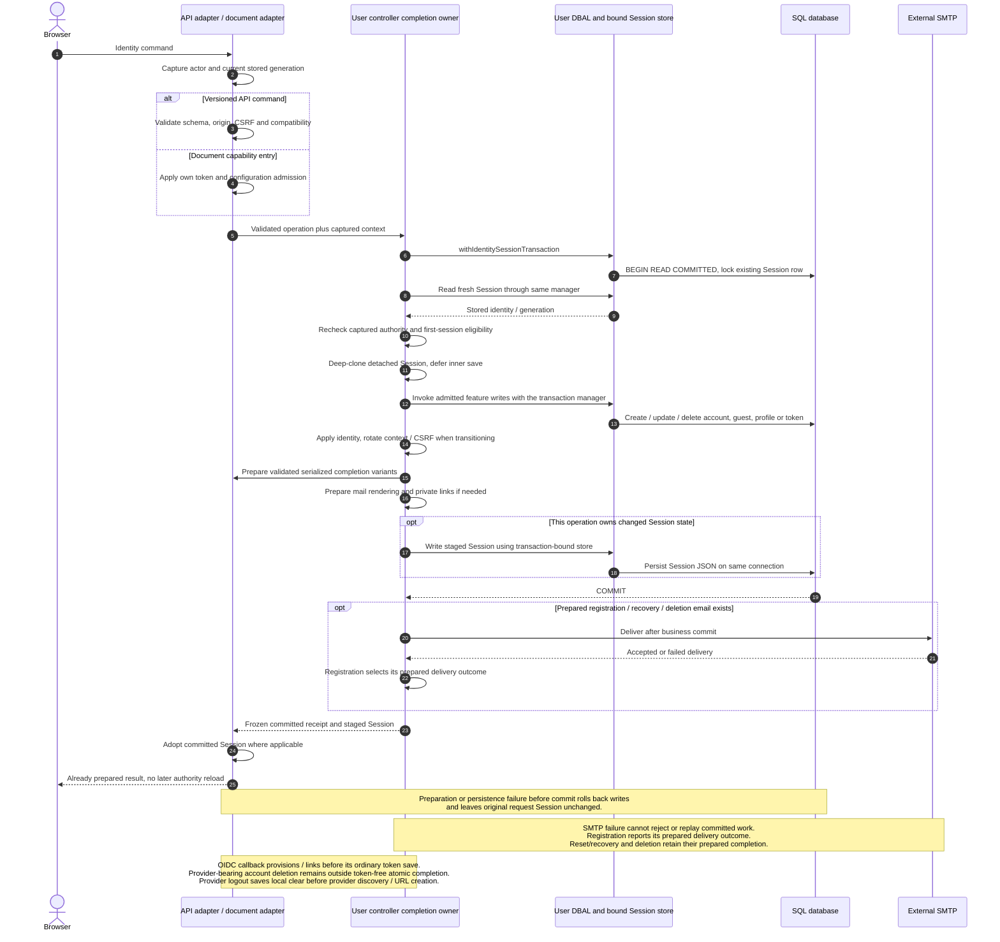

Source owners: [`src/backend/modules/api/session.ts`](../../../src/backend/modules/api/session.ts), [`src/backend/routes/api/v1/auth.ts`](../../../src/backend/routes/api/v1/auth.ts), [`src/backend/controller/userController.ts`](../../../src/backend/controller/userController.ts), [`src/backend/modules/lib/session.ts`](../../../src/backend/modules/lib/session.ts), [`src/backend/modules/lib/frontendSession.ts`](../../../src/backend/modules/lib/frontendSession.ts), [`src/backend/modules/database/services/UserService.ts`](../../../src/backend/modules/database/services/UserService.ts), [`src/backend/modules/email.ts`](../../../src/backend/modules/email.ts), [`src/backend/modules/oidc.ts`](../../../src/backend/modules/oidc.ts).

### Profile capability issuance and transfer

*Sequence diagram.* Issuance checks current principal ownership under the Profile lock. Transfer prelocks the
source/recipient account rows in stable order, then the source Guest when present, then the Profile. It rechecks the
opaque token and expiry after waiting. Transfer does not select or rotate the recipient's active profile/session.

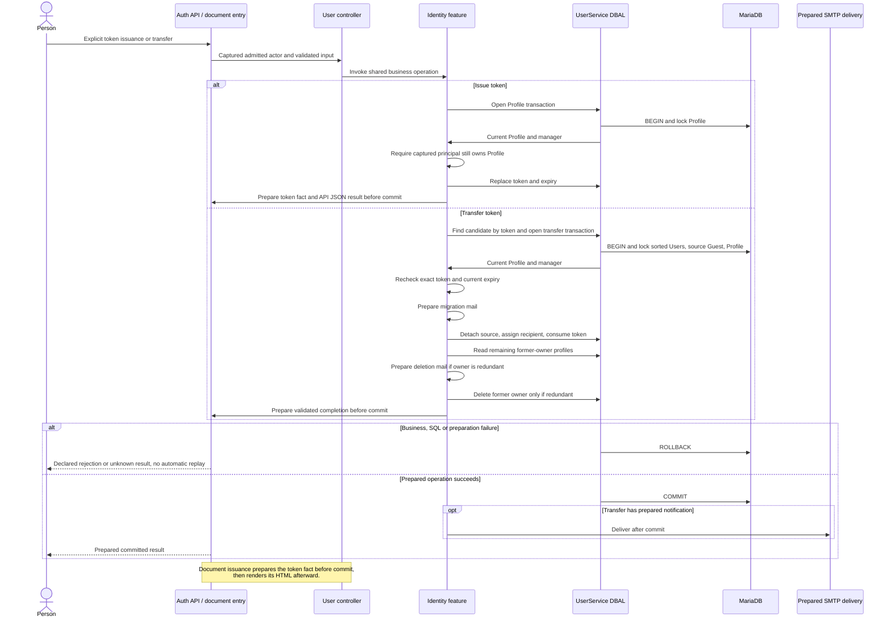

Source owners: [`identity.ts`](../../../src/backend/modules/identity.ts), [`UserService.ts`](../../../src/backend/modules/database/services/UserService.ts), [`userController.ts`](../../../src/backend/controller/userController.ts), [`auth.ts`](../../../src/backend/routes/api/v1/auth.ts), [`email.ts`](../../../src/backend/modules/email.ts).

### Local and provider logout completion

*Sequence diagram.* Provider-bearing API logout and logout documents persist local state before provider work. Only
failure after that persistence can return the explicit unconfirmed-provider outcome. Token-free API logout uses the
locked ordinary identity completion shown above. Local-save failure remains a failed/uncertain operation;
provider-bearing account deletion retains its separately scoped completion behavior.

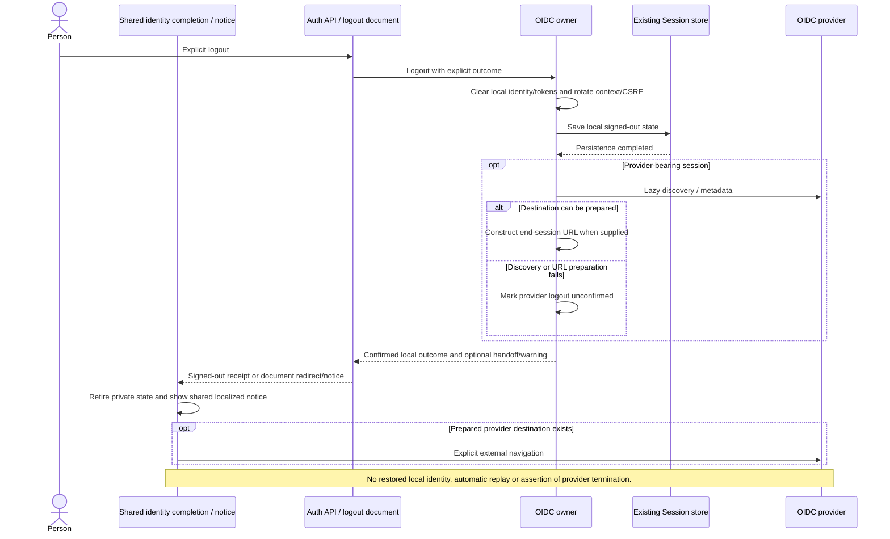

Source owners: [`oidc.ts`](../../../src/backend/modules/oidc.ts), [`auth.ts`](../../../src/backend/routes/api/v1/auth.ts), [`users.ts`](../../../src/backend/routes/users.ts), [`AppHeader.vue`](../../../src/frontend/components/AppHeader.vue).

### Event registration capacity and token consumption

*Sequence diagram.* One Event root lock serializes final-place admission. Existing members can update a full Event.
Deadline tokens bypass only the new-attendee deadline; capacity, dates and dietary rules still apply. Everyone list
semantics and unrelated feature grants are outside this workflow.

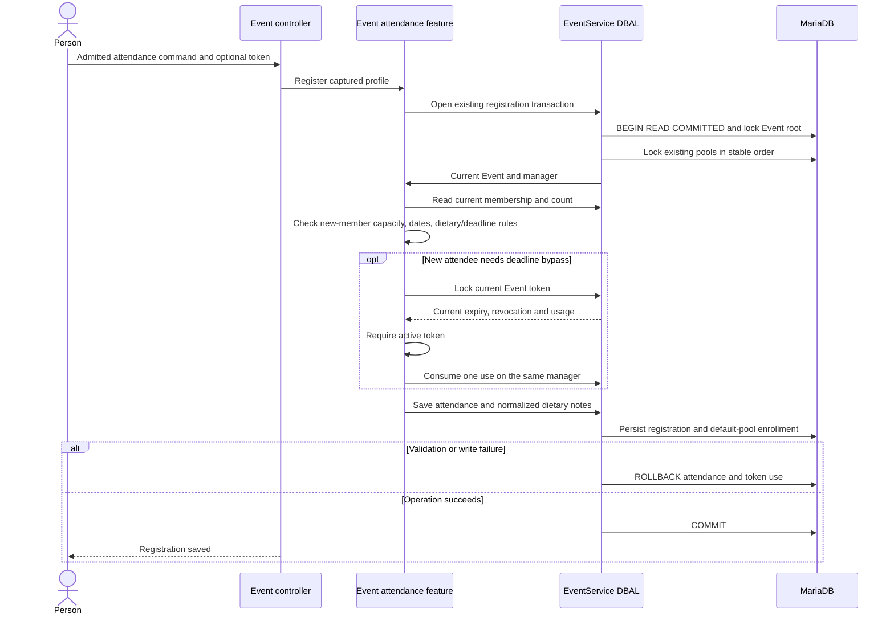

Source owners: [`registration.ts`](../../../src/backend/modules/event/registration.ts), [`EventService.ts`](../../../src/backend/modules/database/services/EventService.ts), [`eventController.ts`](../../../src/backend/controller/eventController.ts), [`event-api.spec.ts`](../../../tests/integration/event-api.spec.ts).

### Trust boundaries and private data flow

*Flowchart diagram.* Transport evidence, identity, page admission, method permissions and private projections are separate checks. This is a conceptual boundary map; upload-specific authorization can precede multipart decoding. Public assets bypass session middleware; private images/proofs/exports retain their route-specific owners.

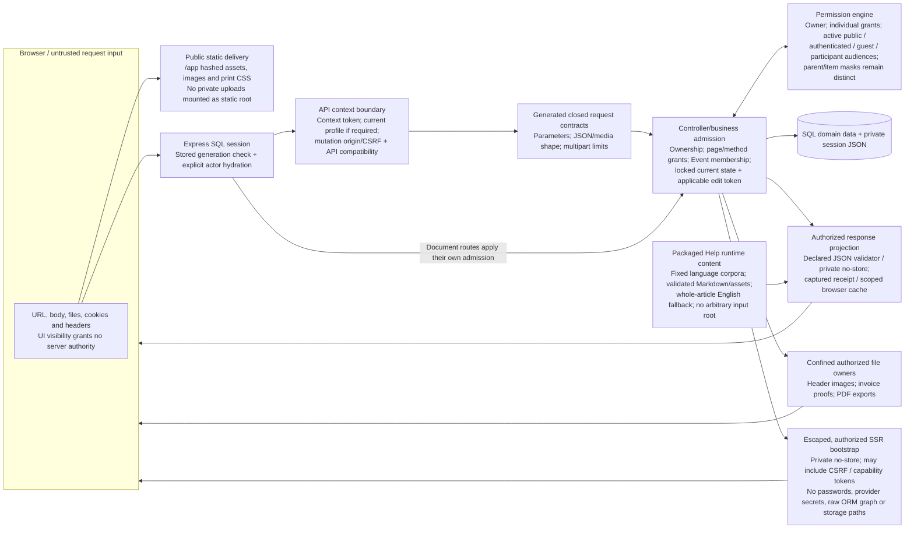

Source owners: [`src/backend/app.ts`](../../../src/backend/app.ts), [`src/backend/modules/api/session.ts`](../../../src/backend/modules/api/session.ts), [`src/backend/modules/api/transport.ts`](../../../src/backend/modules/api/transport.ts), [`src/backend/modules/permissionEngine.ts`](../../../src/backend/modules/permissionEngine.ts), [`src/backend/modules/lib/fileCommons.ts`](../../../src/backend/modules/lib/fileCommons.ts), [`src/backend/controller/helpController.ts`](../../../src/backend/controller/helpController.ts), [`src/frontend/app/serializeBootstrap.ts`](../../../src/frontend/app/serializeBootstrap.ts).

## Activity workflows

### Activity recommendation generation

*Sequence diagram.* Explicit generation and deliberate workspace entry share a bounded process-local coordinator. A worker computes values; the application owns fresh-input and locked persistence checks. Ordinary status polling never dispatches work.

```mermaid
sequenceDiagram
    autonumber
    actor Browser
    participant API as Activity API and controller
    participant Queue as Process-local coordinator
    participant Engine as Worker thread / pure allocator
    participant Owner as Activity business operation
    participant DB as TypeORM and SQL database
    Browser->>API: POST auto generation / deliberate workspace entry
    API->>API: Capture actor, validate contract, authorize plan
    API->>Owner: Check assignment mode and saved stay requirements
    Owner->>Queue: Enqueue canonical plan ID
    alt Active job already exists
        Queue-->>API: Existing job and coalesced=true
    else Waiting queue has 500 entries
        Queue-->>API: Queue-full rejection, retry after 5 seconds
    else New job admitted
        Queue->>Queue: Publish QUEUED record and schedule drain
        Queue-->>API: New job ID
    end
    API-->>Browser: Job accepted: 202 explicit / 200 workspace entry
    Note over Queue,Engine: One sequential runner, records and cache live in this Node process
    Queue->>Owner: Load current allocation snapshot
    Owner->>DB: Read plan, slots, requirements, participants and linked commitments
    DB-->>Owner: Captured inputs
    Owner-->>Queue: Allocation snapshot
    Queue->>Queue: RUNNING, hash allocation inputs and review memory
    alt Matching result cache exists
        Queue->>Queue: Reuse calculation result
    else Calculation required
        Queue->>Engine: Serialized captured inputs
        Note over Engine: Compiled runtime uses worker_threads.<br/>Source fallback yields once, then computes on main thread.
        Engine-->>Queue: Recommendation candidates or calculation error
    end
    Queue->>Owner: Reload snapshot and compare fingerprint
    alt Inputs changed or job invalidated
        Queue->>Queue: Mark STALE, do not persist
    else Inputs still match
        Queue->>Owner: Save generated recommendations with expected context
        Owner->>DB: BEGIN, lock current event / plan context
        Owner->>Owner: Recheck event, dates, current-job callback and fingerprint
        Owner->>DB: Replace generated pending rows, retain manual and review history
        DB-->>Owner: COMMIT
        Owner-->>Queue: Persistence confirmed
        Queue->>Queue: Cache result and mark COMPLETE
    end
    Note over Queue,DB: Errors become FAILED, context conflicts become STALE.<br/>Invalidation fences writes but does not stop CPU calculation.
    Browser->>API: GET job status
    API->>Queue: Read job only within authorized originating plan
    Queue-->>API: Current job view
    API-->>Browser: QUEUED / RUNNING / COMPLETE / FAILED / STALE
    Note over Queue: Terminal records/cache expire after 10 minutes.<br/>Process restart loses queue and status, persisted recommendations remain.
```

Source owners: [`src/backend/routes/api/v1/activity.ts`](../../../src/backend/routes/api/v1/activity.ts), [`src/backend/controller/activityController.ts`](../../../src/backend/controller/activityController.ts), [`src/backend/modules/activity/autoAssignment.ts`](../../../src/backend/modules/activity/autoAssignment.ts), [`src/backend/modules/activity/recommendationJobs.ts`](../../../src/backend/modules/activity/recommendationJobs.ts), [`src/backend/modules/activity/recommendationWorker.ts`](../../../src/backend/modules/activity/recommendationWorker.ts), [`src/backend/modules/activity/fairAssignment.ts`](../../../src/backend/modules/activity/fairAssignment.ts), [`src/backend/modules/database/services/ActivityService.ts`](../../../src/backend/modules/database/services/ActivityService.ts), [`src/backend/modules/database/services/ActivityRecommendationService.ts`](../../../src/backend/modules/database/services/ActivityRecommendationService.ts).

### Activity recommendation review and application

*Sequence diagram.* Warning preview, review persistence and assignment application are separate actions. The apply operation locks the authoritative context and commits review history and all applicable assignment changes together. Optional suggestion refresh follows that commit.

```mermaid
sequenceDiagram
    autonumber
    actor Browser
    participant API as Activity API and controller
    participant Review as Recommendation business owner
    participant DBAL as Activity DBAL
    participant DB as SQL database
    Browser->>API: Preview draft recommendation warnings
    API->>Review: Authorized draft, actor and current plan
    Review->>DBAL: Read-only snapshot
    DBAL->>DB: Load current proposals, assignments and linked commitments
    Review->>Review: Project final occupancy, eligibility and overlap evidence
    Review-->>Browser: Safe warnings and opaque overlap-confirmation digest
    opt Save review without applying
        Browser->>API: Save reviewed draft
        API->>Review: Resolve saved IDs / operation provenance
        Review->>DBAL: Transaction, lock and recheck event / dates
        Review->>DB: Persist review while retaining applied and generated-rejection history
        DB-->>Review: COMMIT
    end
    Browser->>API: Apply approved recommendations with confirmation
    API->>Review: Authorized current draft and captured actor
    Review->>DBAL: Start application transaction
    DBAL->>DB: BEGIN, lock event / plan context
    Review->>Review: Recompute applicability and validate overlap digest
    Review->>DB: Persist supplied review state
    Review->>DB: Lock referenced slots and assignments
    Review->>Review: Recheck ownership, participation, capacity and final occupancy
    Note over Review,DB: Plan all source removals before target additions,<br/>reciprocal swaps are checked as one final state.
    Review->>DB: Apply assignments and mark persisted applied rows APPLIED
    Review->>API: Prepare all complete serialized response variants
    DB-->>Review: COMMIT
    opt Required mode after binding deadline and changes applied
        Review->>Review: Generate fresh suggestions in a separate guarded operation
        Note over Review: Refresh success/failure cannot replay or reject committed assignments.
    end
    Review-->>API: Committed summary plus generation outcome
    API-->>Browser: Select already prepared result variant
```

Source owners: [`src/backend/routes/api/v1/activity.ts`](../../../src/backend/routes/api/v1/activity.ts), [`src/backend/modules/activity/recommendations.ts`](../../../src/backend/modules/activity/recommendations.ts), [`src/backend/modules/activity/autoAssignment.ts`](../../../src/backend/modules/activity/autoAssignment.ts), [`src/backend/modules/database/services/ActivityService.ts`](../../../src/backend/modules/database/services/ActivityService.ts), [`src/backend/modules/database/services/ActivityRecommendationService.ts`](../../../src/backend/modules/database/services/ActivityRecommendationService.ts).

### Activity generation job states

*State diagram.* These are process-local job states, separate from persisted recommendation review states. Invalidation leaves an explicit stale polling result and may admit a replacement job while the old worker finishes.

```mermaid
stateDiagram-v2
    direction LR
    [*] --> QUEUED: New job admitted
    QUEUED --> QUEUED: Same plan coalesces
    QUEUED --> RUNNING: Single runner starts
    QUEUED --> STALE: Plan context invalidated
    RUNNING --> COMPLETE: Fresh inputs and locked persistence commit
    RUNNING --> STALE: Fingerprint changed / context invalidated
    RUNNING --> FAILED: Load, compute or persistence error
    COMPLETE --> [*]: TTL or terminal-record eviction
    FAILED --> [*]: TTL or terminal-record eviction
    STALE --> [*]: TTL or terminal-record eviction
    note right of RUNNING
      One job runs at a time.
      CPU work is not cancelled by invalidation.
      Persisted recommendations have a separate lifetime.
    end note
    note right of STALE
      Old record remains visible for polling.
      A new explicit generation may enqueue a replacement.
    end note
```

Source owners: [`src/backend/modules/activity/recommendationJobs.ts`](../../../src/backend/modules/activity/recommendationJobs.ts), [`src/backend/modules/activity/autoAssignment.ts`](../../../src/backend/modules/activity/autoAssignment.ts).

### Persisted recommendation status and workspace handling

*Flowchart diagram.* The persisted model combines status with manual/hidden flags and operation provenance. The diagram shows ordinary application flows rather than asserting a restrictive state machine: review saves accept the declared status values and retain protected history.

```mermaid
flowchart LR
    Generated["Generated candidates"]
    Manual["New manual draft"]
    Pending["PENDING"]
    Approved["APPROVED"]
    Rejected["REJECTED<br/>generated rejection memory"]
    Applied["APPLIED<br/>retained hidden history"]
    Removed["Row omitted / removed"]
    Workspace["Deliberate workspace entry<br/>maintains saved proposals"]
    Generated -->|"new candidates"| Pending
    Generated -->|"same rejected participant / target"| Rejected
    Manual --> Pending
    Pending <-->|"review save"| Approved
    Pending -->|"reject generated"| Rejected
    Approved -->|"reject generated"| Rejected
    Pending -->|"reject manual"| Removed
    Approved -->|"reject manual"| Removed
    Approved -->|"locked successful apply"| Applied
    Workspace -->|"operation already fulfilled"| Applied
    Workspace -->|"obsolete pending reassignment"| Removed
    Workspace -->|"obsolete approved reassignment"| Rejected
    Rejected -.->|"preserved through generation and later review saves"| Rejected
    Applied -.->|"omitted history merged back on save"| Applied
    Operations["Operations: ASSIGN / UNASSIGN / REASSIGN<br/>Each row retains plan-owned target, profile and optional source"]
    Operations -.-> Pending
```

Source owners: [`src/backend/modules/activity/recommendations.ts`](../../../src/backend/modules/activity/recommendations.ts), [`src/backend/modules/activity/autoAssignment.ts`](../../../src/backend/modules/activity/autoAssignment.ts), [`src/backend/modules/database/entities/activity/ActivityAssignmentRecommendation.ts`](../../../src/backend/modules/database/entities/activity/ActivityAssignmentRecommendation.ts), [`src/backend/modules/database/services/ActivityRecommendationService.ts`](../../../src/backend/modules/database/services/ActivityRecommendationService.ts).

## Finance and file workflows

### Finance calculation and notification

*Sequence diagram.* Read-only preview and committed calculation share the allocation engine. The close/recalculate command rechecks its captured revision under the pool lock, then saves shares, carried signed settlements and provenance together. Notification delivery follows commit and does not change business success.

```mermaid
sequenceDiagram
    autonumber
    actor Browser
    participant API as Finance API adapter
    participant Owner as Event pool business owner
    participant Calc as Pure allocation / settlement projection
    participant DBAL as Invoice DBAL
    participant DB as SQL database
    participant SMTP as External SMTP
    Browser->>API: GET pool preview
    API->>Owner: Current actor, validated input and organizer admission
    Owner->>DBAL: Load pool and its relations
    DBAL->>DB: Read pool relations in repeatable-read snapshot
    DB-->>Owner: Pool revision, invoices, assignments and saved shares
    Owner->>DBAL: Read current event participants / registrations
    Owner->>Calc: Build allocations, provenance and projected settlement credits
    Calc-->>Owner: Read-only preview with saved revision
    Owner-->>Browser: Validated preview, no financial writes
    Browser->>API: POST close / recalculate with reviewed revision
    API->>API: Context / CSRF / compatibility, input validation, prepare fixed receipt
    API->>Owner: Authorize action on current Event and pool
    Owner->>DBAL: Reload pool plus current participants / registrations
    Owner->>Calc: Calculate gross shares and numeric explanation
    Calc-->>Owner: Proposed allocation payloads
    Owner->>Owner: Compare supplied preview revision with loaded revision
    Owner->>DBAL: Commit calculation against loaded pool revision
    DBAL->>DB: BEGIN READ COMMITTED, pessimistic pool lock
    DBAL-->>Owner: Locked current pool and same transaction manager
    alt Revision or lifecycle no longer matches
        Owner->>DBAL: Reject before replacing allocations
        DBAL->>DB: ROLLBACK
        API-->>Browser: Declared rejection, saved shares unchanged
    else Current calculation admitted
        Owner->>DB: Read current registrations, invoices and prior shares
        Owner->>Calc: Carry signed settlements / refunds, project replacement shares
        Calc-->>Owner: New balances and responsibility-change evidence
        Owner->>DB: Replace shares, capture input snapshot and numeric provenance
        Owner->>DB: Set CLOSED, clear stale flag, increment revision, refresh totals
        DB-->>DBAL: COMMIT
        DBAL-->>Owner: Exact applied shares and snapshot
        Owner->>Owner: Prepare notices for actual applied coverage / responsibility changes
        opt Calculation email preference or explicit override enables bulk notices
            Owner->>DBAL: Reload saved settlement only at expected resulting revision
            DBAL-->>Owner: Saved shares and current recipient contacts
        end
        Owner->>SMTP: Queue prepared notices after commit
        Note over Owner,SMTP: Notification delivery follows the financial commit.<br/>Delivery failure cannot reject the saved calculation.
        Owner-->>API: Calculation confirmed
        API-->>Browser: Prepared changed=true receipt
    end
    Note over Browser,DB: Pool-local input rollback keeps saved shares and payment history.<br/>A lost HTTP reply is an unknown outcome, not rollback evidence.
```

Source owners: [`src/backend/routes/api/v1/finance.ts`](../../../src/backend/routes/api/v1/finance.ts), [`src/backend/controller/eventPoolController.ts`](../../../src/backend/controller/eventPoolController.ts), [`src/backend/modules/invoice/calculation.ts`](../../../src/backend/modules/invoice/calculation.ts), [`src/backend/modules/invoice/poolOperations.ts`](../../../src/backend/modules/invoice/poolOperations.ts), [`src/backend/modules/invoice/settlements.ts`](../../../src/backend/modules/invoice/settlements.ts), [`src/backend/modules/invoice/notifications.ts`](../../../src/backend/modules/invoice/notifications.ts), [`src/backend/modules/database/services/EventInvoiceService.ts`](../../../src/backend/modules/database/services/EventInvoiceService.ts).

### Invoice pool lifecycle

*State diagram.* Pool financial closure is independent of individual invoice closure. OPEN and ORGANIZER_ONLY are uncalculated submission-access states; a calculated pool remains CLOSED through edits, recalculation and input rollback.

```mermaid
stateDiagram-v2
    direction LR
    [*] --> OPEN: Create with participant submissions
    [*] --> ORGANIZER_ONLY: Create with participant submissions disabled
    OPEN --> ORGANIZER_ONLY: Change submission access
    ORGANIZER_ONLY --> OPEN: Change submission access
    OPEN --> CLOSED: Calculate and commit shares
    ORGANIZER_ONLY --> CLOSED: Calculate and commit shares
    CLOSED --> CLOSED: Recalculate against current revision
    CLOSED --> CLOSED: Input change sets needsRecalculation
    CLOSED --> CLOSED: Restore pool-local snapshot inputs
    note right of CLOSED
      Saved shares and signed settlements survive input edits.
      Recalculation replaces allocations and carries settlements.
      Snapshot input restoration does not reopen the pool
      or undo external attendance / invoice changes.
      A stale revision rejects before replacing shares.
    end note
```

Source owners: [`src/backend/modules/database/entities/event/EventInvoicePool.ts`](../../../src/backend/modules/database/entities/event/EventInvoicePool.ts), [`src/backend/modules/invoice/poolOperations.ts`](../../../src/backend/modules/invoice/poolOperations.ts), [`src/backend/modules/invoice/state.ts`](../../../src/backend/modules/invoice/state.ts), [`src/backend/controller/eventPoolController.ts`](../../../src/backend/controller/eventPoolController.ts), [`src/backend/modules/invoice/settlements.ts`](../../../src/backend/modules/invoice/settlements.ts).

### Individual invoice lifecycle

*State diagram.* Invoice review/closure is a separate state dimension from the pool. Submitted evidence is retained through rejection/retraction; policy-controlled retention or business-record cascade is the separate deletion boundary.

```mermaid
stateDiagram-v2
    direction LR
    [*] --> NEW: Participant submission to OPEN pool
    [*] --> APPROVED: Authorized organizer cost entry
    NEW --> APPROVED: Organizer accepts with optional corrections
    NEW --> REJECTED: Organizer rejects with reason
    NEW --> RETRACTED: Submitter retracts before review
    APPROVED --> CLOSED: Close accepted invoice
    APPROVED --> APPROVED: Confirmed correction; preserve original evidence
    CLOSED --> CLOSED: Confirmed correction; preserve original evidence
    APPROVED --> REJECTED: Confirmed removal from counted costs
    CLOSED --> REJECTED: Confirmed removal from counted costs
    note right of APPROVED
      APPROVED and CLOSED invoices count in calculations.
      Counted-cost edits mark calculated pools stale.
      Invoice closure itself does not replace pool shares.
    end note
    note right of REJECTED
      Rejection keeps original amount, description and proof.
      Retraction also retains evidence.
      Retention and cascades are separate from review status.
    end note
```

Source owners: [`src/backend/modules/database/entities/event/EventInvoice.ts`](../../../src/backend/modules/database/entities/event/EventInvoice.ts), [`src/backend/modules/invoice/invoiceOperations.ts`](../../../src/backend/modules/invoice/invoiceOperations.ts), [`src/backend/modules/invoice/state.ts`](../../../src/backend/modules/invoice/state.ts), [`src/backend/modules/invoice/retention.ts`](../../../src/backend/modules/invoice/retention.ts), [`src/backend/controller/eventPoolController.ts`](../../../src/backend/controller/eventPoolController.ts).

### Invoice proof ownership and recovery

*State diagram.* Durable proof ledger state survives business-record cascades. Normal upload/attachment/cleanup and explicit offline historical reconciliation share row fences. Recovery states are not automatically deleted.

```mermaid
stateDiagram-v2
    direction LR
    [*] --> STAGED: Durable reservation before disk stream opens
    STAGED --> ATTACHED: Invoice and proof attach commit together
    STAGED --> DELETING: No active upload or live reference
    ATTACHED --> DELETING: Invoice reference removed; no other owner
    DELETING --> DELETING: Failure retains retryAt backoff
    DELETING --> [*]: Unlink or confirmed absence, then remove ledger
    [*] --> QUARANTINING: Explicit offline manifest selects historical orphan
    QUARANTINING --> QUARANTINED: Verified transfer completes
    QUARANTINED --> RESTORING: Explicit restore
    RESTORING --> PRESERVED: Verified transfer completes
    PRESERVED --> QUARANTINING: Explicit reselection in same manifest
    QUARANTINED --> DELETING: Explicit purge after recovery window
    note right of STAGED
      Boot owner plus activeUploads protects current work.
      This ownership scheme assumes one app process.
      Attachment locks the ledger in the invoice transaction.
    end note
    note right of DELETING
      Commit deletion intent before filesystem I/O.
      Live references and alias ownership protect bytes.
      Physical deletion precedes ledger removal.
    end note
    note right of QUARANTINED
      Manifest binds configured root and database.
      File identity and content hashes are checked.
      Automatic cleanup ignores recovery/preserved states.
    end note
```

Source owners: [`src/backend/modules/invoice/proofs.ts`](../../../src/backend/modules/invoice/proofs.ts), [`src/backend/modules/database/entities/event/InvoiceProofFile.ts`](../../../src/backend/modules/database/entities/event/InvoiceProofFile.ts), [`src/backend/modules/database/services/EventInvoiceService.ts`](../../../src/backend/modules/database/services/EventInvoiceService.ts), [`src/types/InvoiceProofTypes.d.ts`](../../../src/types/InvoiceProofTypes.d.ts), [`scripts/reconcile-invoice-proofs.ts`](../../../scripts/reconcile-invoice-proofs.ts).

### Invoice retention and proof cleanup ordering

*Sequence diagram.* Startup catch-up and the hourly maintenance pass remove expired invoice records under pool locks before attempting physical proof deletion. Proof cleanup is durable, bounded and retryable. Entity archival is a separate metadata-only job.

```mermaid
sequenceDiagram
    autonumber
    participant Startup as Startup / hourly timer
    participant Retention as Invoice retention owner
    participant DBAL as Invoice DBAL
    participant DB as SQL database
    participant Proof as Proof lifecycle owner
    participant Disk as Invoice proof directory
    Startup->>Retention: Run retention pass
    Retention->>DBAL: Select expired invoice candidates by event date / calendar months
    DBAL-->>Retention: Invoices grouped by owning pool
    Retention->>Proof: Remember legacy proof ownership before row deletion
    Proof->>DB: Ensure durable ledger references
    loop Each pool
        Retention->>DBAL: Locked pool transaction
        DBAL->>DB: BEGIN, lock pool
        Retention->>DB: Delete selected invoices, advance revision / aggregates
        DB-->>Retention: COMMIT
        Retention->>Proof: Attempt postcommit cleanup for selected proofs
    end
    Retention->>Proof: Scan next bounded ledger page
    loop Each selected proof
        Proof->>DB: Lock ledger, verify no live references or active ownership
        Proof->>DB: Commit DELETING intent
        Proof->>Disk: Unlink within configured directory
        alt Removed or already absent
            Proof->>DB: Remove completed ledger record
        else Filesystem / database failure
            Proof->>DB: Retain ownership and exponential retry backoff
        end
    end
    Retention-->>Startup: Complete pass, failures logged / retained for retry
    Note over Startup,DB: Separate archival job changes archive metadata only.<br/>Archive / restore does not trigger proof deletion.
```

Source owners: [`src/backend/server.ts`](../../../src/backend/server.ts), [`src/backend/modules/invoice/retention.ts`](../../../src/backend/modules/invoice/retention.ts), [`src/backend/modules/invoice/proofs.ts`](../../../src/backend/modules/invoice/proofs.ts), [`src/backend/modules/lib/util.ts`](../../../src/backend/modules/lib/util.ts), [`src/backend/modules/entityArchival.ts`](../../../src/backend/modules/entityArchival.ts), [`src/backend/modules/database/services/EventInvoiceService.ts`](../../../src/backend/modules/database/services/EventInvoiceService.ts).

## Application lifecycle and delivery

### Entity lifecycle and personal visibility

*Flowchart diagram.* Archival changes metadata and overview placement; it does not revoke access or delete files. A linked parent Event contributes effective archive state at read time. Personal visibility is independent of lifecycle.

```mermaid
flowchart LR
  Active["Root archive marker absent"]
  Archived["Root archive marker present"]
  Parent["Linked Event archive marker<br/>Packing / Drivers / Activity only"]
  Effective["Effective archived = root OR parent"]
  Schedule["Startup + hourly automatic eligibility<br/>Event and standalone Activity periods;<br/>enabled and not paused"]
  Preference["Per-profile visibility<br/>default / shown / hidden"]
  Placement["Overview placement<br/>hidden OR default-and-effectively-archived<br/>→ collapsed; shown → active"]
  Delete["Explicit permanent delete<br/>Separate grants and service operation"]
  Gone["Rows removed with declared cascades<br/>Proof ledger survives for later cleanup"]
  Active -->|"Authorized archive"| Archived
  Archived -->|"Authorized restore; parent must be active;<br/>pause own independent auto schedule"| Active
  Schedule -->|"Archive eligible rows"| Archived
  Active --> Effective
  Archived --> Effective
  Parent --> Effective
  Effective --> Placement
  Preference --> Placement
  Active --> Delete
  Archived --> Delete
  Delete --> Gone
```

Source owners: [`src/backend/modules/archive/policy.ts`](../../../src/backend/modules/archive/policy.ts), [`src/backend/modules/entityArchival.ts`](../../../src/backend/modules/entityArchival.ts), [`src/backend/modules/database/services/EntityLifecycleService.ts`](../../../src/backend/modules/database/services/EntityLifecycleService.ts), [`src/backend/modules/database/entities/archive/EntityVisibilityPreference.ts`](../../../src/backend/modules/database/entities/archive/EntityVisibilityPreference.ts), [`src/backend/modules/invoice/proofs.ts`](../../../src/backend/modules/invoice/proofs.ts).

### Build and release architecture

*Flowchart diagram.* Generated outputs are runtime dependencies, with separate browser and server consumers. CI verifies the application; release packaging prepares the runtime archive. Installation and schema operations follow the Database and Operations guides.

```mermaid
flowchart LR
  Contracts["Authored OpenAPI YAML<br/>13 source files; 237 operations"]
  Catalogs["Authored locale catalogs + invoice wording<br/>and permission definitions"]
  Model["Entity + migration source"]
  APIgen["generate-api.mjs<br/>Redocly + openapi-typescript + Ajv"]
  LocaleGen["generate-locales.mjs"]
  IndexGen["genTypeormIdx.ts"]
  Generated["Ignored generated owners<br/>API declarations / operation metadata / standalone validators;<br/>domain choices and credential limits;<br/>locale resources/types/permissions;<br/>ORM entity/migration/subscriber inventory"]
  TS["tsc backend build + contract copy"]
  Vite["Vite browser + SSR builds<br/>Public-source boundary + typecheck;<br/>hashed assets, manifests, gzip/Brotli"]
  Copy["Sass print + Pug/images build copy<br/>Fonts copied during release packaging"]
  Bundle["Release payload<br/>dist/backend + dist/api-contracts<br/>dist/public/app + dist/frontend-server<br/>export views, fonts and packaged Help"]
  CI["CI independent jobs<br/>Database-free Vitest + typecheck;<br/>same-checkout build then MariaDB integration;<br/>literal-schema CI account grants;<br/>built client browser + built app E2E;<br/>reports and Sonar"]
  Release["Manual release after CI<br/>Application build and production package/lock<br/>Versioned source, tag and runtime archive<br/>GitHub release"]
  Install["Operator installation<br/>Configure settings, SQL and private storage;<br/>apply required schema setup/migrations;<br/>run Node dist/backend/server.js"]
  Contracts --> APIgen --> Generated
  Catalogs --> LocaleGen --> Generated
  Model --> IndexGen --> Generated
  Generated --> TS
  Generated --> Vite
  TS --> Bundle
  Vite --> Bundle
  Copy --> Bundle
  CI --> Release
  Bundle --> Release --> Install
```

Source owners: [`package.json`](../../../package.json), [`scripts/generate-api.mjs`](../../../scripts/generate-api.mjs), [`scripts/generate-locales.mjs`](../../../scripts/generate-locales.mjs), [`scripts/genTypeormIdx.ts`](../../../scripts/genTypeormIdx.ts), [`vite.config.mts`](../../../vite.config.mts), [`.github/workflows/ci.yml`](../../../.github/workflows/ci.yml), [`.github/workflows/release.yml`](../../../.github/workflows/release.yml), [`src/backend/modules/frontendBoundary.ts`](../../../src/backend/modules/frontendBoundary.ts).

### Deployment and startup lifecycle

*Flowchart diagram.* Application topology and startup order derived from executable configuration. Production proxy, TLS, service management and recovery requirements are maintained in the Operations guide. Process-local proof ownership and jobs use the established single-application-process model.

```mermaid
flowchart LR
  Config["settings.csv + environment<br/>Environment overrides CSV; settings owner"]
  DB[("Configured MariaDB / MySQL-family database<br/>Migrations separate from runtime;<br/>synchronize=false on app startup")]
  Files[("Application filesystem<br/>dist, fonts, Help payload;<br/>invoice and header image directories")]
  Runtime["One active Node application<br/>Read settings → initialize DB<br/>→ invoice retention/proof cleanup catch-up<br/>→ archive catch-up<br/>→ construct Express<br/>→ initialize development/SSR definitions<br/>→ HTTP listen"]
  Browser["Browser<br/>Configured public root URL / same origin"]
  Timer["Two independent hourly timers<br/>Local process schedule + task-specific overlap rules"]
  Thread["One lazy allocation worker thread<br/>Local queue/cache/status"]
  External["SMTP and optional OIDC provider"]
  Dev["Development only<br/>Source ts-node + nodemon<br/>Vite middleware/HMR WebSocket<br/>input watcher / atomic generation readiness"]
  Offline["Offline operator tools<br/>Settings-aware migration wrapper;<br/>proof inventory/quarantine/restore/purge"]
  Config --> Runtime
  Runtime <--> DB
  Runtime <--> Files
  Browser <--> Runtime
  Runtime --> Timer
  Runtime <--> Thread
  Runtime <--> External
  Dev -.-> Runtime
  Config --> Offline
  Offline --> DB
  Offline --> Files
```

Source owners: [`src/backend/server.ts`](../../../src/backend/server.ts), [`src/backend/app.ts`](../../../src/backend/app.ts), [`src/backend/modules/settings.ts`](../../../src/backend/modules/settings.ts), [`src/backend/modules/database/dataSource.ts`](../../../src/backend/modules/database/dataSource.ts), [`src/backend/modules/activity/recommendationJobs.ts`](../../../src/backend/modules/activity/recommendationJobs.ts), [`src/backend/modules/invoice/proofs.ts`](../../../src/backend/modules/invoice/proofs.ts), [`scripts/runMigration.ts`](../../../scripts/runMigration.ts), [`scripts/reconcile-invoice-proofs.ts`](../../../scripts/reconcile-invoice-proofs.ts), [`scripts/watch-frontend-inputs.mjs`](../../../scripts/watch-frontend-inputs.mjs).
