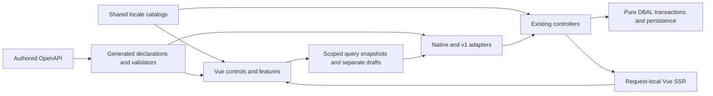

# Frontend foundation design
<!--
documentation-metadata
audience: maintainers; frontend developers; API developers; migration reviewers
owner: frontend migration maintainers
status: migration-pending
last-verified: 2026-10-15
verification-baseline: docs-baseline-2026-09-06-d14
verification-scope: native-isolation decision/history and implemented frontend-owned timer/style delivery reconciled; prior amendments and execution retain their scopes; no full migration or cutover claimed
source-anchors: docs/frontend-migration/FRONTEND_MIGRATION_BASELINE.md; docs/frontend-migration/FRONTEND_PILOT.md; docs/frontend-migration/; contracts/api/v1/; src/controller/; src/modules/database/services/; src/frontend/; src/modules/frontendPilotRenderer.ts; src/modules/frontendDevelopment.ts; src/types/; package.json; vite.config.mts; .github/workflows/ci.yml
next-review: next-migration-slice-or-authorized-cutover
-->

Surveyor's target frontend is Vue 3 and TypeScript with Vite, Vue Router and TanStack Vue Query. Authored OpenAPI
generates shared declaration types and runtime validators; shared language catalogs serve browser and server.
Express retains HTTP/session ownership. Existing controllers own business decisions and pure DBAL services own
queries, transactions, locks and persistence.

The [baseline](FRONTEND_MIGRATION_BASELINE.md) and its 121 edge-case IDs describe the native contract.
The original step-two design was based on `0a3662ae0a6e99e0df0a38f603831d3ac9ff4b61`; the native comparison reference
is `2dfa2573c64178f54684cc4877b5a945f66e24c8`. The reference does not identify a deployed site's version.
Help/Packing and necessary entry/foundation behavior are the current completeness obligation; other feature
migration and default-route cutover remain future work.

## Original decisions and dated amendments

Keep original choices visible when recording an amendment. An alternative described by a design document,
passing tests or an implementation spike cannot authorize a technology substitution.

| Original choice | Current direction and recorded amendment |
|---|---|
| Vue/TypeScript, Vite, Router, Vue Query | Retained. Express-hosted Vite middleware/HMR supplies normal development; manual-refresh watch builds were a spike deviation, subsequently corrected. |
| i18next with i18next-vue | Retained. The original thin provide/inject alternative was conditional on the selected binding failing its proof; D1 restores the primary binding after an unapproved substitution. |
| Authored OpenAPI 3.1; generated declarations and Ajv standalone validators | Retained. One root package/lockfile; no handwritten copies of wire shapes, second validation language or runtime schema compilation. |
| Reusable Bootstrap-compatible controls with suitable Reka primitives | Retained. Dialogs/tabs use Reka; mixed native navigation disclosures have a documented fit assessment in the framework record. |
| Same-component scoped SSR/hydration for established fallbacks | SSR/hydration remains the rendering architecture. Oct8 supersedes mandatory interactive no-JavaScript operation; the refined Req6A amendment below replaces initial interactive controls with shared skeletons while preserving genuinely functional static content. |
| Monotonic Packing revision and retained old fingerprinted assets | Revisions detected changes away and back; retained assets let loaded clients fetch earlier release chunks. D2 and D5 below explicitly supersede those choices and retain their bounded tradeoffs. |
| Existing controller/business owners and pure DBAL | Retained and strengthened by the current shared-backend correction. Transport adapters must not become separate policy owners. |
| Enable a complete interface catalog without requiring a translated Help corpus | The earlier pilot required complete localized Help instead. The direct Oct12 decision restores English fallback for missing localized content and requires visible disclosure; complete localized Help remains the preferred outcome. |

### Authorized rectification (2026-10-07)

The existing decision ledger records maintainer approval of D1–D5. Preserve these amendments and their effects;
the [review](PILOT_PARITY_REVIEW.md) distinguishes recorded authorization from execution evidence.

| Decision | Approved behavior |
|---|---|
| D1: translation integration | Restore i18next-vue around the typed shared i18next translator; prove request isolation, hydration and reactive locale changes. |
| D2: concurrent changes | Replace unreleased Packing revision columns with touched-current-value comparisons under existing locks, including useful setup fields. Preserve unrelated changes and drafts; retain atomic capacity/assignment checks. No relationship revision history or live-editing infrastructure. |
| D3: contract version | Correct unreleased v1 in place, without another pilot API version. |
| D4: uncertain commands | Reconcile through reads without operation tracking or automatic replay. A read cannot determine the outcome of an unknown creation; retain input and explicit review/acknowledged departure. |
| D5: replacing a release | Support current-binary-folder replacement without old assets or additional operator steps. Session refresh detects updates; compatible edits may finish, an idle clean view reloads once, and missing chunks/incompatible commands retain mounted drafts. |

D2 tokens describe current values rather than a monotonic history. A value changed away and back can therefore
match an earlier comparison. Financial revisions and reviewed recommendation fingerprints retain their separate
guarantees. D5 cannot promise every old browser can submit indefinitely after replacement.

### Authorized migration amendments (2026-10-08)

- Preserve native business behavior and nearly identical UI/UX except for explicit migration amendments.
  Backend changes serve the migration through shared operations, projection and transport.
- Complete Help/Packing and necessary shared entry journeys. Overview and other scaffolds retain explicit TODOs;
  implemented portions still satisfy behavior, modularity and readability requirements.
- Interactive migrated pages require JavaScript and display a clear shared message or genuinely read-only result
  when it is disabled. This supersedes the original interactive fallback and Packing-card-image obligation.
- The original procedure kept prospective maintainer guidance as staged deltas for reconciliation at cutover,
  reconciling intervening changes. Language choice has one global user guide per language.
- Healthy shared reads use a 30-second cadence. Eligible recovery targets convergence within roughly one minute,
  retaining server cooldowns, visibility and observer disposal rather than the earlier generic two-minute delay.

### Authorized progressive delivery amendment (2026-10-08)

This original delivery choice remains recorded. The refined Req6A amendment below replaces its initial interactive
shell with a skeleton until initialization; independently scoped reads and mounted background behavior remain.

Overview SSR waits for session bootstrap and renders the interactive shell. Independent active regions read in
parallel and render as ready; a slow region cannot withhold a ready sibling. Closed hidden regions start on opening.
Unknown membership never claims zero or an empty result.

Use shared skeletons only while required scoped data is missing and pending. Retain readable data and drafts during
background reads; validated denial retires private content. Locale-owned bodies must match the selected language.
Read-only Help retains complete SSR. The renderer makes no self-HTTP requests.

### Authorized parity and shared ownership amendment (2026-10-08)

Entry admission, canonical destinations, forms, confirmed feedback, navigation and departure protection are
shared responsibilities. Feature consumers supply data and existing policies; preserve deliberate exceptions,
including surveys' admission/permission behavior.

The original native duplicate submission returned login to ordinary creation. The approved amendment returns to
the exact entity's duplicate URL through the shared guest-flow owner and all existing creation-form consumers.
It grants no new creation or duplication permission.

### Authorized bounded archival repair (2026-10-12)

The Oct8 deferral of broad locking/race hardening remains. The recorded exception for `IMP-042` retains the prepared
event/standalone-activity automatic-archival deadlock repair: acquire the existing primary root lock before the
conditional write and retain it in the existing transaction. Its cost is one lock read per candidate and an explicit
transaction for standalone activity candidates. Preserve eligibility, pause state, affected-row counts and deletion
boundaries. This is no authority for a wider locking redesign.

### Current approved correction boundary (2026-10-12)

The maintainer directly resolved the reopened review:

- Refactor shared backend behavior inside existing controllers using the migration requirements as the base.
  Native and v1 adapters translate their own requests/results and can be removed independently at retirement.
  Business policy has one owner; no new parallel controller or business service is introduced.
- Define method permissions centrally in the owning controller and make pilot authorization match native behavior.
  Record inherited permission inconsistencies in the native defect backlog; their presence does not authorize an
  unrelated native policy change.
- Preserve native English Help unchanged. Existing new English/German Help becomes reviewed release-owned runtime
  content under `docs/user-guide/en/` and `docs/user-guide/de/`. Staged maintainer resources are never runtime input.
- Keep the explicitly approved exact duplicate-return amendment.

Native behavior, guide prose/assets and unrelated implementation remain the comparison reference.
These specific backend/Help/form corrections grant no default-route cutover or native redesign.
The earlier structural relocation retained separate paths. The full authorized sequence now shares Packing
creation, metadata, item/membership writes, counters and setup through named existing-controller operations,
with central method permission definitions consumed by native/v1. Existing administration/event/image owners
supply their shared operations. Adapter coercion, response/feedback and conditional-write differences remain explicit.
Final acceptance and evidence for the approved coexistence remedy are recorded in the paired review.

### Direct completion and editorial decisions (2026-10-12)

The maintainer authorizes the full reviewed implementation sequence and resolves its two remaining decisions:

- Documentation cleanup is permitted. The freeze prevents pilot behavior from entering live native guidance;
  editorial consolidation may retire completed plans/history and repair references. Technical migration amendments
  remain staged until authorized cutover. Native guide prose/assets remain the visual and behavioral comparator.
- Complete localized Help is preferred for each additional interface language. Missing locale corpora, articles or
  figures fall back to the reviewed pilot English corpus with a visible localized notice and English result markers.
  Keep the chosen interface language; expose the actual content language. The later whole-article amendment below
  supersedes the independent missing-figure fallback. Unsafe existing translated source fails
  validation and is never hidden by fallback. This supersedes the prior implementation's complete-corpus requirement.

This authorization covers the bounded corrections and editorial cleanup; final implementation/evidence is recorded
in the existing review. Unrelated native permission, ordering or layout defects still require direct approval.

### Explicit canonical-location and action decisions (2026-10-12)

The maintainer restores all user Help to `docs/user-guide/`, with native root files beside localized catalog directories.
The first correction applied a mistaken directory name without resolving its conflict with the existing canonical
path. The subsequent explicit maintainer correction restores the original name and requires concrete conflict
inspection, measurable engineering checks and reviewed agent compliance. Cleanup explicitly removes the unused
obsolete controls illustration and the maintainer-only Activity Help paragraph; it grants no UI redesign.
The separate pilot Help destination was unauthorized; it is removed rather than treated as an approved design change.
Policies, ADRs, backlog, durable feature references and migration-only records now follow their explicitly defined
categories in the [central documentation policy](../policies/DOCUMENTATION_POLICY.md). This is an authorized
classification correction, not a change to the original technology or trusted-release-content choices.

The bounded native assignment root-S-before-item-X remedy is explicitly approved; it retains parallel assignments and
v1 root/reorder protection. The public-action decision preserves native per-method grants where the security/design
review finds no unintended protected-resource access and no prior stricter requirement. The review found no blanket
v1 profile-minimum requirement. Minimal method baselines and admitted context binding avoid exposing broader private
projections; principal-required native operations retain that requirement. Broader permission review/rework is backlog
scope, not authorization to change native policy during this correction. Execution and remaining limits belong to the
[paired review](PILOT_PARITY_REVIEW.md).

### Authorized same-event no-op clarification (2026-10-13)

The maintainer directly resolves the relink-precondition choice raised in the readiness review. Native and v1
requests selecting the already linked event retain the harmless `changed: false` outcome after current source and
target permissions are checked. Comparison-header presence/value is ignored for this no-op, including empty, stale,
weak, wildcard or oversized evidence; it performs no write.
Changed associations still require the expected current relationship and v1 reviewed comparison inside the locks.

This is a bounded exception to the original general required-precondition rule in the
[API design](API_CONTRACT_DESIGN.md#current-value-comparisons-and-conditional-reads). It does not relax authorization,
change native request fields, broaden another no-op policy or authorize default-route cutover. The approved readiness
corrections preserve the native comparator and shared controller/DBAL owners; actual implementation and checks belong
to the [paired review](PILOT_PARITY_REVIEW.md).

### Authorized temporary Packed-state fallback (2026-10-13)

After the pilot review, the maintainer explicitly approved the implementation and current-tab fallback for failed
Packed checklist storage, requiring problems to remain visible. The original native contract remains
`packed_<list UUID>_<item UUID>` with checked value `1`; successful reads still observe external changes and an
actually missing key means unchecked. Native source and behavior remain the comparison reference.

For the pilot only, unavailable or throwing storage retains the last observed or selected check in the mounted
actor/list visit, including outstanding failed toggle writes. Healthy unrelated keys retain their normal reread
behavior. A persistent localized notice explains that some checks could not be loaded or saved and unsaved changes
may be lost when leaving/reloading the list or changing the account/active profile. A failed read does not prove
that its last observed value or a successful write was unpersisted. Explicit Retry reattempts outstanding
browser-storage writes and reads only; background reads never replay them. Keep the notice while reads fail or
writes remain outstanding. Retire the fallback on list/context change, unmount or admitted-resource retirement;
the persisted keys remain profile-independent. It introduces no server persistence, automatic write replay or
promised restoration of unsaved changes after departure. The [refresh owner](REFRESH_CONFLICT_DESIGN.md#state-ownership)
describes its lifetime, and the [paired review](PILOT_PARITY_REVIEW.md) owns executed evidence.

### Authorized command admission clarification (2026-10-13)

The original command contract preserves already admitted work for its captured actor; pending/unknown status may
outlive its editor, and abort is not rollback. The maintainer conditionally approved rejecting a new
`useCommand.run` after its owning component unmounts only if review established a stale-callback defect rather than
a deliberately deferred submission. The production-consumer audit found no supported new dispatch from an unmounted
owner. The existing shared command owner therefore checks its mounted lifetime before capturing feedback, authority
or a new status lease and before invoking the operation.

This admission check does not interrupt work admitted before unmount, including a deferred request, settlement,
follow-up read, unknown-outcome protection or confirmed navigation. Closing a child dialog may leave its command
owner mounted; those deliberate continuations keep their existing checks. History identifies the original missing
guard and the later status-retention correction, but does not establish a deliberate rationale for admitting a new
write from a retired owner. Native behavior, server authorization and existing completion guarantees remain unchanged;
the paired review owns the actual regression evidence and verification scope.

### Authorized startup recovery clarification (2026-10-13)

After the full pilot review and a direct explanation of the startup consequences, the maintainer explicitly instructed
"Implement your full plan" and approved startup recovery. The original same-component SSR contract preserves input
typed before hydration; D5 permits one automatic reload only for a clean idle view. The review found that an initial
route-chunk failure could occur before mounted draft guards and usable recovery controls existed. A consumed reload
marker could prevent deliberate recovery, while ignored attempt-storage failures allowed repeated automatic reloads.
The review reproduced initial input loss and repeating attempts without working storage. No deliberate exception for
losing such input was established by the reviewed history.

The existing startup, mount and update owners protect SSR controls before route loading and keep that protection until
draft restoration finishes. Automatic reload requires demonstrably clean state and working loop protection. If storage
cannot provide that protection, show localized explicit recovery instead. Deliberate recovery may bypass the automatic
attempt marker, but confirms before discarding edited SSR controls and retains pending/unknown command guards.
Recovery reloads the document; it neither persists secrets/files, restores unknown commands nor replays a write.

The same approved plan clears the browser's file input when the feature acknowledges a confirmed header upload;
rejection, unknown delivery and ordinary refresh retain the chosen file. These bounded corrections preserve native
behavior, shared backend owners and prior completion guarantees. They grant no default-route cutover, broader automatic
retry or new framework/service. The [paired review](PILOT_PARITY_REVIEW.md) owns their actual verification and limits.

### Authorized review follow-up requirements (2026-10-13)

The maintainer's subsequent instructions explicitly require strict test-layer ownership, an audit of component value
lifetimes, complete serialized authored-input observation and final mutation commits. These are separate bounded
requirements; they do not erase the original choices or authorize unrelated native changes.

- E2E retains the built application and full setup/database boundary. An isolated real-browser fixture belongs to
  the client layer; using Playwright alone cannot broaden E2E's definition. This resolves the conflict between the
  central layer rule and the staged wording that had admitted isolated source/hydration cases as E2E.
- Reused component controls and feature drafts share an explicit logical value lifetime. The review reproduced a
  creation/duplicate file selection surviving its draft reset; confirmation releases both owners, while a canceled
  departure or unresolved command preserves the live scope's input.
- `src/modules/lib/permissions.ts` is an exact locale-generation dependency. Observe it through its parent alongside
  contracts/catalogs, serialize API then locale generation, and restart Express only after the successful current batch's
  ready marker. Unrelated library changes keep their existing restart behavior. The original omission's rationale is
  undocumented; actual generator consumption establishes the dependency.
- Guest registration must commit the Guest/profile rows, stored guest session and serialized success receipt as one final
  mutation boundary. The maintainer rejects a remedy that checks the session before creation but still leaves a later
  creation-to-session-save failure race. Original reconcile-only and unknown-outcome protections remain required;
  this does not authorize unrelated session redesign, automatic command replay or changed guest expiry/deletion policy.

The same final-commit requirement applies to pilot account creation and one-time activation. The existing
`UserService.withIdentitySessionTransaction` owns the locked connection; the user controller's private
`commitIdentityCompletion` supplies captured-context admission, isolated staging and result preparation.
`registerUserWithSession`, `registerGuestWithSession` and `activateAccountWithSession` reuse that boundary.
Account signup prepares User/profile/token and validated mail/transport results before commit, without changing the
API caller's identity or returning its activation token. Activation prepares its API receipt or document redirect/flash
before consuming the token. SMTP runs after registration commits and selects an already prepared outcome; acceptance
does not promise inbox delivery. The existing native registration/activation compatibility paths remain unchanged.
The refined Req6A decision supersedes the proposed neutral signup-document wording by authorizing retirement of the
unused interactive pilot POST adapters. The API account transaction remains; current adoption and verification of
that adapter retirement belong to the paired review.
The earlier pilot's ordinary identity guard checked stored context before a separate
save; the explicit finality requirement replaces that boundary for login, private guest-link login and profile switching.
`loginUserWithSession`, `loginGuestWithSession` and `changeActiveProfileWithSession` prepare validated replies or existing
document notices/redirects inside the same locked completion owner. Native inactive-account resend remains before the
identity transaction so its refreshed activation token survives the intended login rejection. Their final executed
pilot scopes are owned by the paired review; no universal session compare-and-swap guarantee is established.

Explicit token-free pilot logout now uses `logoutUserWithSession` through the same completion owner. Classification
requires the absence of any truthy `session.tokens` object, including an empty object, and repeats on fresh locked
staging before authority is cleared. Its generated API receipt or document success notice/303 is prepared before the
stored anonymous identity commits, then adopted without another save. Native defaults and every token-bearing
provider path remain unchanged; Req. 7 defers provider failure remediation as a separate general defect. The paired
review owns executed ORM/source acceptance, renewed system evidence and the limits of this bounded adoption.

Token locking currently protects cooperating pilot reset/activation consumers. Independent source scheduling finds
that an earlier native token read can still finish its username-only password update after a pilot commit, or acknowledge
activation through an ID-only update after consumption/reissue. The direct subsequent Req. 8/9 decisions defer those
general behavioral defects to separately authorized backlog work; they are not migration blockers or permission to
change native writers. The existing finality requirement does not approve those native consequences.

`resetPasswordWithSession` currently prepares the API receipt before its locked password/token commit. Its earlier
full SSR completion preserved the submitted URL and 200 success response; that document path is historical after
Req6A retired the unused interactive pilot POST adapters. `requestPasswordResetWithSession` prepares token, mail/templates,
cached sender and generic output/optional flash before commit, then settles captured delivery afterward. Setup does
not connect to SMTP, and the reply adds no account-discovery/delivery metadata. The existing native defaults remain;
the paired review owns the executed pilot-only concurrency, rollback, mail and delivery scopes and their limits.

The defect register retains the implementation findings once, and the [paired review](PILOT_PARITY_REVIEW.md) owns actual execution,
independent review and remaining limits. These requirements grant no default-route cutover or new documentation destination.

### Authorized whole-article Help fallback and migration scope (2026-10-13)

The maintainer explicitly confirms `docs/user-guide/` in Req. 2A. Native root files/assets remain the comparison
reference; new Help stays entirely within its language directories. Req. 2B retains the disclosed English fallback
while superseding the Oct12 permission to replace an individual missing figure: select one complete localized
Markdown article and its own assets, or its complete reviewed English counterpart and that article's English assets.
Never combine translated article text with another language's images. Authored local links cannot explicitly select
another language; logical topic navigation retains the chosen interface locale and may select a whole English article
at its destination. Asset requests never independently fall back. Actual article language and fallback remain visible.
Unsafe, malformed or unreadable existing source still fails through its established caller boundary rather than being
hidden behind a substitute. The same complete-source selection supplies article titles, navigation and search.

The maintainer's Req. 7–9 decisions place provider logout preparation failure, mixed native/pilot password reset and
mixed activation acknowledgement into separate general-defect backlog entries. Their remedies are not approved by
the migration. The [profile boundary](PROFILE.md#native-reference-and-shared-implementation) owns temporary native
comparison and separately scoped general defects. The general [development policy](../policies/DEVELOPMENT_POLICY.md)
continues to own authorization and engineering boundaries. Earlier bounded approvals retain their recorded scope.

### Authorized interactive startup delivery clarification (2026-10-13)

The maintainer explicitly refines and resolves Req6A: interactive initial content uses loading skeletons, genuinely
noninteractive content may remain static, and failed JavaScript loading or initialization must show a clear localized
JavaScript-required notice. No normal-looking dead controls or navigation may remain available after that failure.

Vue SSR and same-tree hydration remain. The existing context classifies initial content through route metadata and
admission/completion state; interactive content stays in the shared skeleton until client initialization completes.
Read-only Help retains working native GET search, article links and anchors. Static messages, native links and
disclosures remain usable, while JavaScript-dependent selectors, actions, Retry and dismissal controls wait for
initialization. Failure presentation exists independently of the client entry module. SSR outputs/dependencies,
request-local state, authorization and the shared/native backend remain unchanged by this delivery decision.

The approved retirement covers the eight unused interactive pilot POST fallback adapters; initialized consumers
already use the existing APIs. Identity/capability/provider admission GETs and native adapters remain. This replaces
the earlier complete interactive-SSR document shape, without rolling back its accepted backend operations.
Existing reload/consent, unknown-command and draft owners continue protecting genuine static early input and mounted
work; warm navigation and background refresh do not discard initialized views or drafts.

This is the single delivery amendment; the paired review owns actual source adoption and executed acceptance.
Earlier interactive-SSR document/startup receipts retain their historical scope and do not certify the new shape.

### Authorized migration-readiness clarification (2026-10-13)

The maintainer directly authorized the reviewed readiness corrections and clarified that preserving native source,
UI and root Help is temporary migration work. Keep that comparator during coexistence, then remove its preservation
obligation at authorized cutover through the single [cutover inventory](#cutover-retirement-inventory).
Do not carry a frozen native/root-corpus requirement into lasting policy or API contracts. Canonical Help location,
trusted release content, shared backend ownership and existing general engineering rules remain applicable.

The same instruction requires short, clear approval explanations with the four existing fields for each individual
decision. Explain the affected user action, proposed change, consequences and relevant history directly. Quotations,
proposed replacement text and diffs are forbidden in approval requests; no mandatory read-back is required.
Original choices and earlier valid approvals remain recorded above.
This amendment authorizes the scoped readiness corrections, not default-route replacement or implementation of
separately deferred general defects.

### Production documentation freeze and verbatim replacement correction (2026-10-13)

The maintainer rejects importing migration changes into production guides without an explicitly requested or
approved production change. The agent initially interpreted this freeze too broadly, restored ten outside-profile
files to pre-task commit `3b6091caff2717fbbd8405d43fe03b51151cb730`, and incorrectly staged governance and runtime Help.
That interpretation was not a maintainer decision; the explicit role clarification below corrects it.
The immutable commit remains a task restoration baseline, not a deployed-version claim.

At this checkpoint the instruction superseded the earlier delta/merge procedure. Prepare complete replacement documents
in the existing staged area, using final destination-relative links and production-valid metadata. They contain no
temporary migration references, comparison/preservation obligations or cutover instructions. Reconcile approved
production changes and review completeness **before** cutover; authorized cutover copies the reviewed bytes verbatim.
Current migration instructions and evidence stay in this control area, outside future production replacement bytes.
The pre-existing committed production references were raised directly as a conflict. The 2026-10-14 answer below
explicitly authorizes their removal; the earlier question itself supplied no approval.

### Authorized documentation-role clarification (2026-10-14)

The maintainer explicitly limits the freeze to production guides. Policies, AI instructions, approved decision
records and Help-authoring rules stay active; reviewed new pilot Help remains in the canonical runtime tree.
Temporary frontend rules and evidence belong to this directory. Permanent governance discovers optional task
profiles generically, without requiring a particular profile or temporary directory to exist.

The maintainer also explicitly approves removing frontend-migration references from production guides. The
[profile](PROFILE.md#documentation-roles) owns current classification, additive activation, exact cleanup receipts,
the guide staging and retirement inventory. Redundant staged governance/AI/ADR/runtime Help copies are removed.
This correction changes neither application behavior nor the earlier technology, shared-backend or Help-trust choices.

### Authorized amendment staging and risk mitigation (2026-10-14)

After reviewing discovery and drift risks, the maintainer explicitly restores the earlier delta-based approach:
reconciliation is required in either format, so maintained full copies add duplication without removing that work.
This supersedes the complete-copy staging choice above, while retaining the production freeze and verbatim cutover.
The eight staged sources now contain only changed sections or fragments. The existing manifest owns their locations,
original content identities, approved reconciliations and future metadata; unchanged guidance comes from current
approved canonical documents. Do not maintain another full future guide alongside those amendments.

The maintainer also authorizes the reviewed mitigations. Generic repository context supplies active policies and
optional profile declarations, with explicit selection and freshness evidence carried through handoffs. Delivery
to a particular agent host still requires a verified entry-point integration; an emitted receipt cannot prove it.
The temporary guard inventories every amendment and assembles complete ignored output before cutover. Independent
nonauthor and root review pin the actual inputs and output; later guide, source, governance or prepared-byte changes
invalidate that evidence. A separately authorized cutover copies those prepared bytes unchanged, without a merge
or repair during publication. Release packaging excludes optional temporary profile directories while retaining
canonical runtime Help and active governance. These controls do not gate application delivery or grant cutover.

#### Required boundary checks

Follow the [profile's checks and delegation procedure](PROFILE.md#checks-and-delegation) after its activation.
The [boundary manifest](documentation-boundary.json) owns the immutable baseline, production selectors, reviewed
cleanup receipts, amendment operations and prepared destinations. The guard and pinned-output preview remain temporary review tools
without package hooks or delivery-gate integration. Structural checks do not establish completeness or approval;
independent nonauthor and root comparison remains required.

### Authorized readiness consolidation (2026-10-14)

**Historical agent interpretation, superseded on 2026-10-15:** the scalar-only description in this paragraph
overstated approval to remove unused implementation. The
[maintainer correction](../decisions/DEC-006-FRONTEND-FRAMEWORK.md#maintainer-correction-2026-10-15) distinguishes
authored definitions from implemented HTTP transport and directs removal of the unauthorized definition guards.

The maintainer explicitly authorizes the reviewed readiness work and separately approves restoring scalar-only query
transport and removing unused plain-text API output. Both unused additions first appeared in the 2026-10-08 correction;
no current endpoint depends on them, and their original rationale/specific authorization was not established.
The existing generator/transport owner retains JSON arrays, current API operations and native download boundaries.

Current API authoring, strictness and version-compatibility guidance is consolidated in the existing staged
[Development owner](staged/DEVELOPMENT.md#contract-authoring-and-generated-consumers). Original toolchain rationale
and intended future localization/domain integration choices move to active
[DEC-006](../decisions/DEC-006-FRONTEND-FRAMEWORK.md#shared-api-contract-decision), with implemented and future status
kept distinct. This transfers durable knowledge before eventual retirement without creating a documentation destination
or changing frozen production guidance. Control/baseline records remain required during coexistence.

The conditional integration decision is satisfied by the fixture's actual Express middleware, Vite asset delivery
and shared SSR renderer; persistence lies outside that exercised boundary. It belongs to integration while using
the existing database-free selection. The active
[Development Policy](../policies/DEVELOPMENT_POLICY.md#test-selection-and-evidence) owns this bounded classification.
The same policy's [approval explanation](../policies/DEVELOPMENT_POLICY.md#required-change-explanation-2026-10-13)
now owns sufficient decision context, explicit scope/approach and answer-specific request identifiers. The historical
four-field amendments above retain their original scope; they are not the current template.
No new module migration, default route, native retirement or deployment follows from this readiness work.

### Authorized parity-only migration clarification (2026-10-14)

After the P1 finality review, the maintainer explicitly excludes the proposed current-owner token-issuance check
(R1A), current-token consumption strengthening (R1B), transfer cleanup/completion repair (R2), profile-deactivation
finality repair (R3) and account-deletion finality repair (R4). These and all existing backlog remedies remain separate
deferred work. The review records existing behavior; it does not make remediation or another approval request a
prerequisite for completing the frontend journeys. IMP-006 and IMP-058–060 retain the exact defect evidence.

The authorized migration preserves native visual and behavioral contracts, except for already explicitly approved
frontend changes. Minor backend transport/presentation reuse is permitted through existing controller/DBAL owners;
general backend fixes or new business guarantees are outside this scope. Earlier explicitly approved bounded
corrections above remain valid. New frontend/adapter code must still preserve security, private projections,
contract validation, draft/identity lifetimes and honest command outcomes without adding replay or claiming that an
inherited defect is repaired. The [development policy](../policies/DEVELOPMENT_POLICY.md#scope-of-separately-authorized-work)
records the general distinction between scope-preserving consumers and newly introduced/changed business behavior.

This dated clarification corrects the full implementation plan's P1B/C finality-remedy prerequisite and dependent
decision wording. It retains the original plan and prior decision history; it grants no cutover or later-phase scope.

### Authorized direct profile-operation reuse correction (2026-10-14)

The maintainer's A2 follow-up requires adapters to reuse the existing backend as-is wherever possible. The first P1
implementation shared profile name/default helpers but added pilot-only field-edit/create transactions, session locks
and full roster receipts. No specific approval for those stronger ordinary-profile guarantees was established;
the earlier atomic identity-registration/login/profile-switch decisions remain separate and unchanged.

The correction invokes native `updateProfile` and `createProfile` directly after adapter admission. A generated simple
acknowledgement is prepared before the call, then delivered without a new business rejection boundary. Session/roster
display refresh and destination retry follow confirmed success through existing client owners. The unreleased P1
responses change from `IdentityResult` to `MutationResult`; visual workflows, submitted values and native backend
behavior remain unchanged. Existing native partial failures remain inherited/excluded rather than repaired.

### Authorized automatic document reload scope (2026-10-15)

The maintainer's R1 answer narrows the original D5 automatic clean-idle reload to dynamically changeable content
pages, such as lists. Overview and Packing detail declare eligibility; creation, duplication, user-management and
Help do not, even before the user edits them. Static admitted errors/completions on a dynamic URL are excluded too.
The existing route metadata, admitted-content classifier and shared update coordinator own this choice for every
automatic trigger. Draft, pending/unknown command, initialization and loop protection still apply. Release detection
and guarded deliberate recovery remain available on excluded pages. This is a full-document reload decision;
periodic content reads and session/security revalidation retain their existing contracts.
[DEC-006](../decisions/DEC-006-FRONTEND-FRAMEWORK.md#authorized-automatic-document-reload-scope-2026-10-15)
retains the original D5 choice and this dated amendment.

The same authorized readiness work corrects a confirmed command losing its result when a following read pauses for
session revalidation. A read pause does not retire the captured actor. Preserve the confirmed result and its warning
that refresh failed so completed creation input can be released without replay; actual actor retirement still
discards the old result. This enforces the existing saved-plus-failed-refresh contract rather than adding a backend
guarantee or requiring an inherited-defect remedy. The paired review owns actual implementation and checks.

#### Migration contribution handoff

For each authorized route family, trace the [behavior inventory](BEHAVIOR_INVENTORY.md), route/permission boundaries
and [edge cases](EDGE_CASES.md) against the unchanged native comparator and approved exceptions. General application
defects remain separately scoped; do not correct them through a frontend migration or alter frozen product guidance.
Use the existing backend business owners and pure DBAL. Inventory every native/v1 writer and relevant foreign-key
effect before changing transaction coordination; existing coexistence tests prove only their recorded schedules.

Put changed lasting contribution rules in the staged [Development amendments](staged/DEVELOPMENT.md), read with the
unchanged canonical guide and active policies. Put baseline-specific
assertions in the [coverage map](TEST_COVERAGE.md). The [review](PILOT_PARITY_REVIEW.md) owns executed results and limits.
Handoffs name actual shared adoption, authorization, file ownership, retained drafts, privacy, chosen checks and any
general-defect disposition. Native source/UI/Help stay the temporary visual/behavioral reference during coexistence.
Historic D2 schema/reset decisions apply only to inspected disposable targets; no production reset or default-route
replacement follows from a successful local run.

### Authorized native-frontend isolation decision (2026-10-15)

The maintainer explicitly rejects the later conversation's R1 native-password-helper/browser-build sharing proposal.
This is distinct from the earlier R1 automatic-document-reload answer recorded above; answer-scoped identifiers
do not transfer approval between those decisions. Native frontend code must remain
untouched and all of it is to be removed after full migration. Required native frontend behavior may be copied into
new-frontend owners, but the new frontend must not directly consume native frontend code. This permits temporary
native/new duplication; matching consumers within the new frontend still share their implementation. Shared backend
business/domain operations, controllers, DBAL and catalogs remain shared. Common Bootstrap/icons dependencies and
logo/favicon assets are not native application code.

Earlier guidance directly reused the native alert timer and retained native style/helper consumers. This amendment
supersedes that frontend dependency choice without changing the preserved appearance or behavior. At the decision-only
checkpoint, the timer import and renderer stylesheet links still required the bounded adaptation in the existing
plan; the decision itself implemented no independence. The password duplication finding is resolved as an
approved coexistence disposition, not by extraction. Earlier decisions and executed checks retain their original scope.

Native code removal follows complete feature migration and separate cutover authorization. Shared images, third-party
packages and backend owners retain their real consumers; this does not authorize deleting all of `src/public/`,
duplicating backend logic, changing native builds or publishing guides.
Preserve the current approved comparator and its dated exceptions; no rollback of earlier approved changes is directed.

The subsequent explicit instruction to implement the plan authorizes that bounded adaptation. The existing frontend
feedback owner now owns the transient timer, and copied authored Sass belongs to `src/frontend/styles/`.
`application.sass` owns its cascade once for client imports and Vite client/SSR delivery before JavaScript.
Native source/build inputs and shared backend owners remain unchanged.
The [implementation receipt](PILOT_PARITY_REVIEW.md#native-frontend-isolation-implementation-2026-10-15) owns the actual
checks and limits; full feature migration, native removal and publication remain future separately authorized work.

## Cutover retirement inventory

The [boundary manifest](documentation-boundary.json) is the sole amendment-to-destination inventory.
Each listed staged source contains deltas. Reconcile and assemble complete temporary production outputs before
cutover, then independently review their exact inputs and bytes. Authorized cutover replaces each mapped owner
verbatim from that prepared output. No current copy, deployment,
default-route change, native removal or production edit is authorized by this inventory.

| Other temporary material | Cutover disposition |
|---|---|
| Native view/browser/style/Help consumers | After full migration and authorized cutover, remove all native frontend code and retire root-native corpus references. Required copied behavior belongs to new-frontend owners before removal. `docs/user-guide/` remains the canonical parent; its flat native corpus is temporary comparison material. |
| Copied native presentation behavior | The frontend feedback owner supplies notice timing; authored native Sass is copied into `src/frontend/styles/` and composed with pilot overrides by `application.sass` for Vite delivery. Preserve its effective cascade and pre-JavaScript styling. Native source/build inputs remain comparison material until authorized removal, not permanent new-frontend dependencies. |
| Shared dependencies and assets | Retain actual backend/domain/catalog owners, third-party Bootstrap/icons and `/img/logo.png`/`/img/favicon-32x32.png` consumers. These are distinct from native application code. Do not delete all of `src/public/` or duplicate shared backend owners. |
| Comparator fixtures and capture tooling | Review `tests/frontend/`, `tests/integration/`, `tests/e2e/` and maintained capture scripts. Retire/adapt native-only comparison assertions and corpus/routes; retain shared persistence, privacy, recovery and new-frontend behavior checks. |
| Migration profile, control and staged tooling | Retire the profile, completed baselines, recipes, inventories, review/status records and this guard/manifest only after authorized cutover and review of their remaining unique contracts. Original API rationale and intended future targets now belong to active DEC-006; current contribution rules are mapped to the existing guide amendments. Reconcile any remaining unique decision into its durable owner before retiring its source. Unresolved defects retain their existing owner; generic discovery still works with this directory absent. Do not create another archive or carry migration links into replacement bytes. |
| Historical evidence | Existing Git history and ignored images/results describe their original verification scope. They impose no continuing native preservation requirement or deployed-version claim. |

## Architecture and logical ownership

The diagram/owner table describes the implemented shared-operation boundary. Final execution and independent
acceptance remain separate; the current review owns execution evidence and its limits.

| Owner | Responsibility and boundary |
|---|---|
| Existing controller | Named shared operation, authorization, business validation, orchestration and contextual errors; locked checks execute inside DBAL-managed transactions. |
| Native/v1 adapter | Decode operation-specific input and present its response/feedback; share controller policy without forcing identical transport or conflict protocols. |
| DBAL service | Queries, locks, transactions and persistence; no API/UI errors or moved business rules. |
| Feature page/API owner | Concrete workflow, generated operation/validator, query dependencies and feature policy; no ORM/session serialization or infrastructure copies. |
| Shared components/composables | Repeated visual/accessibility, admission/read/command/draft/feedback behavior; explicit contracts, with no hidden feature authorization. |
| App/query/locale owner | Request-local SSR, identity isolation, routing, shared transport and translator; no second server-data store. |
| Runtime Help corpus | Reviewed release-shipped articles/images per language; separate from native content and staged maintainer drafts. |

Shared type-only contracts belong in `src/types/*.d.ts`. Import contracts directly rather than through forwarding
modules. Optional feature render state uses renderer `data` and explicit Pug arguments, not another `res.locals`
channel. Purposeful comments explain nontrivial policy, concurrency, data flow and DOM hooks; named operations,
neighboring formatting and logical blank lines are acceptance criteria.

TanStack Query owns authorized server snapshots, feature drafts own original/local/remote values, and Router owns
durable navigation. Packing's browser-local Packed? checklist retains its existing storage keys and value.
Do not generalize financial review, recommendation or lifecycle policy into a universal CRUD/conflict engine.

## Build, migration and acceptance

One package workflow generates contracts/catalogs, checks server/client/SSR scopes and builds isolated legacy,
Vite client and SSR outputs. Express owns development requests with Vite middleware/HMR; production loads matching
built artifacts without a development server. Generated output remains ignored and is never hand-edited.

Migrate one authorized route family at a time through the [migration contribution handoff](#migration-contribution-handoff),
using the staged [Development amendments](staged/DEVELOPMENT.md#adding-or-changing-a-feature-view), unchanged canonical
guidance and active policies for lasting implementation patterns.
Preserve the native comparison and unique assertion boundaries while reusable controller operations serve both
frontends. Later retirement removes adapters/legacy consumers after complete feature parity and explicit cutover.

Use the cheapest stable checks with unique detection value. Persistence, authorization, privacy, destruction,
actual concurrency and hydration each require their relevant boundary. Builds or captures alone do not establish
visual/behavioral parity; compare the same actors/data on desktop/mobile and report limitations honestly.
Documentation reports remain advisory.

| Record | Single ownership |
|---|---|
| [Framework](../decisions/DEC-006-FRONTEND-FRAMEWORK.md) | Technology comparison, primitives, SSR and development integration |
| [API](API_CONTRACT_DESIGN.md) | Authored wire contract, generated consumers, adapters and conditional requests |
| [Refresh/conflicts](REFRESH_CONFLICT_DESIGN.md) | Read lifecycle, drafts, unknown outcomes and identity/cache boundaries |
| [Localization](LOCALIZATION_DESIGN.md) | Shared catalogs, locale resolution, runtime Help and future localization |
| [Pilot](FRONTEND_PILOT.md) | Current source/routes/build scope and limits |
| [Review](PILOT_PARITY_REVIEW.md) | Current findings, unique historical lessons and actual final verification |

Original feature inventories remain intact. Completed execution sequences are retired; Git preserves their detailed
history rather than a second maintained archive. Full migration, benchmarks, production cutover and live provider/
email verification are not established by this design.
