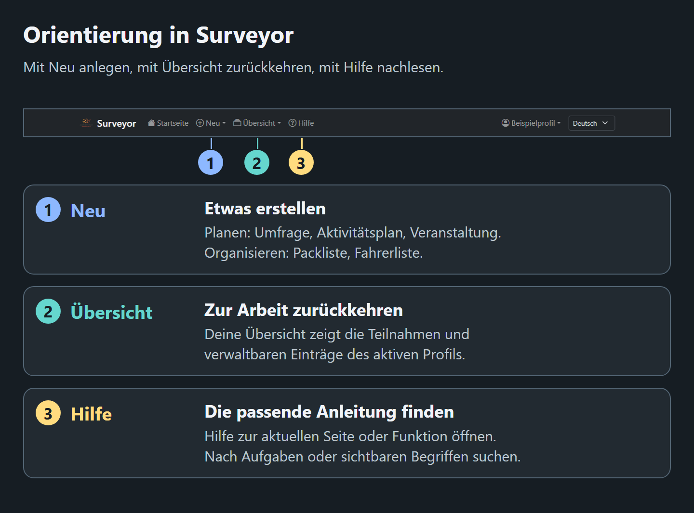

# In-App Help Visuals

<!--
documentation-metadata
audience: documentation contributors; feature maintainers
owner: product documentation maintainers
status: migration-pending
last-verified: 2026-10-09
verification-baseline: docs-baseline-2026-09-06-d14
verification-scope: source-reviewed staged generator destination and native-asset preservation; FPR-07 prospective navigation guidance and exact previously accepted images retained; no new image generation, visual acceptance or production cutover
source-anchors: scripts/generate-help-visuals.mjs; src/locales/; docs/user-guide/visual-labels.json; docs/user-guide/de/visual-labels.json; docs/user-guide/de/assets/; docs/user-guide/de/README.md; docs/user-guide/de/SURVEYS.md; docs/user-guide/de/PACKING_LISTS.md; docs/user-guide/assets/; docs/user-guide/README.md; docs/user-guide/SURVEYS.md; docs/user-guide/PACKING_LISTS.md; src/views/layout.pug; src/frontend/components/AppHeader.vue; src/views/surveyor/survey-vote.pug; src/views/packing/packing-view.pug; .github/workflows/release.yml; tests/unit/help-documentation.spec.ts
next-review: frontend-production-cutover
canonical-merge-target: docs/HELP_VISUALS.md
production-reference: 2dfa257 native frontend documentation; reference only, not installed production evidence
-->

## Cutover staging

This temporary replacement for `docs/HELP_VISUALS.md` describes the prospective localized frontend header.
It does not describe native production. Its navigation drafts are retained byte-for-byte under
`docs/frontend-migration/staged/user-guide/assets/` and the corresponding `de/assets/` directory. The dated
2026-10-07 acceptance below is historical evidence for those unchanged drafts, not for the corrected native image.
At cutover, reconcile the canonical guide and labels, replace the corresponding language-owned navigation assets
with the reviewed staged versions, and retire the merged copies. Keep the original decision/review history.


Each language owns its maintained instructional images beside its guides: English uses `docs/user-guide/assets/`,
and German uses `docs/user-guide/de/assets/`. Each navigation image combines a **source-rendered screenshot of the
actual application header** with numbered explanations outside the screenshot. Both English and German use the
actual localized Vue header and retain the Surveyor logo, home link, creation and overview menus, contextual help,
profile area and language selector. The example profiles
are fictional; these are not captures of live production accounts.

The other images are explicitly captioned explanatory diagrams. Their labels and state distinctions must match the
application. The survey example uses the visible option **1. day in month**; the German diagram explains that actual
legacy control label in German. Packing labels come from the central application catalog.

Assets retain their existing filenames. Each displayed image's adjacent caption includes a full-size image link through the existing help-asset route. Small previews do not replace the written procedures or the ability to inspect the full-size image.

The controls illustration is retained as an authoring reference while its entity-settings update is tracked in the
remediation backlog. It is not embedded in the current user guide; written guidance provides the current controls.

Localized guides select their own text and assets through the language catalog's `help.directory`. Each language
must be self-contained: do not load an image or guide from another language, refer readers to another language's
contents, or replace an equivalent picture with a table. Create a corresponding localized image with the same
instructional meaning. Both languages embed their own navigation, recurrence and shared-versus-personal state
figures with localized alt text, captions and full-size links. The help-asset route binds each image to the selected
locale; absence of a localized asset does not fall back to English.

## Ownership

The product documentation maintainers own the asset set. A feature maintainer identifies affected visuals and guides when labels or control relationships change, then updates them or records follow-up work without blocking feature delivery. Every visual that is actually changed still requires individual inspection after each revision.

| Asset | Used by | Implementation sources to compare |
|---|---|---|
| `navigation-at-a-glance.png` | User-guide home | `src/frontend/components/AppHeader.vue`, `src/locales/en.json` |
| `participant-and-organizer-controls.png` | Retained authoring reference; refresh tracked as DOC-ENTITY-PROPERTIES-VISUAL | `src/views/modules/module_entity_properties.pug`, feature views, permission metadata |
| `survey-recurring-pattern.png` | Surveys | `src/views/surveyor/survey-create.pug`, `src/views/surveyor/survey-vote.pug` |
| `packing-shared-vs-local.png` | Packing Lists | `src/views/packing/packing-create.pug`, `src/views/packing/packing-view.pug`, `src/public/js/packing.ts` |
| `de/assets/navigation-at-a-glance.png` | German user-guide home | `src/frontend/components/AppHeader.vue`, `src/locales/de.json` |
| `de/assets/survey-recurring-pattern.png` | German Surveys | `src/views/surveyor/survey-vote.pug`, `de/visual-labels.json` |
| `de/assets/packing-shared-vs-local.png` | German Packing Lists | `src/frontend/features/packing/`, `src/locales/de.json`, `de/visual-labels.json` |

## Authoring rules

- Keep visuals task-focused. Show only the labels and relationships needed to recognize the relevant screen or state.
- Implementation information is strictly forbidden in user-facing prose, alt text, captions and image pixels in
  every language. Do not include framework names, source-rendering claims, architecture, internal API/storage/permission
  identifiers, generation details or verification/provenance notes. Keep those details in this maintainer guide and
  ignored authoring evidence. Captions explain the task or observable state; an illustration does not need to tell
  readers how it was made. Follow the [user-facing content boundary](../../DOCUMENTATION_POLICY.md#user-facing-content-boundary).
- Use a non-empty Markdown alt description that communicates the instructional point without requiring the image.
- Add a nearby caption when the image is an abstraction, when local versus shared state matters, or when a permission boundary needs clarification.
- Store release-managed raster files under that language's guide `assets/` directory. Do not embed remote images, data URIs, active SVG, scripts, or HTML in guides.
- Do not place personal data, real invitation tokens, credentials, production hostnames, or real participant names in a visual.
- Treat all text inside the image as documentation: verify spelling, capitalization, and meaning against the current Pug or browser source.

## Mandatory visual inspection

Inspect **each image separately after every change**. A contact sheet, successful generation command, bounding-box assertion or earlier revision does not constitute acceptance of the changed image. Open the exact PNG that will be committed, not just an editor preview.

Check the complete image at full resolution, at a representative in-app width, and at a narrow-screen width. Read every title, label, sentence and caption. Check panel boundaries, wrapping, margins, arrows, badges and table columns for text collisions, clipping, overflow or ambiguous associations. Check the real-header crop independently: it must retain the original branding, labels, ordering and account state, without annotation drawn over the controls.

Use measured text widths and explicit padded content boxes when annotating. Prefer shorter copy, more space, additional lines or a taller panel to shrinking text until it fits. Automated containment and overlap checks supplement, but never replace, the visual inspection.

## Update procedure

1. Identify the affected guide, source templates and browser modules. Capture navigation from the actual header; do not draw a substitute navbar from memory or relabel another language's screenshot. An offline source-rendered fixture must preserve the template/component markup and styling and use fictional account data. Record its origin and source/asset fingerprints only in maintainer documentation or ignored authoring evidence, never in the picture or user guide.
2. Update only the affected visual, retaining its filename when its purpose is unchanged. Keep annotations away from screenshot controls and clearly distinguish diagrams from screenshots.
3. Open and inspect that individual exported image at full resolution and representative reduced sizes. Any subsequent change invalidates its prior acceptance: regenerate and inspect it again. Repeat until there are no visual defects in the final export.
4. Recheck alt text, captions and the full-size link. On narrow screens, confirm that the image fits the page and readers can open it at full resolution. Keep the procedure understandable without the image.
5. Optionally collect the documentation reports and content checks in the [Testing Guide](../../TESTING_GUIDE.md). Record actual findings and execution limits; an advisory exit zero is not proof of visual correctness. These checks never block application delivery. Individual visual inspection remains the authoring practice after every image change.
6. Confirm that the release bundle contains every referenced asset. Record the final image hash, dimensions, inspection sizes, findings and acceptance result. Inspect the packaged PNG again if packaging changes its bytes.

Removing a visual requires removing its Markdown reference and either deleting the unreferenced asset or documenting why it remains. Any proposal to load visuals from an untrusted or remotely managed source must reopen [DEC-004](../../decisions/DEC-004-HELP-MARKDOWN-TRUST-MODEL.md) before implementation.

## Reproducing localized figures

After the normal application build, generate prospective navigation figures with the existing script's staged
destination:

```powershell
node scripts/generate-help-visuals.mjs --staged --locale=en --figure=navigation
node scripts/generate-help-visuals.mjs --staged --locale=de --figure=navigation
```

`--staged` writes English to `docs/frontend-migration/staged/user-guide/assets/` and German to the corresponding
`de/assets/` directory. Omitting it writes to the canonical `docs/user-guide/` language directories: never use that
default destination for a Vue navigation draft during migration. Preserve the native production images and their
existing authoring guidance until an explicitly approved cutover. `--figure=navigation` leaves other exports untouched;
omitting `--figure` generates all three figures and requires inspecting every changed export.

The shared authoring script reads explanatory copy from the selected language's canonical `visual-labels.json`;
actual UI labels come from its central application catalog. The staged option changes only the output destination,
not definition selection. If prospective copy differs, resolve its language-owned authoring input before generation;
do not assume that this option reads a staged definition or permits replacing a native production image.
The script does not connect to a database or start an application server. It imports the built Vue renderer with
a fictional session and captures the real header. Pinned Bootstrap 5.3.3 and Bootstrap Icons 1.11.3 styling is cached
in ignored authoring evidence, and used unchanged.

The source-header crop, source/style fingerprints, PNG dimensions, SHA-256 hashes and reduced previews are written
to `.temp/help-visuals-<locale>/`. This evidence is local authoring state, not an additional release dependency.
Reviewed canonical PNGs are intentional release-managed documentation assets. Staged PNGs remain prospective
cutover material; generating them does not install or accept them for production.

## Accepted exports, 2026-10-07

Each final image was opened separately at its original 1440px width, at 768px, and at the 298px article width of a
narrow screen. All labels, wrapping, numbered associations, panel edges, checkbox state and recurrence arrows were
inspected. The actual 1344px header crop was inspected independently. No clipping, collisions or ambiguous
associations remain. The narrow previews fit the article; the adjacent localized full-size links remain necessary
for reading their smallest text. Written procedures contain the same instructions without relying on the image.

The navigation exports were regenerated after removing all public implementation/provenance footnotes from both
languages. The other five PNGs retain their bytes. Each changed navigation PNG and its 768px/298px previews was
inspected individually, as was each language's actual header crop; all task text and numbered associations remain
readable with no clipping or collisions. Provenance is retained here and in ignored evidence only.

| Asset | Dimensions | SHA-256 |
|---|---|---|
| `assets/navigation-at-a-glance.png` | 1440 × 1065 | `266d30271e4ca6b621908760072e6d138500a9c50011f99c44e80434c913ecd3` |
| `de/assets/navigation-at-a-glance.png` | 1440 × 1065 | `dcaf7025b257ae8d81e67d6a399b92e30a52c1e2b01d92d68405af960412d3f0` |
| `de/assets/survey-recurring-pattern.png` | 1440 × 1252 | `f58bcdda6fea37a5a553a1f780fbb82aa51de124dfe03cdf42d2a5101fa019ac` |
| `de/assets/packing-shared-vs-local.png` | 1440 × 1179 | `43b23feb28971b43ec4499df71a93b73e8fa68d630b6a8cff607db3780950f84` |

The English source-header crop hash is `ab09569a7f3fb7bd1233f2c8b3a82ecd0d16e03f46aff073a6ac7d0c93cafb5f`;
the German source-header crop hash is `149884129ddb4ccdaba925c34ad36af948893dadbe3900bfb134eb473748e5eb`.
Its `AppHeader.vue` source hash is `2a76452319ab19df3e6842a759eee2908f34d851b1c99f9337d8c4922e547220`,
and the actual logo hash is `9bbe33339e056d4d26a01a6dfe71a1b89adea1b9980533ed266a9ecbb94a2ed3`.
The generator's evidence records the remaining component, catalog, definition, compiled-renderer and pinned-style
fingerprints. Localized generation writes only the selected language's own assets; figure selection leaves the
other exports untouched.

## Prospective German home caption retained for cutover

The native production figure now uses the actual English native menu labels with German explanations.
At cutover, the staged German frontend header and these matching original translated references belong together:



*Mit **Neu** legst du einen Eintrag an, mit **Übersicht** kehrst du zu deiner Arbeit zurück und mit **Hilfe** findest du die passende Anleitung. Öffne auf kleinen Bildschirmen zuerst das Navigationsmenü. Im Bild in voller Größe kannst du die Navigation genauer ansehen.*
