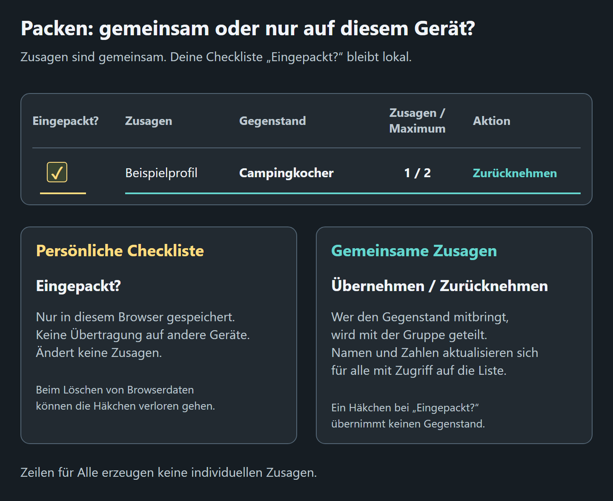

# Packlisten
<!--
documentation-metadata
audience: Packlistenteilnehmer; Packlistenorganisatoren
owner: packing-list feature maintainers
status: current
last-verified: 2026-10-23
verification-baseline: docs-baseline-2026-09-06-d14
verification-scope: Creation and duplication permission instructions reconciled with the shared collapsed disclosure and exact localized labels; existing task guidance, anchors and image bytes retained. Source review only; no new full-article browser verification claimed.
heading-anchors: 1:packing-lists; 2:choose-your-task; 2:understand-the-three-kinds-of-state; 2:open-and-read-a-packing-list; 3:read-the-summary-counters; 3:read-the-item-table; 2:take-an-item; 3:remove-yourself; 2:understand-everyone-items; 2:use-packed-as-your-personal-checklist; 2:open-a-list-as-a-guest; 2:create-a-packing-list; 3:1-open-the-creation-form; 3:2-enter-the-list-details; 3:3-add-the-initial-items; 3:4-select-create-list; 2:manage-list-content; 3:edit-the-list-title-or-description; 3:add-another-item; 3:edit-an-existing-item; 3:reorder-items; 3:remove-another-participant; 3:delete-an-item; 2:manage-the-header-image; 2:link-a-packing-list-to-an-event; 2:configure-sharing-and-permissions; 3:privacy-before-sharing; 2:duplicate-or-delete-a-packing-list; 3:duplicate-a-list; 3:delete-a-list; 2:capabilities-and-limits; 2:practical-examples; 3:shared-camping-equipment; 3:personal-essentials; 3:event-setup; 2:archive-or-restore-a-list; 2:troubleshooting; 3:the-list-cannot-be-created; 3:take-is-missing-or-does-not-work; 3:an-event-linked-list-says-registration-is-required; 3:the-list-is-missing-from-your-overview; 3:my-packed-marks-disappeared; 3:someone-else-can-see-my-packed-marks; 3:item-editing-or-organizer-controls-are-missing; 3:an-item-stays-at-the-top-of-the-list; 2:related-guides
source-anchors: src/backend/controller/packingController.ts; src/common/locales/de.json; docs/user-guide/de/assets/packing-shared-vs-local.png; scripts/generate-help-visuals.mjs; src/frontend/features/identity/IdentityPage.vue; src/frontend/features/overview/OverviewPage.vue; src/frontend/features/packing/PackingPage.vue; src/frontend/features/packing/packed.ts; tests/frontend/frontend-editor.spec.ts; src/frontend/features/packing/; src/frontend/components/EntitySettingsDialog.vue; src/common/locales/; src/frontend/components/permissions/CreationPermissions.vue; src/frontend/; src/backend/controller/helpController.ts
next-review: packing-visible-UI-or-behavior-change
production-reference: 2dfa257 native business comparator with current German migrated controls and approved exceptions; not an installed production commit
-->

Packlisten helfen einer Gruppe, gemeinsame Ausrüstung zu verteilen und persönliche Dinge nicht zu vergessen. Teilnehmer können gewöhnliche Gegenstände übernehmen; Organisatoren können Gegenstände als Bedarf für **Alle** markieren.

> **Gemeinsame Zusagen und „Eingepackt?“ sind verschiedene Zustände.** Namen, Zusagenzahlen, Gegenstandsdetails und **Alle** werden mit der Gruppe geteilt. Ein Häkchen bei **Eingepackt?** ist nur in dem Browser sichtbar, in dem du es gesetzt hast. Es gehört nicht zum aktiven Surveyor-Profil und wird nicht auf andere Browser oder Geräte übertragen.

*Das Häkchen links ist deine persönliche Erinnerung in diesem Browser. Namen und Zusagenzahlen sind für die Gruppe sichtbar. Ein Häkchen bei **Eingepackt?** übernimmt keinen Gegenstand.*

[Diagramm der Packzustände in voller Größe öffnen](/help/assets/packing-shared-vs-local.png?locale=de).

## Deine Aufgabe wählen

- [Einen Gegenstand übernehmen oder die Zusage entfernen](#take-an-item)
- [Die persönliche Pack-Checkliste verwenden](#use-packed-as-your-personal-checklist)
- [Gegenstände für alle verstehen](#understand-everyone-items)
- [Eine Liste als Gast öffnen](#open-a-list-as-a-guest)
- [Eine Packliste erstellen](#create-a-packing-list)
- [Gegenstände hinzufügen, bearbeiten, sortieren oder löschen](#manage-list-content)
- [Eine Liste mit einer Veranstaltung verknüpfen](#link-a-packing-list-to-an-event)
- [Berechtigungen und delegierte Organisatoren einstellen](#configure-sharing-and-permissions)
- [Eine Liste duplizieren oder löschen](#duplicate-or-delete-a-packing-list)
- [Probleme mit einer Packliste lösen](#troubleshooting)

## Die drei Zustandsarten verstehen

| Zustand | Sichtbar für | Beim erneuten Öffnen |
|---|---|---|
| Titel, Beschreibung, maximale Zusagenzahl, Reihenfolge und **Alle** | Alle zur Liste zugelassenen Personen | Auch auf einem anderen Gerät verfügbar. |
| Wer **Übernehmen** gewählt hat und **Zusagen / Maximum** | Alle zur Liste zugelassenen Personen | Deine Zusage gehört zu deinem Surveyor-Profil und ist auch auf einem anderen Gerät verfügbar. |
| Häkchen **Eingepackt?** und grüne Zeile | Nur dieser Browser für diesen Gegenstand | Im selben Browser verfügbar, solange dessen Websitedaten erhalten bleiben. |

Koordiniere Verantwortung über Zusagen. Nutze **Eingepackt?** nur als persönliche Erinnerung in dem Browser, den du mitnehmen wirst.

## Eine Packliste öffnen und lesen

Öffne den Organisatorlink, wähle die Liste in einer Veranstaltung oder öffne sie aus [Deine Übersicht](DASHBOARD.md).

- Mit aktivem Profil öffnet Surveyor eine unverknüpfte Packliste direkt.
- Ohne aktives Profil gelangst du zur Gasteinstiegsseite.
- Eine verknüpfte Liste verlangt normalerweise die Anmeldung zur Veranstaltung. Nichtteilnehmer dürfen nur mit effektivem **Zugriff auf Ansicht** eintreten.

Prüfe vor der Übernahme den Profilnamen im Benutzermenü. Zusagen gehören zu diesem Profil, nicht zum vollständigen Konto insgesamt.

### Die Zähler lesen

Oben auf der Liste stehen:

- **Teilnehmende** — unterschiedliche Profile mit mindestens einer Zusage für einen gewöhnlichen Gegenstand. Mehrere Zusagen derselben Person zählen einmal. **Alle**-Gegenstände erhöhen diesen Zähler nicht.
- **Gegenstände** — sämtliche Zeilen einschließlich der Gegenstände für alle.
- **offen** — gewöhnliche Gegenstände mit mindestens einem freien Zusageplatz.
- **ohne Zusage** — gewöhnliche Gegenstände ohne Zusage. Gegenstände für alle sind ausgenommen, da sie keine individuellen Zusagen verwenden.

### Die Gegenstandstabelle lesen

| Spalte | Bedeutung |
|---|---|
| **Eingepackt?** | Browserlokales Häkchen für diesen Gegenstand. |
| **Zusagen** | Profilnamen der Personen mit einer Zusage oder **Alle** für einen gemeinsamen persönlichen Bedarf. |
| **Gegenstand** | Was mitgebracht werden soll. |
| **Beschreibung** | Optionale Details, Anforderungen oder Mengenhinweise. |
| **Zusagen / Maximum** | Zahl zugesagter Personen und maximale Zahl für einen gewöhnlichen Gegenstand. |
| **Aktion** | Übernehmen, Zurücknehmen, Voll, Alle und erlaubte Organisatoraktionen. |

Das Maximum zählt **Personen**, keine physischen Gegenstände. Soll eine Person drei Klapptische mitbringen, schreibe dies in Titel oder Beschreibung. **Max. Anzahl** gibt an, wie viele unterschiedliche Freiwillige Verantwortung übernehmen dürfen.

## Einen Gegenstand übernehmen

Bei einem gewöhnlichen Gegenstand mit freiem Platz:

1. Suche die Zeile.
2. Wähle **Übernehmen**.
3. Prüfe, ob dein Profilname unter **Zusagen** erscheint und die Zusagenzahl steigt.

Ist das Maximum erreicht, steht dort **Voll**; weitere Teilnehmer können nicht übernehmen. Bereits zugeordnete Teilnehmer können weiterhin **Zurücknehmen** wählen.

Die Übernahme verlangt effektiv **Zugriff auf Ansicht**. Kann ein Teilnehmer die Seite öffnen, aber nicht übernehmen, hilft Organisatoren [Berechtigungen und Freigaben](PERMISSIONS.md).

### Die eigene Zusage entfernen

1. Suche einen gewöhnlichen Gegenstand mit Zusage des aktiven Profils.
2. Wähle in **Aktion** **Zurücknehmen**.
3. Prüfe, ob der Profilname verschwindet und der Zähler sinkt.

Das kleine **×** neben einem Namen ist eine separate Organisatoraktion zum Entfernen einer anderen Person. Gewöhnliche Teilnehmer verwenden ihre eigene Schaltfläche **Zurücknehmen**.

Die Liste erscheint unter **Deine Teilnahmen** in [Deine Übersicht](DASHBOARD.md), sobald das aktive Profil mindestens einen gewöhnlichen Gegenstand übernommen hat. Bloßes Öffnen, **Eingepackt?** oder das Ansehen eines Gegenstands für alle erzeugt keine gemeinsame Zusage und fügt die Liste deshalb nicht zu dieser Sammlung hinzu.

## Gegenstände für alle verstehen

Ein Gegenstand für **Alle** soll von jeder Person für sich selbst mitgebracht werden, etwa Trinkflasche, Schlafsack, Ausweis oder persönliche Medikamente.

- Beim Erstellen heißt der Schalter **Alle**.
- In der bestehenden Liste steht der Schalter **Alle** in **Aktion**.
- **Zusagen** zeigt **Alle** statt individueller Namen.
- Niemand muss **Übernehmen** wählen. Die Zeile zählt nicht zu offenen Gegenständen, Gegenständen ohne Zusage oder Teilnehmern.
- Zeilen für alle sind hervorgehoben und stehen vor gewöhnlichen Zusagezeilen.

Der Schalter ändert, ob eine Zeile individuelle Zusagen verwendet. Er bestätigt nicht, dass alle den Gegenstand tatsächlich eingepackt haben. Dafür kann jede Person ihr browserlokales Häkchen als Erinnerung verwenden.

## Eingepackt? als persönliche Checkliste verwenden

Setze das Häkchen bei **Eingepackt?**, sobald du den Gegenstand eingepackt hast. Die Zeile wird in diesem Browser grün.

Das Häkchen:

- ist für gewöhnliche Gegenstände und Gegenstände für alle verfügbar;
- weist dir den Gegenstand nicht zu;
- ist für Organisatoren oder andere Teilnehmer nicht sichtbar;
- zählt nicht in Teilnehmer- oder Zusagenzählern;
- bleibt in dem Browser, in dem du es gesetzt hast, und wird nicht auf andere Browser oder Geräte übertragen;
- ist mit keinem Surveyor-Konto oder Profil verbunden.

Normalerweise bleibt es nach Schließen und erneutem Öffnen im selben Browser erhalten. Es kann in einem anderen Browser oder Gerät, im privaten Modus oder nach dem Löschen von Websitedaten fehlen. Eine duplizierte Liste beginnt mit eigenen, unmarkierten Gegenständen. Eine andere Person im selben Browserprofil sieht dieselben Häkchen, auch nach einem Wechsel des aktiven Surveyor-Profils.

Kann dein Browser einige Häkchen nicht laden oder speichern, erscheint eine Warnung über der Liste. Deine aktuellen Änderungen bleiben erhalten, solange diese Liste mit demselben Konto und aktiven Profil geöffnet ist, auch wenn ihre Gegenstände aktualisiert werden. Wähle in der Warnung **Erneut versuchen**, um sie erneut zu speichern. Solange die Warnung angezeigt wird, können ungespeicherte Häkchen beim Verlassen oder Neuladen der Seite oder beim Wechsel des Kontos oder aktiven Profils verloren gehen. Gemeinsame Zusagen bleiben davon unberührt.

Verwende **Eingepackt?** nicht als Nachweis erledigter Gruppenaufgaben. Gemeinsame Zusagen und direkte Kommunikation eignen sich für Gruppenverantwortung.

## Eine Liste als Gast öffnen

Gäste können teilnehmen, soweit die Zugriffsregeln der Liste es erlauben.

1. Öffne den Packlistenlink.
2. Wähle ohne aktives Profil **Als Gast fortfahren**.
3. Fülle **Anzeigename** aus. Gib möglichst auch eine E-Mail-Adresse an.
4. Sichere den von Surveyor gezeigten oder verschickten privaten Gastlink.
5. Verwende **Übernehmen**, **Zurücknehmen** und **Eingepackt?**, soweit verfügbar, wie oben beschrieben.

Eine E-Mail-Adresse ermöglicht Gastwiederherstellung. Siehe [Gastzugang per E-Mail wiederherstellen](GETTING_STARTED.md#recover-guest-access-by-email).

Bei verknüpften Listen muss das Gastprofil normalerweise zur Veranstaltung angemeldet sein. Ein listenspezifisches Ansichtsrecht kann Nichtteilnehmer zulassen. [Veranstaltungen](EVENTS.md) erklärt die Anmeldung, [Berechtigungen und Freigaben](PERMISSIONS.md) die addierten Rechte.

## Eine Packliste erstellen

Die Erstellung verlangt ein angemeldetes vollständiges Konto. Gäste dürfen teilnehmen, aber keine Liste erstellen. Das aktive Profil wird Eigentümer.

### 1. Das Erstellungsformular öffnen

1. Öffne oben **Neu**.
2. Wähle unter **Organisieren & teilen** **Packliste**.

Veranstaltungsorganisatoren können stattdessen in **Veranstaltungsverwaltung** **Packlisten der Veranstaltung** aufklappen und **Neue Packliste erstellen** wählen. Dasselbe Formular öffnet sich mit vorausgewählter Veranstaltung.

### 2. Listendetails eintragen

| Feld | Eingabe |
|---|---|
| **Titel \*** | Pflichtname, den Teilnehmer erkennen. |
| **Beschreibung (optional)** | Allgemeine Hinweise, Treffpunkt, Besitzregeln oder weiterer Zusammenhang. |
| **Kopfzeilenbild (optional)** | JPEG-, PNG- oder GIF-Bild bis 10 MiB. |
| **Veranstaltung zuordnen (optional)** | Eine Veranstaltung, mit der das aktuelle Profil verknüpfen darf, auch vergangen oder archiviert; **Keine Veranstaltung** für eine eigenständige Liste. |
| **Gruppenberechtigungen** | Zielgruppenrechte für Ansicht, Bearbeitung, Zusagen, Verwaltung, Duplizieren und verwandte Aktionen. |

Das Formular startet mit den Standardrechten für Nicht-Veranstaltungseinträge. Öffne **Gruppenberechtigungen**, um sie zu prüfen oder zu ändern. Lies [Berechtigungen und Freigaben](PERMISSIONS.md), bevor du sensible Namen veröffentlichst oder Bearbeitungsrechte erteilst.

### 3. Die ersten Gegenstände hinzufügen

Unter **Einzupackende Gegenstände** verwendet die Tabelle diese Spalten:

| Spalte | Eingabe |
|---|---|
| **Gegenstand** | Erforderlicher Gegenstandsname. |
| **Beschreibung** | Optionale Spezifikation, Menge, Größe oder Abstimmungshinweis. |
| **Max. Anzahl** | Höchstzahl der Personen für einen gewöhnlichen Gegenstand; mindestens 1. |
| **Aktion** | Optionaler Schalter **Alle** und Entfernen der Zeile. |

1. Fülle die erste Zeile aus.
2. Wähle für weitere Gegenstände **Zeile hinzufügen**.
3. Aktiviere **Alle**, wenn jede Person den Gegenstand selbst mitbringen soll.
4. Entferne unerwünschte Zeilen mit ihrer Entfernen-Schaltfläche.

Mindestens eine Zeile mit nicht leerem Gegenstandsnamen ist erforderlich. Leere Zeilen werden nicht Bestandteil der Liste.

### 4. **Liste erstellen** wählen

Surveyor erstellt Liste und Anfangsgegenstände gemeinsam und öffnet die geteilte Listenseite. Prüfe vor dem Teilen der URL Reihenfolge, Zugriffsregeln, Veranstaltungsverknüpfung und Zusagenlimits.

## Listeninhalt verwalten

Bedienelemente richten sich nach den effektiven Rechten des aktiven Profils. Der Eigentümer erhält automatisch alle Rechte.

### Listentitel oder Beschreibung bearbeiten

Berechtigte Bearbeiter sehen **Entitätseinstellungen** in der Kopfzeile. Der Dialog enthält nur für das aktive Profil erlaubte Felder und Aktionen.

1. Öffne **Entitätseinstellungen**.
2. Ändere unter **Allgemein** → **Details** den **Titel** oder die **Beschreibung**, soweit vorhanden.
3. Wähle **Eigenschaften speichern**.

Titeländerungen brauchen **Titel bearbeiten**, Beschreibungen **Beschreibung bearbeiten**. Die Beschreibung auf der gewöhnlichen Listenseite ist schreibgeschützt. Jeder Abschnitt speichert separat. Das Speichern lässt die Seite geöffnet und erhält unvollständige Eingaben anderer Abschnitte. Ein fehlgeschlagenes Speichern erhält den Entwurf. Beim Schließen mit ungespeicherten Änderungen entscheidest du, ob du diese verwerfen möchtest; brich das Schließen ab, um weiterzubearbeiten.

### Einen weiteren Gegenstand hinzufügen

Profile mit **Gegenstände hinzufügen** sehen unten **Neuen Gegenstand hinzufügen**.

1. Gib **Titel \*** ein.
2. Ergänze optional **Beschreibung**.
3. Setze **Max. Anzahl** auf die gewünschte Personenzahl.
4. Wähle **Hinzufügen**.
5. Soll der neue Gegenstand für alle gelten, aktiviere nach dem Erscheinen seinen Schalter **Alle**.

### Einen bestehenden Gegenstand bearbeiten

Bei verfügbaren Bedienelementen zeigt die Seite **Zum Bearbeiten doppelklicken, zum Sortieren ziehen**.

- Doppelklicke **Gegenstand** für den Titel.
- Doppelklicke **Beschreibung** für Details.
- Doppelklicke das Maximum unter **Zusagen / Maximum** für das Zusagenlimit.
- Wechsle mit **Alle** in **Aktion** zwischen persönlichem Bedarf für alle und gewöhnlichen individuellen Zusagen.

Ein niedrigeres Maximum ersetzt keine organisatorische Prüfung. Prüfe die vorhandenen Zusagen und kläre überschüssige Verantwortung ausdrücklich.

### Gegenstände sortieren

Ein Profil mit **Gegenstände bearbeiten** kann Zeilen in eine neue Reihenfolge ziehen. Surveyor speichert diese Reihenfolge gemeinsam. Gegenstände für alle bleiben bei der Anzeige vor den gewöhnlichen Zeilen gruppiert.

### Andere Teilnehmer entfernen

Ein Profil mit **Zuweisungen verwalten** sieht neben jedem Namen ein kleines **×**. Es entfernt die Zusage dieses Profils. Dadurch wird weder das Profil gelöscht noch die Person aus einer verknüpften Veranstaltung entfernt.

### Einen Gegenstand löschen

Ein Profil mit **Gegenstände löschen** sieht eine Papierkorb-Schaltfläche in der Zeile.

1. Wähle den Papierkorb.
2. Bestätige die endgültige Löschung dieses Gegenstands.

Die Löschung entfernt den Gegenstand und alle gemeinsamen Zusagen dafür. Sie kann in der Anwendung nicht rückgängig gemacht werden.

## Das Kopfzeilenbild verwalten

Mit **Metadaten bearbeiten** öffnest du **Entitätseinstellungen** → **Allgemein** → **Kopfzeilenbild**. Wähle über **Bild auswählen** eine Datei und dann **Hochladen**, um hinzuzufügen oder zu ersetzen. **Bild entfernen** mit Bestätigung löscht das Bild.

Akzeptiert werden JPEG, PNG und GIF bis 10 MiB. Ersetzen oder Entfernen löscht das bisherige Bild dauerhaft.

## Eine Packliste mit einer Veranstaltung verknüpfen

Verwende beim Erstellen **Veranstaltung zuordnen (optional)**, wenn die Liste zu einer Veranstaltung gehört.

Eine verknüpfte Liste:

- erscheint im Packlistenbereich der Veranstaltung für Personen mit Zugriff auf zugehörige Ressourcen;
- zeigt **Zur Veranstaltung** in der Kopfzeile;
- lässt normalerweise dort angemeldete Profile zu;
- verlangt bei Nichtteilnehmern effektiv **Zugriff auf Ansicht**;
- wird mit der Veranstaltung gelöscht, weil sie zu deren gespeicherten Daten gehört.

Die Erstellung aus **Packlisten der Veranstaltung** wählt die Veranstaltung vor. Die Auswahl enthält berechtigte vergangene, nach Anmeldeschluss liegende und archivierte Veranstaltungen. Verwende Text-, Datums- und Zustandsfilter oder **Keine Veranstaltung**; [Eine Veranstaltung auswählen](EVENTS.md#choose-an-event) erklärt die gemeinsamen Bedienelemente. Bei einer archivierten Veranstaltung erläutert die Auswahl die Archivierungswirkung.

Nach der Erstellung öffnest du **Entitätseinstellungen** → **Verknüpfte Veranstaltung**, wählst ein anderes Ziel oder **Keine Veranstaltung** und dann **Veranstaltungsverknüpfung speichern** mit Bestätigung. Du brauchst **Metadaten bearbeiten** auf der Liste und **Zuweisungen verwalten** auf jedem ausgewählten Ziel. Das Aufheben benötigt kein Recht einer Zielveranstaltung.

Ein Wechsel erhält Liste, Gegenstände, Zusagen, Bild, persönliche Übersichtseinstellungen und eigenständige Archivierung. Veranstaltungszugriff folgt der neuen Beziehung. Die Verknüpfung mit einer archivierten Veranstaltung fügt geerbte Archivierung hinzu. Aufheben entfernt diese Vererbung, stellt aber eine eigenständig archivierte Liste nicht wieder her.

Veranstaltungsanmeldung und Listenrechte sind getrennt. Eine Anmeldung kann den Seitenzugang gewähren; Übernehmen, Hinzufügen, Bearbeiten und Zuweisungsverwaltung prüfen weiterhin die effektiven Listenrechte.

## Freigaben und Berechtigungen einstellen

Packlisten verwenden das allgemeine additive Berechtigungssystem. Mit **Berechtigungen verwalten** öffnest du **Entitätseinstellungen** → **Zugriff** und änderst **Gruppenberechtigungen** oder benannte **Administratoren**.

Übliche Rechte sind:

| Ziel | Benötigtes Recht |
|---|---|
| Eigene gewöhnliche Zusage übernehmen oder entfernen | **Zugriff auf Ansicht** |
| Listentitel ändern | **Titel bearbeiten** |
| Listenbeschreibung ändern | **Beschreibung bearbeiten** |
| Kopfzeilenbild hinzufügen, ersetzen oder entfernen | **Metadaten bearbeiten** |
| Veranstaltungsverknüpfung ändern oder aufheben | **Metadaten bearbeiten**, zusätzlich **Zuweisungen verwalten** am ausgewählten Ziel |
| Zeilen hinzufügen | **Gegenstände hinzufügen** |
| Zeilen sortieren und Untereinträge umfassend bearbeiten | **Gegenstände bearbeiten** |
| Nur Gegenstandsbeschreibungen ändern | **Gegenstandsbeschreibung bearbeiten** |
| Zeilen löschen | **Gegenstände löschen** |
| Fremde Zusagen entfernen | **Zuweisungen verwalten** |
| Gruppen- oder Administratorrechte ändern | **Berechtigungen verwalten** |
| Duplizierungsablauf öffnen | **Daten duplizieren** |

Gegenstandsspezifische Rechte können ebenfalls unterstützte Änderungen einer einzelnen Zeile erlauben. [Berechtigungen und Freigaben](PERMISSIONS.md) enthält alle Bezeichnungen, übergeordneten Ersatzrechte, überlappenden Zielgruppen, Voreinstellungen, Eigentümerregeln und Grenzen des Seitenzugangs.

### Datenschutz vor dem Teilen

Jede zur Packlistenseite zugelassene Person kann den sichtbaren Inhalt einschließlich der zugesagten Profilnamen lesen. Packlisten bieten keine anonymen Zusagen oder eine Namensansicht nur für Organisatoren.

**Eingepackt?** bleibt nur deshalb privat, weil es im Browser bleibt; es ist keine Zugriffssteuerung und kein Prüfprotokoll. Vermeide sensible personenbezogene Informationen in Gegenstandstiteln, Beschreibungen und Profilnamen.

## Eine Packliste duplizieren oder löschen

### Eine Liste duplizieren

Mit vollständigem Konto und **Daten duplizieren** verwendest du die **Entitätseinstellungen**:

1. Öffne die Liste und **Entitätseinstellungen**.
2. Wähle unter **Aktionen** **Duplizieren**.
3. Prüfe Titel, Beschreibung, Gegenstände, Höchstzahlen und **Alle**-Einstellungen.
4. Prüfe die Veranstaltungszuordnung und öffne **Gruppenberechtigungen**, um die Freigaben der neuen Liste zu prüfen.
5. Wähle **Liste erstellen**.

Eigentümer können außerdem **Duplizieren** auf ihrer Karte unter **Verwaltbare Einträge** verwenden.

Das Duplikat ist eine unabhängige Liste. Es kopiert keine Zusagen, browserlokalen Häkchen oder Kopfzeilenbilder. Eigentümer wird das aktive Profil, das die Kopie erstellt.

### Eine Liste löschen

Nur der Eigentümer darf die gesamte Liste löschen.

1. Öffne Liste und **Entitätseinstellungen**.
2. Wähle unter **Aktionen** **Endgültig löschen**.
3. Bestätige.

Die Eigentümerkarte in der Übersicht behält außerdem **Löschen**.

Die Löschung entfernt Liste, Gegenstände, gemeinsame Zusagen und gespeichertes Kopfzeilenbild endgültig. Archivwiederherstellung kann das nicht rückgängig machen. Archiviere, wenn die Liste verfügbar bleiben soll. Eine verknüpfte Liste wird auch beim Löschen ihrer Veranstaltung entfernt.

## Möglichkeiten und Grenzen

| Unterstützt | Nicht vorgesehen |
|---|---|
| Gemeinsame Titel, Beschreibungen, Zusagenlimits und Reihenfolge | Kategorien, Abschnitte oder verschachtelte Gegenstände |
| Profilbezogenes Übernehmen und Entfernen | Einer Person eine numerische Menge zuweisen |
| Anforderungen für alle | Bestätigung, dass wirklich alle den Gegenstand eingepackt haben |
| Browserlokale Pack-Checkliste | Geräteübergreifender, kontobezogener oder für Organisatoren sichtbarer Packstatus |
| Verknüpfte und eigenständige Listen | Listenfrist, automatische Erinnerungen oder Änderungsnachrichten |
| Delegierte Rechte und Administratoren | Anonyme Zusagennamen |
| Bilder, Duplikate, Archivierung, Wiederherstellung und endgültige Löschung | Packlistenexport |

## Praktische Beispiele

### Gemeinsame Campingausrüstung

Erstelle gewöhnliche Zeilen wie **Gruppenzelt**, **Campingkocher** und **Erste-Hilfe-Set**. Setze das Maximum auf die Zahl verschiedener Freiwilliger. Modell, Größe und physische Mengen gehören in **Beschreibung**.

### Persönlicher Bedarf

Aktiviere **Alle** für **Trinkflasche**, **Schlafsack** und **Ausweis**. Teilnehmer verwenden dann **Eingepackt?** als eigene lokale Checkliste ohne überflüssige Zusagen.

### Veranstaltungsaufbau

Verknüpfe die Liste mit der Veranstaltung und erstelle gewöhnliche Zeilen wie **Anmeldeschilder**, **Verlängerungskabel** und **Projektor**. Gib dem Team nur die benötigten Bearbeitungs- und Zuweisungsrechte.

## Eine Liste archivieren oder wiederherstellen

Eigentümer oder Organisatoren mit **Metadaten bearbeiten** können unter **Entitätseinstellungen** → **Aktionen** → **Archivierung** für alle archivieren oder wiederherstellen. Archivierung erhält Gegenstände, Zusagen, Bilder, bisherigen Zugriff und Aktionen. Packlisten haben kein eigenes automatisches Archivierungsdatum; verknüpfte Listen erben die Archivierung ihrer Veranstaltung. Die gewöhnliche Ansicht zeigt gegebenenfalls nur **Dieser Eintrag ist archiviert.**

Bei geerbter Archivierung erläutert der Dialog, dass zuerst die Veranstaltung wiederhergestellt werden muss, und bietet gegebenenfalls **Veranstaltung öffnen**. Eine separat archivierte Liste bleibt nach Wiederherstellung der Veranstaltung archiviert. Du findest sie unter **Archiviert und ausgeblendet** in [Deine Übersicht](DASHBOARD.md#find-archived-and-hidden-items). **Für mich ausblenden**, **Für mich einblenden** und **Standardsichtbarkeit verwenden** werden für das aktive Profil gespeichert. Diese Übersichtseinstellungen sind von browserlokalen Pack-Häkchen getrennt.

## Probleme lösen

### Die Liste lässt sich nicht erstellen

Prüfe:

- Ein vollständiges Konto statt eines Gastkontos ist angemeldet.
- **Titel** ist ausgefüllt.
- Mindestens eine Zeile hat einen nicht leeren Gegenstandsnamen.
- Jedes Maximum beträgt mindestens 1.
- Das aktive Profil darf die ausgewählte Veranstaltung verwalten.
- Das Bild ist JPEG, PNG oder GIF und höchstens 10 MiB groß.

### Übernehmen fehlt oder funktioniert nicht

Prüfe, ob:

- der Gegenstand für **Alle** gilt und deshalb keine individuelle Zusage braucht;
- die Zeile bereits **Voll** ist;
- das Profil schon zugesagt hat und stattdessen **Zurücknehmen** verwenden sollte; oder
- das Profil effektiv **Zugriff auf Ansicht** hat.

### Eine verknüpfte Liste verlangt eine Anmeldung

Melde das aktive Profil zur Veranstaltung an oder bitte einen Organisator um ein listenspezifisches Ansichtsrecht, wenn Nichtteilnehmerzugang beabsichtigt ist. Profilwechsel können Veranstaltungsanmeldung und Rechte ändern.

### Die Liste fehlt in Deine Übersicht

Prüfe das aktive Profil.

Klappe in beiden Sammlungen **Archiviert und ausgeblendet** auf und entferne Filter.

- Eigentümer und benannte Administratoren finden die Liste unter **Verwaltbare Einträge**.
- Teilnehmer finden sie nach Übernahme mindestens eines gewöhnlichen Gegenstands unter **Deine Teilnahmen**.
- Ansehen, Pack-Häkchen und ausschließliche Anforderungen für alle erzeugen keine gemeinsame Zusage.

### Meine Pack-Häkchen sind verschwunden

Verwende dasselbe Browserprofil und Gerät. Privater Modus, gelöschte Websitedaten, andere Browser oder Geräte und duplizierte Listen übernehmen deine Häkchen nicht. Der Organisator kann deine persönlichen Häkchen nicht wiederherstellen.

### Jemand anderes sieht meine Pack-Häkchen

Die Häkchen sind browserlokal, nicht profilprivat. Jeder im selben Browserprofil sieht bei derselben Liste dieselben Häkchen. Verwende ein eigenes Browserprofil oder entferne sie vor der Weitergabe eines gemeinsam genutzten Geräts.

### Gegenstandsbearbeitung oder Organisatoraktionen fehlen

Dem aktiven Profil fehlt das entsprechende Recht. Bitte den Eigentümer oder einen Berechtigungsverwalter, **Zugriff** zu prüfen. Freigaben aller passenden Zielgruppen und Einzelzuweisungen addieren sich.

### Ein Gegenstand bleibt oben

Mit **Alle** markierte Zeilen stehen vor gewöhnlichen Zusagezeilen. Deaktiviere **Alle**, wenn individuelle Zusagen verwendet werden sollen, oder sortiere innerhalb der jeweiligen Gruppe.

## Weitere Anleitungen

- [Erste Schritte](GETTING_STARTED.md) — Konten, Gäste, Wiederherstellung und aktive Profile.
- [Deine Übersicht](DASHBOARD.md) — Teilgenommene und verwaltbare Listen finden.
- [Berechtigungen und Freigaben](PERMISSIONS.md) — Vollständige Beispiele und Referenz.
- [Veranstaltungen](EVENTS.md) — Anmeldung und verknüpfte Ressourcen.
- [Benutzerhandbuch](README.md) — Alle Funktionsanleitungen.
