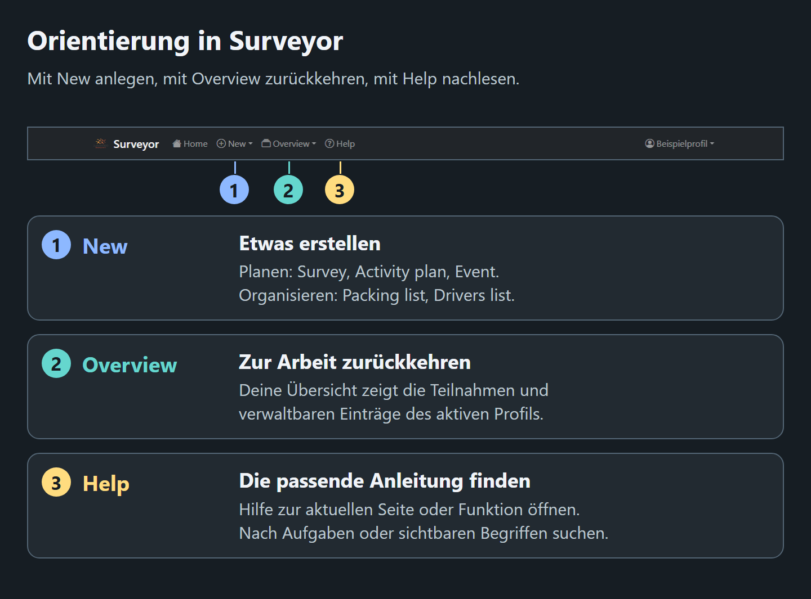

# Surveyor-Benutzerhandbuch
<!--
documentation-metadata
audience: deutschsprachige Endnutzer
owner: product documentation maintainers
status: current
last-verified: 2026-10-20
verification-baseline: docs-baseline-2026-09-06-d14
verification-scope: Migrated controls and exact localized labels source-reconciled with current component/catalog owners; settings save/discard, refresh and notice wording corrected where applicable. Native business reference, declared anchors and image bytes retained; no new browser execution claimed.
heading-anchors: 1:surveyor-user-guide; 2:find-help-quickly; 2:start-here; 3:create-or-use-a-full-account; 3:join-as-a-guest; 3:use-the-correct-profile; 2:feature-guides; 2:permissions-and-sharing; 2:common-controls; 2:guide-index
source-anchors: src/controller/helpController.ts; src/views/layout.pug; src/locales/de.json; src/frontend/components/AppHeader.vue; docs/user-guide/de/assets/navigation-at-a-glance.png; scripts/generate-help-visuals.mjs; src/frontend/features/identity/IdentityPage.vue; src/frontend/features/overview/OverviewPage.vue; src/frontend/features/help/; src/locales/
next-review: help-source-or-visible-UI-change
production-reference: 2dfa257 native business comparator with current German migrated controls and approved exceptions; not an installed production commit
-->

Surveyor hilft Gruppen, Termine zu finden, Veranstaltungen zu organisieren, Ausrüstung und Fahrten abzustimmen und Aktivitäten zu verteilen. Beginne mit dem Weg, über den du die Anwendung aufgerufen hast.

## Hilfe schnell finden

Die Hilfe ordnet Anleitungen nach Aufgaben statt alphabetisch. Verwende **Hilfe durchsuchen**, wenn du die Aufgabe oder eine sichtbare Schaltfläche kennst, aber nicht den Namen der Funktion. Der Link **Hilfe** in der Navigationsleiste öffnet die passende Anleitung zum aktuellen Bereich. Mit **Auf dieser Seite** springst du innerhalb einer Anleitung zu einem Ablauf oder zur Problemlösung.

*Mit **Neu** legst du einen Eintrag an, mit **Übersicht** kehrst du zu deiner Arbeit zurück und mit **Hilfe** findest du die passende Anleitung. Öffne auf kleinen Bildschirmen zuerst das Navigationsmenü. Im Bild in voller Größe kannst du die Navigation genauer ansehen.*

[Navigationsbild in voller Größe öffnen](/help/assets/navigation-at-a-glance.png?locale=de).

## Erste Schritte

### Ein vollständiges Konto erstellen oder verwenden

Eine Surveyor-Installation kann lokale Konten mit Benutzername und Passwort, die Anmeldung deiner Organisation oder beides anbieten.

- Wähle für ein lokales Konto **Registrieren**, fülle das Formular aus, aktiviere das Konto über die E-Mail und melde dich anschließend an.
- Verwende für die Organisationsanmeldung **Mit _Anbietername_ anmelden** oder folge der automatischen Weiterleitung. Die erste erfolgreiche Anmeldung erstellt oder verknüpft das Surveyor-Konto.
- Nach der Anmeldung öffnet Surveyor **Deine Übersicht** mit einem aktiven Profil.

Unter [Erste Schritte](GETTING_STARTED.md) findest du Kontoaktivierung, Passwortwiederherstellung, Profilverwaltung, Übertragung und Löschung.

### Als Gast teilnehmen

Öffne die Einladung des Organisators und wähle **Als Gast fortfahren**. Ein Gast verwendet einen Anzeigenamen und einen privaten Zugangslink anstelle eines Passworts.

Gib möglichst eine E-Mail-Adresse an. Surveyor kann dir dann den privaten Link schicken und später über **Anmelden** → **Zugang anfordern** alle mit dieser Adresse verbundenen Gastkonten zurückgeben. Gäste können auch **Deine Übersicht** mit den Einträgen ihres Gastprofils öffnen.

Siehe [Über eine Einladung als Gast teilnehmen](GETTING_STARTED.md#join-an-invitation-as-a-guest) und [Gastzugang per E-Mail wiederherstellen](GETTING_STARTED.md#recover-guest-access-by-email).

### Das richtige Profil verwenden

Ein vollständiges Konto kann mehrere Profile enthalten; ein Gastkonto enthält eines. Das aktive Profil bestimmt den angezeigten Namen, Teilnahmen, Eigentümerschaft und die Einträge in **Deine Übersicht**.

Prüfe den Profilnamen im Benutzermenü. Mit einem vollständigen Konto kannst du unter **Deine Profile** Profile erstellen oder wechseln. Ein bestehendes Gastprofil oder Profil eines vollständigen Kontos lässt sich mit einem 24 Stunden gültigen Übertragungstoken in ein anderes vollständiges Konto verschieben.

Siehe [Konten und Profile verstehen](GETTING_STARTED.md#understand-accounts-and-profiles).

## Anleitungen zu den Funktionen

- **[Deine Übersicht](DASHBOARD.md)** — Teilnahmen und verwaltbare Einträge des aktiven Profils suchen, filtern und öffnen.
- **[Umfragen](SURVEYS.md)** — Wiederkehrende monatliche Wochentagsmuster abstimmen, mit **Ja**, **Vielleicht** oder **Nein** antworten, namentliche Ergebnisse lesen und gemeinsam Kombinationen hinzufügen. Ein bestimmter Monat ist ein zusätzlicher unterstützter Anwendungsfall.
- **[Veranstaltungen](EVENTS.md)** — Anmelden, Teilnahme aktualisieren, Veranstaltungen erstellen und verwalten, Nachmeldelinks und Teilnehmer verwalten, Pläne und Listen verknüpfen und sensible Teilnehmerdaten exportieren.
- **[Kostenpools und Zahlungen](INVOICE_POOLS.md)** — Belege einreichen und prüfen, gemeinsame Kosten verteilen, Kostenübernahmen und Zuschläge verwalten, Anteile berechnen und Zahlungen dokumentieren.
- **[Packlisten](PACKING_LISTS.md)** — Zusagen für Gegenstände und Anforderungen an **Alle** koordinieren; anschließend **Eingepackt?** als persönliche Checkliste in diesem Browser verwenden.
- **[Aktivitätenpläne](ACTIVITY_PLANS.md)** — Zeitfenstern beitreten oder sie verlassen, Rollen übernehmen, Abläufe erstellen, erforderliche Teilnahme festlegen, Besetzung prüfen, Zuweisungsvorschläge ansehen und einen druckfreundlichen Plan exportieren.
- **[Fahrtenlisten](DRIVERS_LISTS.md)** — Profilgebundene Fahrten anbieten, Mitfahrplätze belegen, Teilnehmerzahlen ohne Doppelzählung lesen und veranstaltungsbezogene Fahrten unter klaren Datenschutzregeln verwalten.

## Berechtigungen und Freigaben

Mehrere Surveyor-Funktionen verwenden Zielgruppen- und Einzelberechtigungen für Ansicht, Bearbeitung, Zuweisungen und Verwaltung. Umfragen nutzen absichtlich ein eigenes Teilnahmemodell statt des allgemeinen Berechtigungssystems.

Die Anleitung [Berechtigungen und Freigaben](PERMISSIONS.md) beginnt mit typischen Einstellungen. Danach erläutert sie addierte Freigaben, überlappende Zielgruppen, delegierte Verwaltung, alle Berechtigungsbezeichnungen und die Ausnahme für Umfragen. Aktionen einzelner Funktionen stehen in der jeweiligen Anleitung.

Teilnehmeraktionen wie **Beitreten**, **Übernehmen**, **Entfernen** und **Absenden** bleiben in der jeweiligen Funktionsansicht. Öffne **Entitätseinstellungen** für Eigenschaften und Aktionen, die dein aktives Profil ändern darf, darunter **Gruppenberechtigungen**, **Duplizieren**, Archivierung und gegebenenfalls das Eigentümern vorbehaltene **Endgültig löschen**. Nicht erlaubte Bedienelemente werden im Dialog weggelassen.

## Gemeinsame Bedienelemente

- Öffne **Neu**, um eine **Umfrage**, einen **Aktivitätsplan**, eine **Veranstaltung**, eine **Packliste** oder eine **Fahrerliste** anzulegen. Dafür ist ein vollständiges Konto nötig; das aktive Profil wird Eigentümer.
- Öffne **Übersicht** → **Deine Übersicht**, um zu Teilnahmen und verwaltbaren Einträgen des aktiven Profils zurückzukehren.
- Mit dem Suchfeld und **Filter** innerhalb jeder Sammlung grenzt du deren Karten ein.
- Öffne **Hilfe** für diese Anleitungen.
- Öffne im Profilmenü **Profileinstellungen**, um den Anzeigenamen des aktiven Profils zu ändern.
- Nutzer vollständiger Konten können unter **Deine Profile** Identitäten erstellen oder wechseln.
- Mit **Aktualisieren** auf der aktuellen Seite oder im jeweiligen Abschnitt lädst du die neuesten verfügbaren Angaben. Gewöhnliches Aktualisieren erhält unvollständige Eingaben und gewählte Dateien; es wiederholt keine Einreichung. Ist das Ergebnis einer Aktion ungeklärt, folge den angezeigten Prüf- oder Wiederherstellungsschritten, bevor du entscheidest, was als Nächstes nötig ist.
- Mit der Sprachauswahl in der Kopfzeile wechselst du übersetzte Bedienelemente und die Hilfe. [Sprache wählen](LOCALIZATION.md) erklärt, wo die Auswahl gespeichert wird und wo weiterhin englischer Inhalt erscheinen kann.
- Wähle **Abmelden**, wenn du ein gemeinsam genutztes Gerät verlässt. Sichere als Gast vorher den privaten Link oder die Wiederherstellungs-E-Mail.

## Verzeichnis der Anleitungen

1. **[Erste Schritte](GETTING_STARTED.md)** — Konten, Aktivierung, Anmeldung, Gastwiederherstellung, Profile, Übertragung und Löschung.
2. **[Deine Übersicht](DASHBOARD.md)** — Profilbezogene Teilnahme, Verwaltung, Suche, Filter und Eigentümeraktionen.
3. **[Berechtigungen](PERMISSIONS.md)** — Zugriff und Freigaben für Funktionen mit Berechtigungssystem.
4. **[Umfragen](SURVEYS.md)** — Wiederkehrende Kombinationen aus Wochentag und Monatswoche als Hauptanwendung; außerdem Planung für einen Monat, geteilte Links, Gäste, namentliche Ergebnisse und Eigentümeraktionen zum Lebenszyklus.
5. **[Veranstaltungen](EVENTS.md)** — Anmeldung, Fristen, Ernährungsangaben, Verwaltung, verknüpfte Ressourcen, Export und Datenschutz.
6. **[Kostenpools und Zahlungen](INVOICE_POOLS.md)** — Veranstaltungskosten, Belege, Prüfung, Anteile, Zahlungsausgleich und Aufbewahrung.
7. **[Packlisten](PACKING_LISTS.md)** — Gemeinsame Zusagen, Anforderungen an alle, Veranstaltungsverknüpfung, Berechtigungen und die browserlokale Pack-Checkliste.
8. **[Aktivitätenpläne](ACTIVITY_PLANS.md)** — Teilnahme, Zeitfenster und Rollen, Veranstaltungsvoraussetzungen, Anforderungen, Besetzung, Zuweisungsempfehlungen, Warnungen und Ablaufexport.
9. **[Fahrtenlisten](DRIVERS_LISTS.md)** — Fahrer- und Mitfahrerabläufe, Kapazität, Zähler, Veranstaltungsverknüpfung, Berechtigungen, Datenschutz, Bilder, Duplizieren und Löschen.
