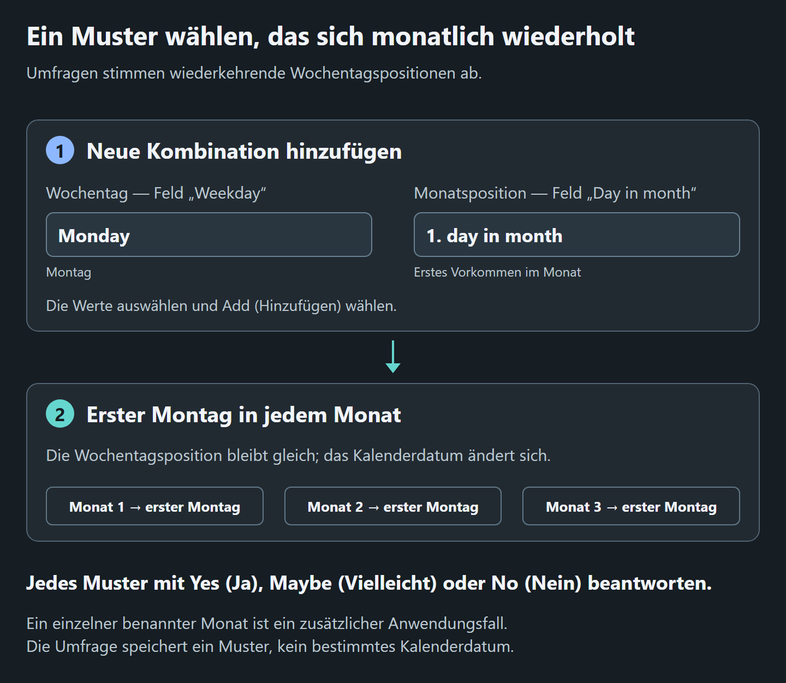

# Umfragen
<!--
documentation-metadata
audience: Umfrageteilnehmer; Umfrageorganisatoren
owner: survey feature maintainers
status: current
last-verified: 2026-10-07
verification-baseline: docs-baseline-2026-09-06-d14
verification-scope: eigenständige deutsche Anleitung mit stabilen Linkzielen; wiederkehrende Monatsmuster, Gäste, namentliche Antworten und Eigentümeraktionen; deutsch erklärtes Diagramm mit den tatsächlichen Bezeichnungen der Umfragefelder
heading-anchors: 1:surveys; 2:choose-your-task; 2:understand-the-recurring-monthly-model; 2:vote-in-a-survey; 3:1-open-the-survey-link; 3:2-check-the-active-profile; 3:3-choose-one-answer-for-every-combination; 3:4-select-submit; 2:change-an-answer; 2:return-as-a-guest; 2:read-the-results; 3:your-response; 3:all-answers; 3:result-visibility-and-privacy; 2:add-another-combination; 2:create-a-survey; 3:1-open-the-creation-form; 3:2-enter-the-survey-details; 3:3-add-at-least-one-combination; 3:4-select-create-survey; 2:understand-survey-access-before-sharing; 2:share-a-survey; 2:surveys-and-events; 2:manage-a-survey; 3:header-image; 3:title-and-description; 3:duplicate-a-survey; 3:delete-a-survey; 2:practical-examples; 3:primary-use-choose-a-recurring-monthly-meeting-pattern; 3:secondary-use-choose-a-day-within-one-stated-month; 3:compare-regular-volunteer-days; 2:capabilities-and-limits; 2:archive-or-restore-a-survey; 2:troubleshooting; 3:the-survey-cannot-be-created; 3:the-survey-is-missing-from-your-overview; 3:a-guest-cannot-return; 3:a-new-combination-shows-no-for-earlier-voters; 3:the-add-action-reports-an-error; 3:permission-or-event-controls-cannot-be-found; 3:entity-settings-or-an-expected-action-is-missing; 2:related-guides
source-anchors: src/views/surveyor/survey-create.pug; src/views/surveyor/survey-vote.pug; src/controller/surveyController.ts; docs/user-guide/de/assets/survey-recurring-pattern.png; scripts/generate-help-visuals.mjs
next-review: survey-visible-UI-or-behavior-change
-->

Umfragen dienen vor allem der Abstimmung **wiederkehrender monatlicher Termine**, etwa ob eine Gruppe sich jeden Monat am ersten Montag, zweiten Mittwoch oder letzten Freitag treffen soll. Dieses Muster ist die Stärke der Funktion: Teilnehmer beantworten jede verständliche Wochentagsposition einmal mit **Yes** (Ja), **Maybe** (Vielleicht) oder **No** (Nein).

Zusätzlich kann eine Umfrage Optionen eines bestimmten Monats vergleichen. Nenne Monat und Jahr im Titel oder in der Beschreibung, denn gespeichert werden Wochentagspositionen statt konkreter Kalenderdaten. Für mehrere genaue Termine kann ein auf Einzeltermine spezialisierter Abstimmungsdienst direkter sein. Verwende Surveyor, wenn das wiederkehrende Monatsmuster im Mittelpunkt steht.

*Wähle **Monday** (Montag) und **1. day in month** (erstes Vorkommen im Monat), dann **Add**, um den ersten Montag jedes Monats vorzuschlagen. Das genaue Kalenderdatum ändert sich von Monat zu Monat.*

[Diagramm des Monatsmusters in voller Größe öffnen](/help/assets/survey-recurring-pattern.png?locale=de).

## Deine Aufgabe wählen

- [In einer Umfrage abstimmen](#vote-in-a-survey)
- [Als Gast zurückkehren](#return-as-a-guest)
- [Ergebnisse lesen](#read-the-results)
- [Eine weitere Kombination hinzufügen](#add-another-combination)
- [Eine Umfrage erstellen und teilen](#create-a-survey)
- [Eine Umfrage verwalten, duplizieren oder löschen](#manage-a-survey)

## Das wiederkehrende Monatsmodell verstehen

Jede Option verbindet einen Wochentag mit einer Position im Monat.

| Kombination | Bedeutung |
|---|---|
| **1. Monday of the month** | Der erste Montag im besprochenen Monat. |
| **3. Wednesday of the month** | Der dritte Mittwoch dieses Monats. |
| **Last (4./5.) Friday of the month** | Der letzte Freitag, also je nach Monat der vierte oder fünfte. |

Verfügbar sind **1**, **2**, **3**, **4** und **Last**. Es gibt keine eigene fünfte Woche; für das letzte Vorkommen eines Wochentags verwendest du **Last**.

Für die wiederkehrende Hauptanwendung kann **Monatliche Ausschusssitzung** die Muster erster Dienstag, zweiter Mittwoch und letzter Donnerstag vergleichen, die sich jeden Monat wiederholen.

Für die zusätzliche Einmonatsanwendung kann **Planungstag Oktober 2026** ersten Samstag, zweiten Sonntag und letzten Freitag vergleichen. Monat und Jahr ergeben sich aus Titel und Beschreibung, nicht aus den Kombinationen.

## In einer Umfrage abstimmen

### 1. Den Umfragelink öffnen

Verwende den Link des Organisators.

- Mit bereits aktivem Profil öffnet sich die Abstimmungsseite direkt.
- Andernfalls bietet die Einstiegsseite **Log in**, **Recover guest account**, **Create account** und **Continue as guest**.

Ein Gast gibt einen **Display name** und optional eine E-Mail-Adresse an. Die E-Mail ist sehr empfehlenswert: Surveyor schickt den privaten Gastlink dorthin und kann später mit dieser Adresse verbundene Gastkonten wiederherstellen.

### 2. Das aktive Profil prüfen

Der Profilname im Benutzermenü bezeichnet die Identität des Stimmzettels. Wechsle bei einem vollständigen Konto mit mehreren Profilen vor der Abstimmung zum gewünschten Profil.

### 3. Für jede Kombination eine Antwort wählen

Wähle unter **Your response**:

- **Yes** — Die Option passt gut.
- **Maybe** — Die Option könnte bei Bedarf passen.
- **No** — Die Option passt nicht.

Für eine vom Profil noch nicht beantwortete Option zeigt Surveyor zunächst **No**.

### 4. **Submit** wählen

**Submit** speichert den gesamten angezeigten Stimmzettel. Erneutes Absenden ersetzt die bisherigen Antworten dieses Profils. Prüfe deshalb jede Spalte vor dem Speichern.

Nach dem ersten Absenden erscheint die Umfrage unter **Your participation** in [Deine Übersicht](DASHBOARD.md) dieses Profils.

## Eine Antwort ändern

1. Öffne die Umfrage über **Your participation** oder den ursprünglichen Link.
2. Ändere die gewünschten Antworten **Yes**, **Maybe** oder **No**.
3. Wähle erneut **Submit**.

Die neue Abgabe ersetzt den bisherigen Stimmzettel des aktiven Profils. Es gibt keine separate Aktion, um einen Stimmzettel zu entfernen oder den Teilnehmernamen in den Ergebnissen zu verbergen.

## Als Gast zurückkehren

Gäste können den nach dem Beitritt angezeigten privaten Link verwenden. Mit angegebener E-Mail-Adresse wird dieser auch per E-Mail geschickt.

Falls der Link fehlt:

1. Wähle auf der Einstiegsseite **Recover guest account** oder bei **Anmelden** die Gastwiederherstellung.
2. Gib die E-Mail-Adresse des Gastprofils ein.
3. Öffne die Wiederherstellungs-E-Mail und wähle bei mehreren Konten das richtige.
4. Öffne nach Wiederherstellung des Gastzugangs den Umfragelink oder den Eintrag aus **Deine Übersicht**.

Den vollständigen Ablauf findest du unter [Gastzugang per E-Mail wiederherstellen](GETTING_STARTED.md#recover-guest-access-by-email).

## Ergebnisse lesen

Die Abstimmungsseite enthält zwei Ergebnisbereiche.

### **Your response** — Deine Antwort

Diese Zeile zeigt die aktuell ausgewählten Antworten des aktiven Profils. Änderungen werden erst mit **Submit** gespeichert.

### **All answers** — Alle Antworten

Die Tabelle zeigt:

- eine Zeile je Profil mit abgegebenem Stimmzettel;
- eine Spalte je Umfragekombination;
- den Profil- oder Gastanzeigenamen;
- Grün für **Yes**, Gelb für **Maybe** und Rot für **No**.

Kommt nach ersten Abstimmungen eine Kombination hinzu, zeigen bestehende Ergebniszeilen in der neuen Spalte **No**, bis die Personen zurückkehren und erneut antworten.

Surveyor berechnet keinen Gewinner, Punktwert oder Rang. Vergleiche die Spalten und entscheide, was der Gruppe am besten passt. Ein hilfreicher Ansatz ist, zuerst die meisten **Yes**-Antworten zu suchen und bei ähnlichen Optionen **Maybe** zur Unterscheidung zu verwenden.

### Sichtbarkeit und Datenschutz der Ergebnisse

Jede zugelassene Person kann **All answers** mit Anzeigenamen und Antworten sehen. Umfragen unterstützen weder anonyme Stimmen noch private Ergebnisse nur für Organisatoren.

Teile die Umfrage nur mit der beabsichtigten Gruppe. Empfänger können den Link an andere Personen weiterleiten.

## Eine weitere Kombination hinzufügen

Optionen werden gemeinsam ergänzt. **Jeder zur Abstimmungsseite zugelassene Teilnehmer darf eine Kombination hinzufügen**, darunter:

- der Eigentümer;
- Teilnehmer mit vollständigem Konto; und
- registrierte Gäste.

Eine Organisator- oder Administratorrolle ist nicht nötig.

1. Scrolle zu **Add new combination**.
2. Wähle unter **Weekday:** Montag bis Sonntag.
3. Wähle unter **Day in month:** **1. day in month**, **2. day in month**, **3. day in month**, **4. day in month** oder **Last (4./5.) day in month**.
4. Wähle **Add**.

Die Option erscheint für alle als neue Spalte. Jede Kombination aus Wochentag und Monatsposition darf pro Umfrage nur einmal vorkommen.

Bisherige Teilnehmer werden nicht automatisch benachrichtigt. Bitte sie bei einer späteren Ergänzung, ihre Antworten zu aktualisieren. Nach der Erstellung lassen sich Kombinationen nicht entfernen; ergänze späte Optionen daher sorgfältig.

## Eine Umfrage erstellen

Die Erstellung verlangt ein angemeldetes vollständiges Konto. Gäste dürfen teilnehmen, aber keine Umfrage anlegen. Das aktive Profil wird Eigentümer.

### 1. Das Erstellungsformular öffnen

1. Öffne oben **Neu**.
2. Wähle unter **Planen und entscheiden** **Umfrage**.

### 2. Umfragedetails eintragen

| Feld | Eingabe |
|---|---|
| **Survey Title \*** | Pflichtname, der die Entscheidung beschreibt. Nenne gegebenenfalls Monat oder weiteren Datumskontext. |
| **Description** | Optionale Hinweise, Hintergrund, Antwortfrist oder Erklärung der späteren Entscheidung. |
| **Header image (optional)** | JPEG-, PNG- oder GIF-Bild bis 10 MiB. |

Surveyor erzwingt keine Antwortfrist für Umfragen. Ein Datum in der Beschreibung ist informativ; der Organisator muss die Frist außerhalb der Anwendung kommunizieren und durchsetzen.

### 3. Mindestens eine Kombination hinzufügen

Die Tabelle **Select date combinations** beginnt mit einer Zeile.

1. Wähle **Weekday**.
2. Wähle bei **Week of month** **1**, **2**, **3**, **4** oder **Last**.
3. Ergänze mit **Add combination** eine Zeile.
4. Entferne nicht benötigte Zeilen über **Remove**.

Mindestens eine gültige, eindeutige Kombination ist erforderlich.

### 4. **Create Survey** wählen

Die neue Umfrage öffnet ihre Abstimmungsseite. Der Eigentümer kann wie jeder andere Teilnehmer abstimmen.

## Vor dem Teilen den Umfragezugang verstehen

Umfragen nutzen absichtlich ein einfaches eigenes Teilnahmemodell. Sie verwenden **nicht** die **Gruppenberechtigungen** von Veranstaltungen, Aktivitätenplänen, Pack- und Fahrtenlisten.

Der Umfragelink bildet die Einladungsgrenze:

- Personen mit aktivem Profil eines vollständigen Kontos öffnen ihn direkt;
- Personen ohne aktives Profil können sich anmelden, ein Konto erstellen, ein Gastkonto wiederherstellen oder als Gast fortfahren;
- jeder zugelassene Teilnehmer kann abstimmen, alle Antworten sehen und Kombinationen hinzufügen;
- nur der Eigentümer erhält die unten beschriebenen Lebenszyklusaktionen.

Es gibt für Umfragen keine Zielgruppenvoreinstellungen, Einzelberechtigungen, Mitadministratoren oder reinen Leserollen. Behandle den Link als Gruppeninformation und sende ihn nur an Personen, die teilnehmen und namentliche Ergebnisse sehen sollen.

## Eine Umfrage teilen

Der Organisator muss Teilnehmer nicht im Voraus hinzufügen.

1. Öffne die erstellte Umfrage.
2. Kopiere ihre Adresse aus dem Browser.
3. Sende den Link über den üblichen Kommunikationsweg der Gruppe.
4. Erkläre, was **Yes**, **Maybe** und **No** bei dieser Entscheidung bedeuten und bis wann du Antworten brauchst.

Wer einen Stimmzettel abgibt, findet die Umfrage später mit demselben Profil unter **Your participation**.

## Umfragen und Veranstaltungen

Umfragen sind eigenständig. Sie haben kein **Assign to event**, erscheinen nicht in verknüpften Veranstaltungsressourcen und erben weder Veranstaltungsanmeldungen noch Veranstaltungsberechtigungen.

Du kannst trotzdem einen Veranstaltungstermin damit besprechen: Schreibe Monat oder Veranstaltungsname in Titel oder Beschreibung und teile den Umfragelink separat.

## Eine Umfrage verwalten

Öffne **Entitätseinstellungen** in der Kopfzeile für die Aktionen des aktiven Profils. Titel, Beschreibung und Archivierung bleiben dem Eigentümer vorbehalten. Umfragen bleiben eigenständig und erhalten keine Veranstaltungs- oder Gruppenberechtigungssteuerung.

### Kopfzeilenbild

Öffne **Entitätseinstellungen** → **Allgemein** → **Kopfzeilenbild**. Wähle über **Bild auswählen** eine Datei und dann **Hochladen**, um ein Bild hinzuzufügen oder zu ersetzen. Zum Löschen wählst du **Bild entfernen** und bestätigst.

Die Ersatzdatei muss JPEG, PNG oder GIF sein und darf höchstens 10 MiB groß sein.

### Titel und Beschreibung

Der Eigentümer kann diese Eigenschaften ändern, ohne eine neue Umfrage anzulegen:

1. Öffne **Entitätseinstellungen**.
2. Bearbeite unter **Allgemein** → **Details** **Titel** oder **Beschreibung**.
3. Wähle **Eigenschaften speichern**.

Link, Kombinationen und Antworten bleiben erhalten. Jeder Dialogabschnitt speichert getrennt. Ein fehlgeschlagenes Speichern erhält deinen Entwurf; Schließen verwirft ungespeicherte Änderungen. Befehle, die die Seite aktualisieren, verlangen vorher eine Entscheidung zu Entwürfen anderer Abschnitte.

### Eine Umfrage duplizieren

Erstelle mit dem Eigentümerprofil eines vollständigen Kontos eine separate Kopie:

1. Öffne die Umfrage und **Entitätseinstellungen**.
2. Wähle unter **Aktionen** **Duplizieren**.
3. Prüfe vorausgefüllten Titel, Beschreibung und Kombinationen.
4. Ändere bei Bedarf Werte und wähle **Create Survey**.

Der Eigentümer kann auch **Duplicate** auf der Karte unter **Administrable entities** verwenden.

Das Duplikat ist eine neue Umfrage mit eigenem Link und ohne Teilnehmerantworten. Das Kopfzeilenbild wird nicht kopiert; lade bei Bedarf eines für die neue Umfrage hoch.

### Eine Umfrage löschen

Nur der Eigentümer kann endgültig löschen.

1. Öffne die Umfrage und **Entitätseinstellungen**.
2. Wähle unter **Aktionen** **Endgültig löschen**.
3. Bestätige die Löschung.

Die Eigentümerkarte in der Übersicht behält außerdem **Delete**.

Die Löschung entfernt Umfrage, alle Kombinationen, alle abgegebenen Antworten und das gespeicherte Kopfzeilenbild endgültig. Verwende Archivierung, wenn die Umfrage verfügbar bleiben soll.

## Praktische Beispiele

### Hauptanwendung: ein wiederkehrendes monatliches Treffen wählen

Erstelle **Monatliche Ausschusssitzung** mit:

- erstem Dienstag;
- zweitem Mittwoch; und
- letztem Donnerstag.

Teilnehmer stimmen ab, welche wiederkehrende Position gewöhnlich am besten passt.

### Zusätzliche Anwendung: einen Tag in einem genannten Monat wählen

Erstelle **Workshop Oktober 2026** und erkläre, dass alle Kombinationen Oktober 2026 meinen. Ergänze:

- ersten Samstag;
- zweiten Sonntag; und
- letzten Samstag.

Gespeichert wird das Wochentagsmuster; Titel und Beschreibung liefern Monat und Jahr. Das funktioniert, die Oberfläche ist jedoch weiterhin für wiederkehrende Muster statt genauer Datumsvergleiche optimiert.

### Regelmäßige Ehrenamtstermine vergleichen

Erstelle **Monatliche Ausrüstungskontrolle** mit mehreren Wochentagspositionen. Bitte Freiwillige, **Maybe** nur zu wählen, wenn sie mit Vorlauf teilnehmen könnten.

## Möglichkeiten und Grenzen

| Unterstützt | Nicht unterstützt |
|---|---|
| Wochentag plus erstes, zweites, drittes, viertes oder letztes Vorkommen im Monat | Auswahl eines konkreten Datums, Monats, Jahres oder einer Uhrzeit |
| Antworten Yes, Maybe und No | Rangfolge, Punktzahlen oder automatische Gewinnerermittlung |
| Vollständige Konten und Gäste | Anonyme Abstimmung oder private Antworten |
| Ergebnistabelle mit Teilnehmernamen | Ergebnisse nur für Organisatoren |
| Gemeinsames Ergänzen von Kombinationen | Entfernen oder Bearbeiten bestehender Kombinationen |
| Kopfzeilenbild und Titel-/Beschreibungsänderung durch Eigentümer | — |
| Duplizieren, Archivieren, Wiederherstellen und endgültiges Löschen durch Eigentümer | Antworten schließen oder Frist erzwingen |
| Eigenständiges Teilen per Link | Veranstaltungsverknüpfung oder allgemeine Berechtigungsmatrix |

## Eine Umfrage archivieren oder wiederherstellen

Der Eigentümer kann unter **Entitätseinstellungen** → **Aktionen** → **Archivierung** **Für alle archivieren** oder **Für alle wiederherstellen** wählen oder das Übersichtskartenmenü verwenden. Umfragen haben keinen automatischen Archivierungszeitplan. Archivierung erhält Kombinationen, Antworten, Bilder und den gewöhnlichen Zugang zum Abstimmen und Ergänzen; sie beendet die Abstimmung nicht. Die gewöhnliche Ansicht zeigt gegebenenfalls nur **Dieser Eintrag ist archiviert.**

Archivierte Umfragen findest du unter **Archived and hidden** in [Deine Übersicht](DASHBOARD.md#find-archived-and-hidden-items). Jedes Profil, dessen Übersicht die Umfrage enthält, kann **Hide for me**, **Show for me** und **Use default visibility** für die eigene Kartenposition verwenden. Eigentümerschaft ist dafür nicht nötig; fremde Übersichten ändern sich nicht.

## Probleme lösen

### Die Umfrage lässt sich nicht erstellen

Prüfe:

- Ein vollständiges Konto statt eines Gastkontos ist angemeldet.
- **Survey Title** ist ausgefüllt.
- Mindestens eine Kombination ist vorhanden.
- Keine Kombination aus Wochentag und Position wiederholt sich.
- Das Bild ist JPEG, PNG oder GIF und höchstens 10 MiB groß.

### Die Umfrage fehlt in **Deine Übersicht**

Prüfe zuerst das aktive Profil.

Klappe in beiden Sammlungen **Archived and hidden** auf und entferne dort Filter.

- Eigentümer finden sie unter **Administrable entities**.
- Teilnehmer finden sie nach einer Stimmabgabe mit diesem Profil unter **Your participation**.
- Bloßes Öffnen oder Hinzufügen einer Kombination erzeugt keinen Stimmzettel.

### Ein Gast kann nicht zurückkehren

Nutze **Recover guest account** auf der Einstiegsseite oder die Gastwiederherstellung bei **Anmelden** mit der Adresse der Gasterstellung. Siehe [Erste Schritte](GETTING_STARTED.md#recover-guest-access-by-email).

### Eine neue Kombination zeigt bei früheren Teilnehmern **No**

Dies ist die angezeigte Vorgabe, bis jede Person zurückkehrt und die neue Spalte beantwortet. Bitte die Teilnehmer, die Umfrage erneut zu öffnen.

### **Add** meldet einen Fehler

Prüfe, ob dieselbe Kombination bereits existiert. Doppelte Kombinationen sind nicht erlaubt.

### Berechtigungs- oder Veranstaltungssteuerung fehlt

Sie gehört nicht zu Umfragen. Teile den eigenständigen Umfragelink mit der gewünschten Gruppe. [Berechtigungen und Freigaben](PERMISSIONS.md) gilt nur für andere Funktionen mit allgemeinem Berechtigungssystem.

### Entitätseinstellungen oder eine erwartete Aktion fehlt

Prüfe das aktive Profil und öffne **Entitätseinstellungen** auf der Umfrageseite. Titel, Beschreibung, Archivierung und endgültiges Löschen verlangen das Eigentümerprofil. Eine Kopie zu erstellen verlangt zusätzlich ein vollständiges Konto. **Duplicate** und **Delete** auf Übersichtskarten erscheinen nur für den Eigentümer unter **Administrable entities**.

## Weitere Anleitungen

- [Erste Schritte](GETTING_STARTED.md) — Konten, Gäste, Wiederherstellung und Profile.
- [Deine Übersicht](DASHBOARD.md) — Eigene und beantwortete Umfragen finden.
- [Berechtigungen und Freigaben](PERMISSIONS.md) — Allgemeines Modell anderer Funktionen und Umfrageausnahme.
- [Veranstaltungen](EVENTS.md) — Nach der Terminentscheidung eine Veranstaltung erstellen und verwalten.
- [Benutzerhandbuch](README.md) — Alle Funktionsanleitungen.
